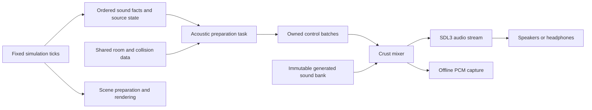

# Sound support

## Status and purpose

This is the implementation design. The game has SDL3 window, input, and task
providers. It has no sound mixer, sound assets, or audio output provider.

Use one Crust sound engine for native and web builds. SDL3 supplies device output.
Gameplay must not call SDL or pass device handles. Sound must work without the
GPU renderer, and its sample clock must not depend on the frame rate.

The [game design](../../../SPINWARD.md#sound-is-the-instrument-panel) defines the
information that sound carries. The current
[expedition](../game/expedition.md) supplies the first consumers. Do not add
signals for world systems that do not yet exist.

## Components and data flow

These are proposed source locations, not directories already implemented.

| Component | Location | Responsibility |
| --- | --- | --- |
| Checked sound API | `src/audio/api/` | Sound handles, bank ownership, control batches, capture |
| Mixer | `src/audio/mix/` | Sample cursors, envelopes, filters, panning, buses, output limiting |
| Sound generation | `src/audio/synthesis/` | Seeded noise, oscillators, envelopes, recipe evaluation |
| Acoustic scene | `src/audio/scene/` | Sources, listener, room paths, transmission and obstruction |
| Output provider | `src/audio/platform/` | SDL3 stream, callback, device state, platform errors |
| Shared transport | `src/runtime/` | Bounded message storage, publication and retirement |
| Game sound policy | `src/game/audio/` | Simulation facts to cues, priorities, loop controls |
| Sound recipes | `assets/sounds/` | Normal Crust files with generation parameters |
| Tests | `tests/audio/` | Offline mixing, portal fixtures, device and browser witnesses |

The mixer has no room graph, collision scene, SDL handle, or game state.
Acoustic preparation produces only bounded numeric path controls. Game sound
policy selects cues. It does not implement mixing or portal search.

## API and ownership

The checked interface provides these operations. Exact Crust declarations must
follow the ownership model when the first slice is implemented.

- Create an immutable `SoundBank` from recipes. Each sound has a stable content ID.
- Open an `AudioSession` with a bank loan and explicit capacity settings.
- Submit a `SoundBatch` with an epoch, simulation tick, ordered events, listener,
  source updates, and prepared paths.
- Read device status and diagnostic counters outside the callback.
- Pause, resume, reset an epoch, and close the session.
- Run the same mixer into an owned PCM buffer for an offline capture.

A source handle contains an index and a generation. A source belongs to one
logical object. Its anchors give placements, not additional playback cursors.
A one-shot event has its own sequence number. An impact remains valid after its
hook or drone changes room or its object is removed. Store the impact position,
room, source identity, and event tick at contact time.

The session retains the bank and callback storage until output has stopped and
all callbacks have returned. The callback owns mixer cursors, filter history,
voice slots, and output scratch. Workers cannot borrow those fields. The
application owns device control authority. A preparation task gets a copied
source/listener snapshot and explicit shared scene loans.

Use a bounded single-producer, single-consumer batch queue. The application is
the producer after a preparation result is complete; the mixer is the consumer.
Publish a complete batch with release ordering and read it with acquire
ordering. Return a slot only after its contents have been consumed. Never publish
pointers into a live `Trial`, temporary task result, or mutable collision array.
The queue protocol belongs to the common runtime and must pass an ownership and
race witness before audio uses it. Extend Crust if the required atomic or
ownership contract is missing.

An accepted batch retains every event in order. The initial design does not
replace queued batches or coalesce events. Validate capacities at admission.
A full queue reports an error outside the callback; it must not discard a hook
attachment, block the callback, or allocate a larger queue in that callback.
A reset changes the epoch. Old events cannot start voices in the new expedition.

## Timing and tasks

Run acoustic preparation after simulation, beside prediction and scene
preparation. Rendering does not wait for sound preparation. Use the existing
frame task lifetime and join rules until a separate scheduling experiment proves
that a different lifetime improves latency. The mixer keeps running while the
frame waits for a worker, GPU completion, or presentation.

Sound facts come from completed fixed ticks, not render submissions. Catch-up
steps retain their event order. Continuous controls use the most recent completed
tick in the batch. The callback applies batches only at block boundaries.

Use an integer sample counter. Convert tick offsets to samples with integer
quotient and remainder arithmetic. In an offline capture, this gives exact event
positions independent of the block size. Live playback maps simulation time onto
the mixer clock when an epoch starts or resumes. Apply an overdue event at the
next block boundary and count its lateness; do not replay a backlog of elapsed
ambient sound. Repeated lateness is a failed latency gate, not a reason to add
more output buffering.

Pause stops gameplay sound with a short envelope and freezes its source cursors.
Resume starts a new live clock mapping without replaying paused ticks. Device
loss and browser suspension use the same clock rule. Restart discards old-epoch
commands and fades old voices. Offline captures use the recorded simulation
clock and explicit pause policy, with no wall-clock dependency.

## Mixer and output provider

Start with stereo floating-point PCM at 48 kHz and 128-sample internal blocks.
These are initial engineering settings. Define them once in the audio component.
The device can request a different amount or format. SDL3 handles device format
conversion. The provider fills each request in whole stereo frames, in bounded
chunks from preallocated scratch. A zero-byte request does no mixing.

Use one SDL3 stream for the mixed output. Open the default playback device with
[`SDL_OpenAudioDeviceStream`](https://wiki.libsdl.org/SDL3/SDL_OpenAudioDeviceStream),
then explicitly resume it. Its stream owns the associated logical device.
The callback's requested byte count is variable; it is not a fixed block-size
contract. See the
[stream callback contract](https://wiki.libsdl.org/SDL3/SDL_SetAudioStreamGetCallback).

The native callback must not wait for the game, a task worker, disk, or the GPU.
Do not allocate, log, load recipes, trace collision geometry, or acquire game
locks in it. Supply PCM with
[`SDL_PutAudioStreamData`](https://wiki.libsdl.org/SDL3/SDL_PutAudioStreamData).
That API copies input data and can fail. Its internal storage and synchronization
are SDL responsibilities; measure their cost rather than claiming that the whole
SDL call is allocation-free or lock-free.

On callback failure, set a preallocated error record and stop producing new
sound. The application reports the error and stops the audio session. Do not
format an error message in the callback. On close, stop device consumption,
detach the callback with synchronization, then destroy the stream. Release the
bank and callback context only after callback quiescence is confirmed by the
SDL API contract and tested under concurrent shutdown.

Each voice has one source cursor and optional path taps. Generate each source
block once, then distribute it to its audible paths. Keep virtual loop cursors
running while the source is inaudible. Do not restart a machine loop whenever a
portal becomes audible. Short envelopes smooth start, stop, gain, pan, filter,
and path changes. Retain headroom on each bus and use a final peak limiter.
Output must remain finite and bounded even when all admitted voices are active.

Voice admission uses explicit priorities. Reserve capacity for player actions
and objective cues. Ambient voices may be virtualized; their elapsed time still
advances. If a lower-priority voice is replaced, fade it and count the replacement.
Failure to admit a reserved cue is an error. Never steal an arbitrary voice due
to container iteration order. Resource limits and sound tuning have one owning
definition each; docs and HUD code must not copy those values.

## Web output

Use the same mixer and SDL3 stream API in WebAssembly. The current SDL3
[Emscripten provider](https://github.com/libsdl-org/SDL/blob/release-3.4.2/src/audio/emscripten/SDL_emscriptenaudio.c)
uses `ScriptProcessorNode`. Its JavaScript processing runs on the main thread.
It cannot maintain callbacks during a blocked browser main thread. A native
callback timing result does not establish browser audio continuity.

Open or resume audio from the existing start gesture. A suspended audio context
is a visible state, not successful audible playback. The launcher must provide
a resume action after browser suspension. Report device errors in the existing
application error path. A user-selected mute is valid; silently treating a
failed device as mute is not.

The first delivery gate measures the SDL3 provider during actual room generation,
shader setup, flight, and tab suspension. If it misses the stated gate, stop
expansion and implement an AudioWorklet output provider. Reuse the same Crust
mixer and serialized control batches. The worklet owns an independent mixer
instance; it cannot borrow the main Wasm heap. The transport must then prove
bounded delivery and bank transfer in the production launcher. Shared memory
requires an explicit deployment/header decision. Do not assume the current
Pages deployment provides cross-origin isolation.

## Portal acoustics

Sound uses the room graph even when no room is visible. A turned camera must
not change audibility. Use shared object identity and anchor transforms, but do
not reuse renderer-visible anchors or light propagation cutoffs as acoustic
reachability.

Separate physical source placements from propagated acoustic paths. A generated
anchor must not become a new root emitter. Several distinct paths may reach the
same room, including recursive paths to one source. A path ID contains source
generation, physical anchor identity, and ordered directed portal IDs. Deduplicate
only identical paths. Do not use room ID as a visited-set key.

The initial path model uses segments from source to portal centres, through
successive portal centres, and to the listener. Convex hulls make these segments
stay inside each room; internal props can still obstruct them. Map each segment
with the composed portal transform and scale. Direction at the listener comes
from the final segment, so a source around a bend sounds through its opening.
This is an aperture-centre approximation. It does not model diffraction or
specular reflection. A source can remain audible around a tunnel corner.

Use distance attenuation with a finite near radius, authored aperture
transmission, and a low-pass control. Test segment obstruction against retained
collision data on the preparation task. Exclude the source surface contact at
its starting endpoint; use feature identity, not an arbitrary position offset.
A hit on a prop adds an authored obstruction loss/filter. It does not create a
new source or a full wave simulation. Cache static room adjacency and acoustic
material data. Invalidate moving obstruction results from collision revisions.

Search strongest paths first. Use remaining transmission as an upper bound.
Portal transmission must be less than one for this initial model, so recursive
zero-distance cycles also lose energy. Stop paths below the authored audible
threshold. Use explicit work and path capacities in addition to that threshold.
When the work budget is exhausted, retain the best completed paths and report
search truncation. A test scene cannot pass its quality gate with unreported
truncation. Validate thresholds, losses, and capacity products when loading a
scene; trusted mixer controls need no repeated topology validation.

For one source, scale path gains by `1 / max(1, sum(path_gain))` before panning.
Thus recursive paths cannot increase its total gain without bound. This ceiling
does not change gains when their sum is below one. Use equal-power stereo
panning for each path. Each channel gain then remains below the source ceiling.
Fade each path in or out under its stable ID. Do not move one path's pan position
to an unrelated path when the search order changes. Initial
paths have no propagation delay. They are alternate directional contributions,
not simulated echoes. This avoids a separate source clock for each portal image.
A cue can request one strongest path instead of multiple paths. Use this for
short hook-attachment cues in the first slice. Select its path when the event
starts. Machine loops can use multiple paths. Acoustic direction does not replace
the tether-route indicator or promise that a passage is traversable.

Distance is measured in listener body units: convert segment lengths to listener
room units, then divide by the listener scale factor. Uniformly scaling the
listener and its neighbourhood must preserve the sound. Compose portal ratios
with the shared rational scale type; convert at the numeric preparation boundary.
Crossing a scale portal preserves source cursor and authored pitch. Do not derive
pitch from a discontinuous coordinate jump. The first model has no Doppler.
Adding Doppler requires continuous path-length derivatives across portal
transfers and a separate audible acceptance test.

## Assets and game cues

Generate initial sounds in Crust recipes. Compile short impacts and tonal cues
into immutable PCM at bank construction. Use bounded oscillator, noise, and
filter state for continuous wind and machine sounds. Random generators use a
per-source seed; audio must not consume the gameplay random stream. Recipe and
bank failures occur before the device starts. Store useful author notes in the
recipe file, not a document for each sound.

| Cue | Source and input | Presentation |
| --- | --- | --- |
| Hook launch | Player action event | Short onboard mechanical cue |
| Hook attachment | Captured wall-contact event | Spatial transient at the anchor |
| Reel | Actual reel state and cable shortening rate | Onboard loop; blocked pull must differ from cable movement |
| Drone impact and scrape | Contact impulse and tangential speed | Impact one-shot or smoothed scrape, with material variation |
| Thrust, boost, brake | Applied actuator state | Onboard cues; no sound from an input that produced no action |
| Burst ready | Shared cooldown transition | Brief cue; no repeated ready beep each tick |
| Wind | Air-relative speed and local air density | Listener-relative noise and filtering |
| Structure hum | Regional radius state | Listener-relative tone with the game-design pitch mapping |
| Machinery | Source phase and room anchors | Spatial loop with portal transmission |
| Completion | Objective transition | One distinct cue; no repeated sound on later frames |

Sweeper and bearing cues require their actual simulation state. Beacon relight
music requires a relight event. Do not substitute the current finish event for
a fictional beacon. There is no continuous flight music.

Separate cue timbres before increasing gain. Wind must leave attachment cues
audible at high speed. Reel motion must not use the same pitch contour as the
radius hum. Do not mute the radius cue on every scrape near the hull. Suppress
the ready cue when a held command immediately consumes the new burst charge;
the applied burst already supplies feedback. Provide master,
effects, and atmosphere gain controls. Accessibility indicators consume the
same simulation facts as sound. A sound-only warning is not an acceptable
consumer of a new gameplay state.

## Delivery gates and checks

Implement a small production slice before extending the sound bank or path
system. Use hook attachment and reel sound in the main game and shared demo,
through one translated/rotated portal, on both native and web builds. This slice
must cross the checked session, task result, callback, and speaker boundaries.
An offline tone alone does not prove this architecture.

Record a silent baseline and a sound-enabled run at the same resolution, room,
seed, camera path, and device. Use the shaft hub as the render-load witness.
Initial acceptance targets are:

- No callback deadline miss in a ten-minute native run. Mixer p99 is below one
  quarter of the requested output duration. Record the maximum as well.
- Sound preparation adds less than 0.5 ms to frame-time p99 in that witness.
- Measured action-to-output onset p95 is at most 50 ms native and 100 ms web.
  These are targets, not SDL guarantees. Measure output with loopback or a
  recorded action/audio signal; queue timestamps alone are insufficient.
- No audible gaps in ordinary web flight. Record the outcome of an injected
  100 ms main-thread stall separately. A gap confirms the SDL provider constraint
  and activates the worklet gate if that stall occurs in production flight.
- No unbounded queue growth, recursive gain growth, or callback allocation in
  game-owned code. Report voice replacement, late events, search truncation,
  queue occupancy, callback duration, and device state outside the callback.

Use focused fixtures for these checks:

1. Mix a recorded event sequence at different callback block sizes. Event sample
   positions and same-backend PCM must match. Cross-platform float output uses
   explicit peak/RMS error bounds; device resampling is outside this comparison.
2. Check fractional cursor advance, seeded synthesis, loop wrap, clipping,
   non-finite recipe rejection, priority admission, and envelope continuity.
3. Test translated, rotated, scaled, cyclic, and same-room multiple-path graphs.
   Camera rotation must not change path admission. Uniform scale must preserve
   attenuation. Repeated paths must share the same source phase.
4. Test wall contact, props, corners, and moving blockers without game levels.
   Check that a wall-attached hook is audible on the incident side.
5. Force queue saturation, stale generations, reset, pause, resume, device error,
   and shutdown during callback and preparation. Run native race diagnostics.
6. In the production browser launcher, test start gesture, pointer lock,
   fullscreen, mute, tab suspension, resume, and explicit output failure.
7. In a short listening test, ask players to identify attachment versus release,
   moving reel versus blocked pull, and an opening's direction. Record incorrect
   answers. Also hold radius constant while changing reel speed, then reverse
   those roles under high wind. At least 90 percent of responses must identify
   the changed signal in this bounded test. Do not approve more ambient layers
   while these cues remain unclear.
8. Move the listener across translated and scaled portals beside a stationary
   source. Capture path IDs, gains, pan, and PCM. Check that path replacement
   uses fades, source phase remains continuous, and camera-only rotation does
   not change path count or total pre-pan gain.

After this slice passes, add movement and scrape cues, then machine loops and
recursive acoustic paths, then the atmosphere channels as their simulation
inputs become available. Each step must preserve the timing and ownership gates.
