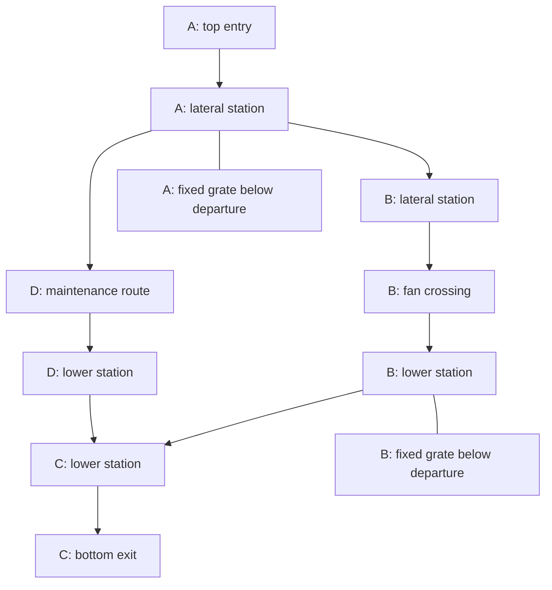

# Content hierarchy

Use this order to define content:

1. **Biome:** the work that this part of the structure performs. It defines
   machine families, support structures, materials, and movement opportunities.
2. **Subbiome:** a distinct part of that work. Add one only when both its main
   silhouette and its flight problem differ from the rest of the biome.
3. **Geometry:** the shape of the connected flight space. It defines the main
   turns, changes in section, branches, and sightlines.
4. **Room variant:** a named place with specific structures, clearances, anchor
   points, landmarks, and a purpose in an expedition.
5. **Instance:** a variant placed through its connection ports, with its local
   objective and light state.

Spin state and radius select physical forces, not a visual theme. A biome is
placed in one stratum, but its theme comes from its work, not its radius.

## Biomes

Each biome fills one stratum of the drum. The
[game design](../../../SPINWARD.md#world-structure) assigns strata to radii and
defines each stratum's hazards in the dive and after the relight. Each flight
problem below names the dive first and the climb second.

### Service network (stratum 1)

| Subbiome | Spaces | Flight problem | Current recipes |
| --- | --- | --- | --- |
| Hex tunnels | Narrow hexagonal tunnels with long straight stretches, junctions and side alcoves | Coast and corner the straights; on the climb, reach a junction or alcove before a pig, or slide through at speed | `hex-*` |
| Shafts | Square grid of radial shafts, with grates, fans, supports, and octagonal cross tunnels | Change shafts around blocked sections; on the climb, use the same network against rotating fans and airflow | `shaft-*`, `oct-*`; grate and fan prefabs exist; fan motion and airflow require implementation |

#### Shafts: radial shaft grid

The second service-network subbiome is a grid of radial shafts. Each shaft
extends 500 m from its inner end toward the hull. Viewed along the shaft axes,
the shafts form a square pattern. The player enters the top of one shaft and
leaves the bottom of a different shaft. Here, top means toward the spine and
bottom means toward the hull. These names also apply while the drum is stopped.

The grid continues beyond the playable route. Some shafts can be entered, some
can only be seen, and others are hidden behind closed structure. The player
explores a connected part of a larger machine.

The inner boundary connects to the terminal placement in
[the hex service level](../../levels/service.crs). The outer boundary leads to
the power conduits. This is a layout proposal; the current level does not yet
contain this shaft grid.

The shaft exit leads onward through the other strata. Power returns when the
player activates the hull beacon, as specified by the game design. Reaching the
bottom of this shaft section does not itself activate machinery or open routes.

##### Global structure and connections

Neighbouring shafts have octagonal cross tunnels at selected depths. Connections
follow the sides of the square grid. There are no direct diagonal connections.
A cross tunnel can be open or closed. Its state is part of the authored or seeded
layout, and the dive reveals that state.

A shaft is a continuous structure made from connected local rooms. A room seam
alone must not interrupt its flight space or spindle. Grates, fixed supports,
and fans divide that space into sections. Use room boundaries where they serve
asset reuse, visibility, or moving-part ownership. The full shaft does not have
to be one room or one mesh.

The grid defines neighbouring columns. Radial placement defines their orientation
relative to the drum. Its two lateral directions run along the drum axis and
around its circumference. At different angular positions, radial axes differ.
Circumferential neighbours separate as radius increases; their deeper cross
tunnels can be longer. Axial neighbours keep their axial spacing.
Fit the cross tunnels to the actual port frames; use straight sections and bends
where required. Do not change the force frame at a portal to make a square-grid
sketch fit. Prefer a continuous rigid layout for this section.

| Connection or obstacle | Dive | Powered return |
| --- | --- | --- |
| Clear shaft section | Coast along the spindle and steer around fixed supports | Control radial and sideways drift using the same supports |
| Fixed grate across a shaft | Blocks axial passage and forces a lateral route; openings can reveal structure beyond | Keeps the same route blocked |
| Fan station | Stopped blades leave openings through the station | Blades rotate and drive air; the crossing requires a suitable approach and phase |
| Open octagonal cross tunnel | Move into a neighbouring shaft at the same connection depth | Use the same connection to change shafts or escape an axial machine route |
| Closed cross tunnel | A solid closure shows that this neighbour cannot be reached here | Remains closed unless a separate door contract explicitly changes it |

A grate must block the drone with real collision geometry. Its visible openings
must match that geometry. A texture with transparent holes and a solid invisible
plane cannot supply this contract. The existing girder web has no collision;
it cannot serve as a grate. Define hook contact from the actual solid bars and
openings rather than giving the grate an invisible hook surface.

##### Shaft end caps

End caps accept the full shaft profile and the matching spindle. Keep their
main shapes distinct: a shallow end plate, a deep cone, a recessed filter,
and an offset outlet. Select the cap from the route graph before adding detail.
A closed cap has one shaft connection. Only a boundary passage has an onward
connection. The hub remains the option for several branches.

| Variant | Shape and spindle end | Use and status |
| --- | --- | --- |
| Bearing cap | Dished end wall, large central bearing, eight radial ribs, and a dark spindle seal | Common closed end; implemented as `shaft-cap-bearing` |
| Collector cone | Tapered chamber with wall pipes entering a ring manifold around the spindle housing | Closed end with a deep profile; implemented as `shaft-cap-collector` |
| Filter plenum | Annular grate around the spindle bearing; filter banks and short baffled ducts behind it | Fixed grate with matching bar collision, filter cassettes, and baffled elbow ducts; implemented as `shaft-cap-filter` |
| Offset outlet | End-wall spindle bearing beside one offset octagonal passage | Single-route boundary connection; implemented as `shaft-cap-outlet` |

Keep the shell enclosed behind filters and duct bends. Use transparent texels
for mesh openings where suitable, with matching solid collision. A closed cap
must remain closed after power returns. These variants do not imply spindle
rotation, new controls, or new objectives.

Show a closed-end cue at the last branch before the cap. Small marks on the cap
alone cannot identify a closed route from a distant station. Place full-bright
marks on fixed structure; they emit no light. Use the bearing cap for ordinary
ends and vary the other cap families where their machine role fits.

##### Route construction

The [shaft-grid generator design](shaft-grid.md) specifies station layers,
unit-edge distance, seeded construction, and the exact route length and short dead-end limits.
The small route below illustrates content roles. The standalone generator uses
one main route and short dead ends; it does not generate the alternate routes
in this broader content example.

Build the route as a graph of shaft sections and cross tunnels before adding
surface detail. An axial edge joins successive open sections in one shaft.
A lateral edge joins neighbouring shafts. A grate or closed connection removes
that passage from the traversal graph.

Use permanent axial blocks to make lateral travel necessary. A direct descent
through the entry shaft must not reach the subbiome exit. Place a usable lateral
connection before each required axial block. Give the player room to inspect
that connection and turn without entering a fan's swept volume.

The main route changes shafts and ends in a different column. Add branches that
rejoin at another depth or column. Some branches may require a short move toward
the spine before they continue outward. Use these moves deliberately; avoid
chains of dead ends that only require the player to retrace a long empty shaft.
A longer route with more turns can avoid a fan. It does not need a new hazard
just to make that choice valid.

Plan view of the first square, looking outward along the shafts:

```text
A --- B
|     |
D --- C
```

Each letter represents a full shaft. Each line permits cross tunnels at selected
depths; it does not mean that a connection exists at every depth.

This first route uses a square of neighbouring shafts. A is the entry column;
C is the exit column. B and D give two routes between them. Grates stop A from
continuing below its departure and B from continuing below its departure.



The diagram shows traversal choices and the locations of blocks. Lines to grates
are blocked ends. Both routes work in reverse. In plan, the square is A–B–C–D–A;
A–C and B–D are not neighbours. The D route is longer and has more turns than
B's direct machine route. The full grid can contain more columns without making
all of them part of this first route.

Construct at least one complete route before selecting optional closures.
Check entry to exit and exit to entry. Do not independently randomize every
connection and hope that the result stays connected. Seed variation can change
cross-tunnel depths, closures, support patterns, and reconverging branches while
preserving the required structure. Check the powered route as well as its stopped
geometry. A graph edge through a fan is insufficient evidence of a usable return.

##### Fans, supports, and tether flight

Fans are the moving axial obstacles and the source of airflow. The current
`shaft-rotor` has X-shaped frames with wings that reach the wall. Keep that
no-tip-gap rule, but give a fan a blade shape and housing that explain its work.
Do not infer fan behaviour from an arbitrary decorative rotating part.

The spindle housing and structural mounts stay fixed. Bearings and a visible
rim separate the moving assembly from the wall and housing. Pipe and girder
stations occupy the spaces between machines. Their geometry must leave a clear
approach, fixed hook targets, and room to recover on both sides of each fan.
The outward recovery space becomes the inward approach on the return.

In the dive, fans are stopped and the player can inspect their blade openings,
bearing tracks, and adjacent cross tunnels. On the return, power starts their
motion and airflow. Motion follows simulation time and the shared power state.
It must not reset when the player enters a room or looks at a fan. If spin-up
occurs in view, sound and motion show the change.

For the first powered route, fan flow acts outward along the main shaft and
opposes the climb. Define air velocity in local duct volumes and keep it
continuous across open mouths. Account for cross-tunnel openings and grate
permeability when authoring those volumes. A solid closure stops a duct; a
permeable grate need not stop airflow. No force passes through a solid wall
because a fan happens to be nearby. A pressure or fluid simulation is not
required, but the authored flow must follow the visible ducts.

Player, launched hook, sparks, and prediction use the same air velocity. Drag
uses velocity relative to that air. Keep fan flow separate from centrifugal,
Coriolis, and spin-up forces. Local shaft coordinates do not redefine gravity.

Keep the existing physical hook and latched reel. A shot through a blade opening
to a fixed mount is permitted. The cable can cross structure; the drone still
has to clear the moving blades. Do not add automatic reel braking or apply the
door-specific hook-release rule to fans. A required route must remain usable
without attaching to lethal moving blades.

Start with one fan crossing in the first route. Use blade depth, open-sector
width, speed, and approach clearance to obtain a readable moving passage.
Test a continuous crossing before adding repeated fan stations. Do not fill a
shaft with independent gates that reduce flight to repeated waiting.

##### Structure beyond the visible route

Keep the square pattern readable through repeated shaft spacing, spindle axes,
and cross-tunnel alignment. At an open cross-tunnel exit, show enough of the
neighbour's spindle and wall to establish that it is another shaft. Grates can
reveal a lower section that requires another route. Closed tunnel mouths imply
other connections without exposing a view into an empty void.

Give accessible shafts distinct large features: a pipe arrangement, a support
pattern, a machine station, or a recognisable surface treatment. The view back
from a cross tunnel must also identify the shaft. Colour alone is insufficient.
Place branch cues at the departure station, where the route choice occurs.
Use distinct collar marks for axial and circumferential cross tunnels. A shaft
identifier and station mark can support navigation, but the route must remain
readable from its structure without a mandatory map or coordinate display.

Build reachable rooms and any rooms visible through openings. A fully concealed
column needs no rendered interior. A visible but unreachable section still needs
its enclosure and visible machinery. Cap unused ports with solid structure.
Generate all meshes and textures through the shared Crust recipe system.

During the dive, the player lamp reveals local structure. Sparse emergency
fixtures and full-bright marks can continue the existing hex-level cues. Keep
distant architecture dark. A full-bright texel does not emit light. After the
relight, fixed lamps reveal shaft depth, fan silhouettes, and cross-tunnel mouths.
Keep fixed phase marks on the housing and audible blade motion so timing does
not depend on colour or a flashing lamp. Fan sound and particles show the local
airflow. The powered grid should make previously inspected connections easier
to recognise from a distance.

##### Recipe work and first checks

| Existing basis | Required extension |
| --- | --- |
| `shaft-pipes`, `shaft-girders`, `shaft-rotor` | Assemble long continuous columns with matched spindles and clear connection stations |
| `shaft-fan` | Stopped pitched fan blades, fixed bearing housings, and clear service-pipe bays; match both shaft ends |
| `shaft-station` | Rectangular through-shaft room with four OCT-8M side mouths, seeded wall pipe routes, and a continuous spindle; assemble these into the grid |
| `oct-*` passages and closures | Fit cross tunnels to station frames and distinguish permanent closures from operating doors |
| `shaft-hub` | Use only where its single shaft end and octagonal branches fit the layout; it cannot replace a through-shaft side station |
| `shaft-grate` | Fixed cutout grid with matching solid bars; place it on blocked axial edges |
| Fan blade pivots | Connect deterministic motion and local airflow to the fan assembly |
| Moving collision and hook anchors | Apply the game design's machinery damage and checkpoint rules; share motion with rendering and prediction |

Keep recipe dimensions and port details in source comments. Connect machine
power to the shared relight and spin-up state described by
[the engine gap register](engine-gaps.md#p1-time-dependent-shared-spin).
Current force evaluation has no local air velocity; fan support must add it
for all affected bodies and forecasts together.

Build the first route shown above as a bounded design witness, then fly it
outward while stopped and inward while powered. Check that a new player can
identify the forced shaft change, find the alternative route, and recognise the
exit column on the return. Record route choices, wrong turns, fan collisions,
and time spent waiting before each crossing. If a player who knows the route
repeatedly misses a complete opening period while trying to cross, inspect the
approach sightline and timing cues before adding more fans. Compare direct and
maintenance routes with the same player and machine schedule.

The [prototype gates](../../../SPINWARD.md#prototype-plan) still apply. This
layout proposal supplies no human playtest result. Retain the game's comfort,
completion, and retry criteria when evaluating the first route.

### Power conduits (stratum 2)

| Subbiome | Spaces | Flight problem | Current recipes |
| --- | --- | --- | --- |
| Conduit tubes | Open tubes about 250 m across, each with a central core and debris | Cross open space where Coriolis drift is visible; on the climb, resist the core's pull and use orbiting debris as moving anchors | None |
| Conduit tunnels | Smaller tunnels that connect the tubes, with exposed conduits | Choose tunnels that stay clear of exposed conduits; on the climb, avoid the live ones | None |

### Cooling works (stratum 3)

| Subbiome | Spaces | Flight problem | Current recipes |
| --- | --- | --- | --- |
| Cooling pools | Open pools under kilometre-high cooling towers; coolant floats as large bubbles in the dive | Route between static coolant bubbles; on the climb, cross sloshing pools and climb the towers against falling streams | None |

### Hull city (stratum 4)

| Subbiome | Spaces | Flight problem | Current recipes |
| --- | --- | --- | --- |
| City | Irregular towers that rise from both the inner and outer sides of the stratum, with hull breaches into the abyss | Find the beacon in the dark; on the climb, chain anchors up out of the heaviest gravity without falling or drifting into a breach | None |
