# Shaft-grid generation

## Purpose and status

This design defines the logical graph for the
[shaft subbiome](room-catalogue.md#shafts-radial-shaft-grid).
It specifies a finite construction that guarantees a minimum entrance-to-exit
route distance. It does not use generation retries or reduce the requested
minimum when a random choice fails. The graph generator and a standalone flight
demo are implemented.

Use the catalogue for appearance, machinery, flight, and the powered return.
Use the [room format](room-format.md) for geometry and connection contracts.
A graph station is a logical connection site. It need not be a separate room.

## Playable demo

Run:

```sh
crust demo.crs levels/shafts.crs --seed 1
```

The entrance is a bearing cap. The exit is the only offset outlet cap.
Use the normal flight, tether, burst, and brake controls. The demo keeps the
existing spin control. Fans remain stopped: this recipe creates static fan
geometry and assigns no moving-body controller or airflow field.

The shaft recipe passes its graph settings directly to the generator.
The [graph model](../../src/app/level/shafts/model.crs) defines the default
minimum and growth limits. Set `minimum`, `attachments`, and `shortcuts` in the
recipe to change them. The shared demo runner supplies only the seed.
An unlimited growth limit permits the complete pass. Zero disables that pass.
Invalid minimum values produce an error.

The [placement code](../../src/app/level/shafts/placement.crs) defines the inner
radius and grid pitch. Grid `x` follows the circumference; grid `y` follows the
drum axis. Grid `z` increases radial depth. Station centres keep their radial
position and orientation. Side tunnels use rigid octagonal links with angled
end faces and four continuous pipes. Their end frames match both stations.

Only selected stations and open passages become rooms. Each unused radial
port ends in a closed bearing, collector, or filter cap. Each unused lateral
port has a closed octagonal stopper. The outlet has an octagonal stopper at
its far end to enclose this standalone region. The demo does not change
`main.crs`.

Room recipes are built once per repeated type during assembly. Each placed
room retains its own render and collision data. Graph search, recipe work,
and allocation occur during loading.

```mermaid
flowchart LR
    seed["Seed and route controls"] --> cycle["Block tree and station cycle"]
    cycle --> path["Long entrance-to-exit arc"]
    path --> forest["Forest attachments"]
    forest --> joins["Distance-safe joins"]
    joins --> placement["Radial station frames"]
    placement --> rooms["Shafts, cross tunnels, and closures"]
    rooms --> checks["Rigid port checks"]
    checks --> flight["Shared flight and rendering"]
```



## Grid and distance

The region has an 8 by 8 array of radial shafts. Each shaft has four 125 m
segments. There are five station layers, including the inner and outer ends.
The three internal layers permit cross tunnels between adjacent shafts.
The end layers have no cross tunnels. The grid has no wraparound links.

A station has coordinates `(x, y, z)`:

- `x` and `y` identify a shaft; each ranges from 0 through 7.
- `z` identifies depth, from 0 at the inner end to 4 at the outer end.
- Axial passages join `(x,y,z)` to `(x,y,z+1)`.
- Cross tunnels join adjacent `x` or `y` stations at the same internal depth.

Choose the entrance with the seed from the inner-end shafts. Choose the exit
from the other outer-end shafts. Their shaft coordinates must differ.
The random choice can select any such pair; construction does not restrict it
by route length. Only these two end stations connect to the internal route.
Other shaft ends are closed boundaries in this slice.

All distance-graph edges have unit cost. An axial passage expands into three
edges with two intermediate nodes. A cross tunnel remains one edge.

```text
Axial passage:  A --- a --- b --- B    distance 3
Cross tunnel:   A ------------- B    distance 1
```

Intermediate nodes serve distance calculation only. They have no lateral ports,
room identity, or separate geometry. They belong to one axial passage. Opening
or closing that passage changes the complete chain as one operation.

| Quantity | Full candidate grid |
| --- | ---: |
| Stations | 320 |
| Axial passages | 256 |
| Cross tunnels | 336 |
| Nodes after axial subdivision | 832 |
| Unit edges after axial subdivision | 1104 |

These totals include the closed end stations and all candidate passages.
Allocate only admitted content for rendering and collision.

Distance is an approximate travel measure. The three-to-one ratio gives shaft
travel more cost while retaining breadth-first search (BFS). It is not a promise
about metres, completion time, fan safety, or the amount of radial progress.
Circumferential cross tunnels can have different physical lengths at different
depths, as described in the catalogue.

## Inputs and output

The graph generator takes a seed and a requested minimum distance `L` in unit
steps. Its public supported range is derived below. Optional controls limit
the number of additional stations attached to the initial path and the number
of extra passages accepted during shortcut admission. Zero adds none; an omitted
limit permits the complete pass. These are upper limits, not promised counts.
The graph model owns grid dimensions and subdivision count. The shared random
helper owns the integer sequence. Capacities and supported bounds are derived
from these definitions.

The output contains stable station and passage IDs, entrance and exit IDs,
open or closed passage states, and the retained entrance-to-exit path. It also
contains the final shortest distance and selected reachable stations. Geometry
assembly assigns grates, closures, clear sections, and fan stations afterwards.
A fan occupies a traversable passage; it is not an additional graph connection.

This is load-time work. Temporary construction storage and repeated BFS passes
are permitted. There is no graph search or allocation in the frame loop.

## Construct the initial cycle

Use the internal station graph only: 8 by 8 by 3 stations.
Pair columns `x=2q` and `x=2q+1`, for `q` from 0 through 3, at each `y`.
This makes a 4 by 8 grid of blocks. Each block contains six stations.

In each block, connect the six stations as a cycle: down one shaft in increasing
`z`, across at the deepest internal layer, up the other shaft, and across at the shallowest
internal layer. Each cycle has four axial edges and two cross-tunnel edges.
There are 32 disjoint cycles at this point.

Generate a seeded spanning tree of the 4 by 8 block grid. For example, shuffle
the finite list of block adjacencies, then use Kruskal's algorithm. Every block
is present and the block grid is connected, so this process always produces
31 tree edges. It does not require random attempts.

For each tree edge, splice the two block cycles:

1. Select one edge in each block. The two selected edges are opposite sides of
   one grid square.
2. Delete both selected edges.
3. Add the other two sides of that square.

The selections below ensure that all required original edges remain available.

### Splice along the block-row direction

For neighbouring blocks `(q,y)` and `(q,y+1)`, use their cross-shaft edges at
`z=1` when `y` is even, and at `z=3` when `y` is odd. Replace those edges with
two cross tunnels along `y`.

A block's connections to its previous and next row use different depths.
They therefore consume different original edges.

### Splice along the paired-column direction

For neighbouring blocks `(q,y)` and `(q+1,y)`, use matching axial edges on their
facing shafts, `x=2q+1` and `x=2q+2`. Select either internal depth interval with
the seed. Replace those axial edges with two cross tunnels along `x`.

A block's left and right connections use different shafts. Row splices consume
cross-shaft edges; paired-column splices consume axial edges. Thus no two
splices consume the same original edge.

### Why the construction terminates with one cycle

Each splice joins two separate cycles into one cycle. A subset of a tree has
no cycles, so the endpoints of each unprocessed tree edge remain in separate
components. Each selected original edge is still present because splice edge
sets do not overlap. Induction over the 31 tree edges gives one cycle through
all 192 internal stations, each visited once.

This proof applies to every spanning tree of the block grid and either axial
interval choice at each paired-column splice. The seed changes the result, not
the guarantee.

## Select the initial route

Let `s` be the internal station next to the entrance, and `t` the internal
station next to the exit. Subdivide the cycle's axial passages before measuring
its two `s`-to-`t` arcs. Keep the longer arc; resolve an equal-length tie with the
seed. Open the two terminal axial passages as well.

The result is a simple entrance-to-exit path. Close the other candidate passages
at this stage. Keep this path open throughout generation.

### Guaranteed range

Let `X` be the number of paired-column edges in the block spanning tree.
The initial 32 small cycles have 128 axial edges. Each paired-column splice
removes two axial edges; row splices preserve their number. Therefore:

```text
A = 128 - 2X                    axial edges in the station cycle
C = 192 + 2A                    unit edges after subdivision
B_min = C/2 + 6                 lower bound on initial route distance
```

The two terminal passages contribute six steps. The longer arc has at least
half the cycle length. There are at most 24 paired-column adjacencies in the
block grid. Thus `A >= 80`, `C >= 352`, and `B_min >= 182` for every seed and
permitted endpoint pair.

The public contract accepts integer `L` from 1 through 182. Every accepted
request has a valid initial route without retries. The actual initial route
can be longer. A larger request is outside this contract, even when one seed
happens to support it. Validate public parameters before construction; never
clamp `L`, switch to an unproved algorithm, or treat a producer defect as a
normal generation failure.

This bound is conservative. It does not claim that 182 is the largest possible
supported minimum. Enlarging the public range requires a stronger construction
or proof that covers every permitted input.

## Add reachable branches

The initial path determines the required reachable set. Forest and shortcut
candidates include only passages between internal stations. The two selected
terminal passages are already open. Every other passage to an end station
remains closed. Grow a forest to include optional internal stations:

1. Mark all path stations reached. Add each passage with exactly one reached
   endpoint to a candidate array, in passage-ID order.
2. Select an array entry with the seed. Remove it by swapping in the last entry.
   If both endpoints are now reached, discard this stale entry.
3. Otherwise open the whole passage and mark its other station reached. This
   counts as one successful attachment.
4. Add the newly reached station's passages to unreached neighbours, in passage-ID
   order. Queue each passage at most once. Never join two reached stations here.

Every added component attaches to the path exactly once. It cannot shorten the
entrance-to-exit route. Stop when the configured attachment limit is reached or
the candidate array is empty. An omitted limit runs to exhaustion. Exhaustion
reaches all internal stations because their candidate grid is connected.
A limit above the remaining station count therefore ends normally at exhaustion;
it is not an exact-count request. Stations not reached remain outside the
playable set.

Freeze the playable set before shortcut admission. Do not admit edges into
excluded stations. The required path cannot be excluded. Visible but unreachable
shaft sections are a separate geometry requirement from the catalogue.

## Add shortcuts and joins

Run BFS from the entrance and from the exit on the expanded open graph. Store
these distance arrays as `ds` and `dt`. Every station in the playable set is
connected, so its two distances are finite.

Consider each remaining candidate passage between playable stations once, in
seeded order. For endpoints `u` and `v`, let `c` be its chain length: three for
an axial passage or one for a cross tunnel. Admit the complete passage only if:

```text
min(ds[u] + c + dt[v], ds[v] + c + dt[u]) >= L
```

Recompute both BFS arrays after each accepted passage. The intermediate nodes
of a closed axial passage have no other connections, so adding its chain has
the same effect on route distance as adding a single edge of cost `c`. BFS
still uses only unit edges.

### Why the shortcut check is exact

With positive costs, a shortest path can be simple. After one passage is added,
a shortest route either avoids it or uses it once in one of two directions.
Consequently the new shortest distance is exactly:

```text
min(old_distance,
    ds[u] + c + dt[v],
    ds[v] + c + dt[u])
```

The current graph already has `old_distance >= L`. The admission rule therefore
preserves the bound. Graph distances cannot increase as passages are added.
An edge rejected once cannot become admissible later. A full pass produces an
inclusion-maximal open graph for this fixed playable set and fixed exclusions:
no remaining individual passage can open without violating the bound. This does
not mean it has the largest possible number of edges among all valid layouts.

The generator may stop earlier to keep fewer open connections. That preserves
the distance guarantee but gives up maximality. Random order affects the final
layout. It does not affect correctness or termination.

## Guarantees and separate content checks

The construction guarantees connected entrance and exit, distinct entrance and
exit shafts, a minimum expanded-graph distance, and finite generation work.
The same distance holds in reverse because the graph is undirected. Closed
passages remain closed across the dive and return.

In the full grid, every permitted endpoint pair is at least 13 unit steps apart:
four axial passages and at least one cross tunnel. For `L <= 13`, the distance
rule admits every candidate between playable stations. Such settings provide
no additional distance constraint; the optional passage limit still controls
how many connections open.

It does not guarantee exact distance `L`, a specified number of loops, a useful
alternate route, safe fan timing, or a desired flight time. If the distance ever
reaches exactly `L`, accepted additions preserve that equality. Otherwise it can
remain larger. Do not report a requested minimum as the measured shortest path.

The complete cycle is a construction aid. The final playable graph can contain
branches and joins and can exclude stations. Requiring useful alternative
routes or a specific number of shaft changes needs an additional constructive
rule; a graph cycle alone does not establish either property.

After graph construction, geometry must preserve the admitted passage states.
The demo uses closed shaft caps to close axial passages. A grate can replace
a cap only with a closed enclosure behind it. A stopper seals a lateral passage. Fan placement must leave a physically usable route. Do not delete a required route edge to place a fan, or add an
unrecorded maintenance bypass that defeats the distance bound. Apply any extra
passage through the same admission check.

The guaranteed path can pass through any column and internal station. Artistic
exclusions must follow the generated playable set. Arbitrary preselected missing
columns or forbidden edges are not supported by this construction.

## Determinism and cost

Use stable coordinate-derived IDs. Reuse the integer random sequence and bounded
draw in [graph_random](../../src/demo/labyrinth/graph/storage.crs) through a shared
generation helper; do not copy its constants into this generator. Its bounded
draw uses modulo reduction. The design does not require a uniform distribution
over layouts or endpoint pairs.

Start each candidate list in passage-ID order. Use descending Fisher-Yates for
shuffles. Consume one graph random stream in this order: endpoints, block-tree
shuffle, axial interval choices, arc tie, forest choices, shortcut shuffle.
Draw the exit from the 63 shaft IDs other than the entrance, in increasing order.
Process tree splices in tree-admission order. Keep geometry-detail randomness
separate. Never depend on hash iteration or worker completion order. The graph tests check repeatable seed output.

The block-tree and cycle operations are linear apart from candidate ordering.
Each BFS is linear in expanded nodes plus open edges. Shortcut admission takes
one initial pair of BFS passes and one pair per accepted candidate. Storage is
linear in the full candidate graph. These are bounded load-time costs for this region.

## Verification

Use a focused graph fixture. It must not build rooms, start a renderer, or run
a full expedition.

- Check station IDs, legal adjacency, no wraparound, and complete chain ownership.
- Check sampled and extremal block trees and splice selections for one station
  cycle with degree two and exactly one visit per internal station.
- Check the formula for `A`, the expanded cycle length, and both route arcs.
- Enumerate all 4,032 permitted endpoint pairs for representative seeded trees,
  including both extremes: `X=3` uses all 28 row links and three paired-column
  links; `X=24` uses all paired-column links and seven row links.
- Check final distance with an independent BFS over the fully expanded graph.
  Exercise both ends of the supported `L` range and intermediate values.
- Check the shortcut formula against full recomputation after adding one passage.
  Include an axial chain; it must never be admitted one edge at a time.
- Check connectivity, fixed exclusions, deterministic output, and the no-shortcut
  property of forest attachment. Check maximality only when the pass is complete.
- Record reachable stations, axial and lateral steps on shortest routes, loops,
  and dead-end lengths. Use these to assess content quality separately from proof.

Small-graph exhaustive checks can verify the admission rule independently of
this construction. Seed samples supplement the splice proof; they do not replace
its coverage of every block tree.

Run `crust tests.crs shaft-grid` for the graph checks. They include the two
extremal block trees, all endpoint pairs on representative cycles, an independent
expanded-graph BFS, forest distance checks, and shortcut recomputation.
Run `crust tests.crs shaft-layout` for a small assembly fixture. It checks rigid
loops, both lateral directions, different radial depths, real drone crossings,
and closed stoppers. It starts no renderer.
