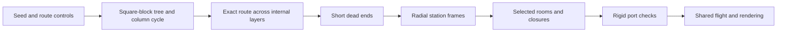

# Shaft-grid generation

## Purpose

The [shaft subbiome](room-catalogue.md#shafts-radial-shaft-grid) has one main
route of an exact requested length and a small number of short dead ends.
Construction has no random retries. Only selected stations and open passages
become rooms. Other candidate stations have no render or collision geometry.

Use the catalogue for appearance, machinery, flight, and the powered return.
Use the [room format](room-format.md) for geometry and connection contracts.
A graph station is a logical connection site. It need not be a separate room.

## Playable demo

```sh
crust demo.crs levels/shafts.crs --seed 1
```

The entrance is a bearing cap. The exit is the only offset outlet cap.
Use the normal flight, tether, burst, and brake controls. The demo keeps the
existing spin control. Fans remain stopped: the recipe creates static geometry
and assigns no moving-body controller or airflow field. It does not change
`main.crs`.

The [graph model](../../src/app/level/shafts/model.crs) owns the default settings:
`length`, `branches`, and `branch_length`. The recipe can change these settings
before it calls the generator. The shared demo runner supplies the seed.

- `length` is the exact entrance-to-exit distance in graph steps.
- `branches` is the maximum number of dead ends. Zero disables them.
- `branch_length` is the maximum number of cross tunnels in each dead end.
  It must be positive when branches are enabled.

Branch counts are upper bounds. A candidate root with no free neighbour adds
no branch. A branch stops when it reaches its length limit or has no free
neighbour. Invalid route lengths produce an error before graph allocation.



## Grid and distance

The region has an 8 by 8 array of radial shafts. Each shaft has four 125 m
segments. There are five station layers. The three internal layers permit
cross tunnels between adjacent shafts. End layers have no cross tunnels.
The grid has no wraparound links.

A station has coordinates `(x, y, z)`:

- `x` and `y` identify a shaft, from 0 through 7.
- `z` identifies depth, from 0 at the inner end to 4 at the outer end.
- Axial passages join `(x,y,z)` to `(x,y,z+1)`.
- Cross tunnels join adjacent `x` or `y` stations at the same internal depth.

An axial passage has distance three. A cross tunnel has distance one.
For independent distance checks, expand an axial passage into three unit edges
with two intermediate nodes. These nodes have no lateral ports or geometry.
Opening or closing an axial passage changes the complete chain.

| Quantity | Full candidate grid |
| --- | ---: |
| Stations | 320 |
| Axial passages | 256 |
| Cross tunnels | 336 |
| Nodes after axial subdivision | 832 |
| Unit edges after axial subdivision | 1104 |

Distance is an approximate travel measure. It does not specify metres, flight
time, or fan safety. Cross tunnels can have different physical lengths at
different depths. Assembly adds stoppers and caps without adding graph steps.

## Construct the column cycle

Use the square grid of shaft columns. Divide it into sixteen 2 by 2 blocks.
Connect the four columns of each block as a cycle.

Shuffle the block adjacency list with the seed. Use Kruskal's algorithm to
select a spanning tree of the 4 by 4 block grid. For each selected tree edge,
remove the two facing edges of its block cycles. Add the other two edges of
the grid square between them.

Each block side has its own original edge. Splices on different sides cannot
consume the same edge. Each tree edge joins two separate components, so each
splice joins two cycles. After all tree edges are processed, one cycle visits
all columns exactly once. This holds for every shuffled order.

The implementation stores this construction cycle on the first internal layer.
These records guide construction. A cycle edge becomes an open passage only
when the route or a branch uses it.

## Construct the exact route

The main route moves outward through each depth layer once. Its four axial
passages contribute twelve graph steps. For a requested length `L`, assign the
remaining `N = L - 12` steps to cross tunnels on the three internal layers.
The [graph model](../../src/app/level/shafts/model.crs) defines the maximum
consecutive cross-tunnel count and derives the supported length range from it.
The lower bound requires at least one cross tunnel so the endpoint columns differ.
The upper bound adds the cross-tunnel capacity of all internal layers to the
axial distance. Requests outside this range produce an error.

Choose the entrance column and cycle direction with the seed. Divide the
cross-tunnel budget among the internal layers with seeded bounded draws:

1. Calculate how many cross tunnels the remaining layers can hold.
2. Set the current layer's lower bound to the steps that cannot fit later,
   or zero when all remaining steps can fit later.
3. Set its upper bound to the smaller of the remaining budget and the
   consecutive cross-tunnel limit.
4. Draw its length from that interval. The last layer uses the remainder.

No draw can make the remaining budget impossible. Some layers can have no
cross tunnels, which gives a longer continuous shaft run. Transfer depths vary
with the seed. The main route cannot exceed the cross-tunnel limit between
shaft segments.

All layers follow the same column-cycle direction. The total lateral budget
is positive and smaller than the cycle, so entrance and exit columns differ.
The route never returns to an earlier column. Consecutive axial passages can
use the same column at different depths without repeating a station.

Open the terminal passages and record every main-route station. Leave every
other candidate passage closed. Endpoints are selected with the route; they
are not an independent pair imposed before construction.

The exact route guarantee applies to this outward-moving construction and its
stated range. It does not enumerate all possible paths in the full cubic grid.

## Add short dead ends

Shuffle the internal main-route stations. Visit each root at most once. From a
root, choose an unreached lateral neighbour with the seed. Continue from the
new station until the length limit is reached or no free lateral neighbour
remains. Stop adding branches at the configured branch limit.

Each branch is a simple chain attached at one main-route station. Branches
cannot attach to each other, join another reached station, or enter a terminal
layer. Each root has at most one branch. Unused neighbouring passages stay
closed even when both endpoints have rooms.

Every new passage adds one new station. The selected graph remains a tree.
There is exactly one entrance-to-exit path, and its distance remains `L` in
both directions. There are no shortcut or whole-grid attachment passes.

## Placement and content

The [placement code](../../src/app/level/shafts/placement.crs) defines the inner
radius and grid pitch. Grid `x` follows the circumference; grid `y` follows the
drum axis. Grid `z` increases radial depth. Station centres keep their radial
position and orientation.

Side tunnels use rigid octagonal links with angled end faces and four continuous
pipes. An open octagonal stopper joins each end to its station. The tunnel
spans the two stopper exit frames. Station positions and pipe connections stay
aligned.

Each unused radial port ends in a closed bearing, collector, or filter cap.
Each unused lateral port has a closed octagonal stopper. The outlet has an
additional stopper at its far end to enclose the standalone region. All closed
passages remain closed during the dive and return.

Room recipes are built once per repeated type during assembly. Each placed
room retains its own render and collision data. Construction and allocation
occur during loading. The graph output contains stable station and passage IDs,
open passage states, selected stations, endpoints, the ordered main route,
and its exact distance.

Geometry must preserve the selected graph. A fan must leave its passage
traversable. Do not remove a required edge to place machinery or create an
unrecorded bypass. A grate can replace a closure only with a closed enclosure
behind it. Visible but unreachable structures require explicit content; the
generator does not fill unused columns with rooms.

## Determinism and cost

Use coordinate-derived IDs and the shared
[random helper](../../src/app/generation/random.crs). It uses modulo reduction;
this design does not require a uniform distribution over layouts.

Initialize block candidates in coordinate order. Use descending Fisher-Yates
for shuffles. Consume the graph random stream in this order: block tree,
entrance and direction, layer lengths, branch root shuffle, and branch steps.
Keep geometry-detail randomness separate. Do not depend on hash iteration or
worker completion order.

Construction storage is linear in the candidate grid. Route work is linear
in the selected path. Branch work stops at the available stations or configured
limits. There is no repeated shortest-path search during construction and no
allocation or graph search in the frame loop.

## Verification

Run `crust tests.crs shaft-grid`. This focused test builds no geometry and starts
no renderer. It checks every supported length across seeds. Checks include:

- Exact path cost and no repeated main-route station.
- Outward shaft travel and the consecutive cross-tunnel limit.
- Independent BFS over expanded unit-edge adjacency.
- Reachability equal to the selected set, tree topology, and closed unused ends.
- Distinct endpoint columns and deterministic replay.
- Dead-end count and length limits, no branch forks, and no joins.
- A branch-free request and invalid input rejection.

Run `crust tests.crs shaft-layout` for a small assembly fixture. It checks rigid
loops, both lateral directions, different radial depths, open stoppers, real
drone crossings, and closed stoppers. It starts no renderer.
