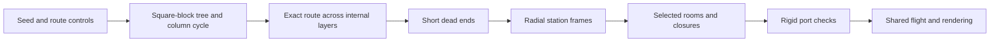

# Shaft-grid generation

## Purpose

The [shaft subbiome](room-catalogue.md#shafts-radial-shaft-grid) has one main
route of an exact requested length and a small number of short dead ends.
This describes the implemented base graph. The approved
[hazard expansion](#hazard-expansion-design) adds fan bypasses and powered routes.
Construction has no random retries. Only selected stations and open passages
become rooms. Other candidate stations have no render or collision geometry.

Use the catalogue for appearance, machinery, flight, and the powered return.
Use the [room format](room-format.md) for geometry and connection contracts.
A graph station is a logical connection site. It need not be a separate room.

## Playable demo

```sh
crust demo.crs levels/shafts.crs --seed 1
```

The entrance is a bearing cap. The exit is the only offset outlet cap.
Use the normal flight, tether, burst, and brake controls. The demo keeps the
existing spin control. Fans remain stopped: the recipe creates static geometry
and assigns no moving-body controller or airflow field. It does not change
`main.crs`.

The [graph model](../../src/app/level/shafts/model.crs) owns the default settings:
`length`, `climb`, `branches`, and `branch_length`. The recipe can change these settings
before it calls the generator. The shared demo runner supplies the seed.

- `length` is the exact entrance-to-exit distance in graph steps.
- `climb` is the number of shaft segments in one upward detour. Zero selects
  a monotone descent. Both turns must stay on internal layers.
- `branches` is the maximum number of dead ends. Zero disables them.
- `branch_length` is the maximum number of cross tunnels in each dead end.
  It must be positive when branches are enabled.

Branch counts are upper bounds. A candidate root with no free neighbour adds
no branch. A branch stops when it reaches its length limit or has no free
neighbour. Invalid route lengths produce an error before graph allocation.



## Grid and distance

The region has an 8 by 8 array of radial shafts. Each shaft has four 125 m
segments. There are five station layers. The three internal layers permit
cross tunnels between adjacent shafts. End layers have no cross tunnels.
The grid has no wraparound links.

A station has coordinates `(x, y, z)`:

- `x` and `y` identify a shaft, from 0 through 7.
- `z` identifies depth, from 0 at the inner end to 4 at the outer end.
- Axial passages join `(x,y,z)` to `(x,y,z+1)`.
- Cross tunnels join adjacent `x` or `y` stations at the same internal depth.

An axial passage has distance three. A cross tunnel has distance one.
For independent distance checks, expand an axial passage into three unit edges
with two intermediate nodes. These nodes have no lateral ports or geometry.
Opening or closing an axial passage changes the complete chain.

| Quantity | Full candidate grid |
| --- | ---: |
| Stations | 320 |
| Axial passages | 256 |
| Cross tunnels | 336 |
| Nodes after axial subdivision | 832 |
| Unit edges after axial subdivision | 1104 |

Distance is an approximate travel measure. It does not specify metres, flight
time, or fan safety. Cross tunnels can have different physical lengths at
different depths. Assembly adds stoppers and caps without adding graph steps.

## Construct the column cycle

Use the square grid of shaft columns. Divide it into sixteen 2 by 2 blocks.
Connect the four columns of each block as a cycle.

Shuffle the block adjacency list with the seed. Use Kruskal's algorithm to
select a spanning tree of the 4 by 4 block grid. For each selected tree edge,
remove the two facing edges of its block cycles. Add the other two edges of
the grid square between them.

Each block side has its own original edge. Splices on different sides cannot
consume the same edge. Each tree edge joins two separate components, so each
splice joins two cycles. After all tree edges are processed, one cycle visits
all columns exactly once. This holds for every shuffled order.

The implementation stores this construction cycle on the first internal layer.
These records guide construction. A cycle edge becomes an open passage only
when the route or a branch uses it.

## Construct the exact route

The main route crosses all depth layers and can include one upward detour.
The [graph model](../../src/app/level/shafts/model.crs) owns the route settings,
the consecutive cross-tunnel limit, and the supported length bounds.

For climb `u`, the route has `4 + 2u` axial passages. Each contributes three
graph steps. A monotone route needs at least one cross tunnel. A route with a
climb needs at least two: one before each reversal of axial direction. The
maximum length adds the cross-tunnel capacity of every internal station visit
to the axial distance. Requests outside these bounds produce an error.

Choose the entrance column and cycle direction with the seed. For a climb,
choose a lower turn depth that leaves the full upward leg between internal
layers. The route descends to this turn, climbs the requested number of layers,
then descends to the outer boundary. A monotone route visits each internal
layer once. A climb adds two internal visits per upward shaft segment.

Divide the cross-tunnel budget among these visits with seeded bounded draws:

1. Require a cross tunnel before each reversal of axial direction. Reserve
   the required crossings at later turns before the current draw.
2. Calculate how many cross tunnels the remaining visits can hold. The current
   lower bound must leave no more than this capacity for later visits, and
   must include the crossing when this visit is a turn.
3. Set the upper bound to the smaller of the consecutive cross-tunnel limit
   and the budget left after the reserved crossings.
4. Draw from that interval. The last visit uses the remaining budget.

No draw can make the remaining budget impossible. Visits with no cross tunnel
continue the same shaft run. Both turns of an upward detour change columns,
so the route cannot retrace a shaft segment. The seed changes the turn depth
and the positions of optional transfers.

All cross tunnels follow the same column-cycle direction. The supported
lateral budgets are positive and smaller than the cycle. Entrance and exit
columns therefore differ, and the route never returns to an earlier column.
Repeated depths during a climb use different columns and station IDs.

Open the terminal passages and record every main-route station. Leave every
other candidate passage closed. Endpoints are selected with the route; they
are not an independent pair imposed before construction.

The exact route guarantee applies to this single-detour construction and its
stated range. It does not enumerate all possible paths in the full cubic grid.

## Add short dead ends

Shuffle the internal main-route stations. Visit each root at most once. From a
root, choose an unreached lateral neighbour with the seed. Continue from the
new station until the length limit is reached or no free lateral neighbour
remains. Stop adding branches at the configured branch limit.

Each branch is a simple chain attached at one main-route station. Branches
cannot attach to each other, join another reached station, or enter a terminal
layer. Each root has at most one branch. Unused neighbouring passages stay
closed even when both endpoints have rooms.

Every new passage adds one new station. The selected graph remains a tree.
There is exactly one entrance-to-exit path, and its distance remains `L` in
both directions. There are no shortcut or whole-grid attachment passes.

## Hazard expansion design

The [fan design](room-catalogue.md#fans-supports-and-tether-flight) defines
slow crossings, adjacent airflow sources, and fast or cycling fans with short
hexagonal bypasses. The static demo connects a hex bypass around each fan.
Fan motion and airflow require the controllers in the fan design. Add powered
hazard rules after construction of the base route and dead ends.

Keep the requested length as the base-route budget. A bypass joins both sides
of a fan and creates a local loop. Record its passage costs in the expanded
graph. Report the base distance and the measured stopped and powered route
costs separately. The tree and exact-distance guarantees above apply before
hazard expansion.

A permanently fast fan blocks its direct passage while powered. Its bypass
must remain usable. A cycling fan permits direct passage only during a usable
slow window; its bypass remains available during all phases. A slow fan needs
a crossing window checked against blade motion, airflow, and the drone shape.
Check the return direction as well as the dive. Connectivity alone does not
establish that opposing flow or a timed crossing can be passed.

Select an adjacent airflow source together with the affected shaft interval,
its flow direction, and its intake or exhaust path. Build only the required
fan section and its visible enclosure. A solid cap cannot remain across a
required air path. This content selection must not restore generation of all
unused shaft columns.

The first hazard placement uses one shaft affected by an adjacent airflow
source and one cycling fan with a short hexagonal bypass. Preserve clear runs
between encounters. Use the catalogue's flight checks before expanding the
placement rules to more encounters.

## Placement and content

The [placement code](../../src/app/level/shafts/placement.crs) defines the inner
radius and grid pitch. Grid `x` follows the circumference; grid `y` follows the
drum axis. Grid `z` increases radial depth. Station centres keep their radial
position and orientation.

Side tunnels use rigid octagonal links with angled end faces and four continuous
pipes. An open octagonal stopper joins each end to its station. The tunnel
spans the two stopper exit frames. Station positions and pipe connections stay
aligned.

A fan interval has five connected rooms: clear approach, side collar, compact
fan, side collar, and clear approach. The approaches share the space that
remains after the fan and collars. Their total length equals the passage
between the station faces. The spindle continues through all five rooms.
Each collar side port connects through an open hex stopper to a T-junction.
A straight hex tunnel joins the junctions; its length matches their port gap.
Closed hex stoppers seal the unused T branches. This forms a local
loop around the fan without changing station positions or the base route
budget. The room graph contains all bypass rooms and connections. Small
service pipes stay in the clear approaches. The fan remains static.

Each unused radial port ends in a closed bearing, collector, or filter cap.
Each unused lateral port has a closed octagonal stopper. The outlet has an
additional stopper at its far end to enclose the standalone region. All closed
passages remain closed during the dive and return.

Room recipes are built once per repeated type during assembly. Each placed
room retains its own render and collision data. Construction and allocation
occur during loading. The graph output contains stable station and passage IDs,
open passage states, selected stations, endpoints, the ordered main route,
and its exact distance.

The current static assembly preserves the selected base graph and adds a
local bypass loop at each fan. Each fan leaves its direct passage traversable.
Powered route checks must include the bypass links and fast-fan closures.
A grate can replace a closure only with a closed enclosure
behind it. Visible but unreachable structures require explicit content; the
generator does not fill unused columns with rooms.

## Determinism and cost

Use coordinate-derived IDs and the shared
[random helper](../../src/app/generation/random.crs). It uses modulo reduction;
this design does not require a uniform distribution over layouts.

Initialize block candidates in coordinate order. Use descending Fisher-Yates
for shuffles. Consume the graph random stream in this order: block tree,
entrance and direction, turn depth, layer lengths, branch root shuffle, and
branch steps.
Keep geometry-detail randomness separate. Do not depend on hash iteration or
worker completion order.

Construction storage is linear in the candidate grid. Route work is linear
in the selected path. Branch work stops at the available stations or configured
limits. There is no repeated shortest-path search during construction and no
allocation or graph search in the frame loop.

## Verification

Run `crust tests.crs shaft-grid`. This focused test builds no geometry and starts
no renderer. It checks every supported length and climb across seeds. Checks include:

- Exact path cost and no repeated main-route station.
- Requested upward travel, net outward travel, and the consecutive cross-tunnel limit.
- Independent BFS over expanded unit-edge adjacency.
- Reachability equal to the selected set, tree topology, and closed unused ends.
- Distinct endpoint columns and deterministic replay.
- Dead-end count and length limits, no branch forks, and no joins.
- A branch-free request and invalid input rejection.

Run `crust tests.crs shaft-layout` for a small assembly fixture. It checks rigid
loops, both lateral directions, different radial depths, open stoppers, real
drone crossings, and closed stoppers. It starts no renderer.
