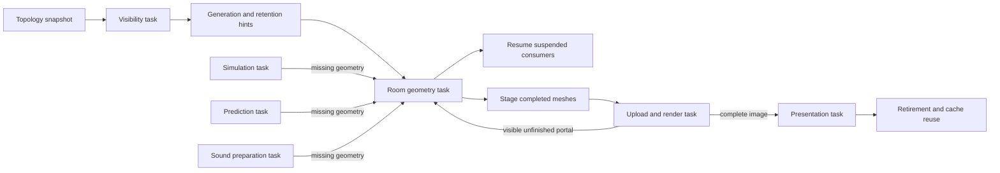

# Room streaming

Normal play uses room residency. The loader is in `src/app/streaming/`.
The common task runtime owns execution and dependency waits. Game code does
not use platform thread or synchronization objects.

## Persistent state

Level construction records asset builders, owned parameters, added parts,
and material edits. It assigns room, portal, and collider identities. Graph
connections, room frames, lights, controllers, and collision instance records
stay resident. Door state survives geometry eviction.

Construction still builds geometry once to establish collider layouts. After
startup admission, the combined mesh is released. A geometry task reconstructs
a room from its recorded inputs and produces a mesh and immutable collision
chunk. Assets without a replay recipe remain pinned for the level lifetime.
This includes the older labyrinth and direct room fixtures.

Each task owns its inputs until retirement. A level retains its task schedule,
recipes, topology snapshot, and result slots. Shutdown drains the schedule before
it releases those slots. Results cannot cross a level replacement. A recipe
change requires a new construction.

## Visibility and requests

Visibility uses convex portal polygons and connection transforms, including
rotation and scale. Recursive paths retain distinct traversal states. Only the
result merges room identities. Logical global positions do not determine
visibility. Visibility treats doors as open.

A task computes visibility rows and loading waves from an immutable topology
snapshot. Rows and completed plans remain cached for the construction. The
application consumes completed plans. It does not expand visibility at a room
crossing. Polygon or traversal exhaustion conservatively includes all candidates.

The current visibility row and further waves provide generation and retention
hints. They do not require a frame to wait. Audio range, prediction, the hook,
and particles can also request geometry. All requests use the same work-stealing scheduler. Callbacks release their worker
when they await a dependency. The automatic worker cap is defined in
`src/game/tasks/runtime.crs`.

A room request shares one generation task with all consumers. A consumer that
finds missing collision geometry returns a dependency on that task. The worker
is released. The scheduler resumes the consumer after successful generation.
A failed dependency fails its consumers. An incomplete prediction does not
publish markers or door requests.

The application can wait when it needs a simulation, prediction, or audio task
result. These are task joins. There is no application loading loop for every room
in a visibility set. Required room results remain retained until the visibility
plan changes and consumers have retired.

## Rendering and publication



Completed meshes enter unused GPU arena ranges before rendering needs them.
The next instance list is built separately. Capacity checks finish before it
replaces the published list. Failed staging preserves that list. Transfers and
rendering use the existing asynchronous GPU operation path.

Portal metadata states whether each destination is ready. The renderer reports
an unfinished destination only when portal pixels survive rasterization. It
returns a dependency result instead of a valid image. The application joins the
room task, stages its result, and retries rendering with the same simulation
state. It does not present an incomplete image or advance simulation on retry.
The dependency uses the existing renderer completion status readback.

Prediction and audio use immutable collision snapshots. They add a generated
chunk when their task resumes. Snapshot references keep chunks alive through
reader retirement. Residency changes and GPU range reuse occur between retired
frames. Texture banks and door render assets remain resident.

## Memory and execution modes

`--room-memory N` sets the geometry arena budget in MiB. Arena size and the
default budget are defined in `src/app/streaming/storage.crs`. The CPU cache uses
a budget derived from that value. Persistent topology, visibility plans, worker
scratch, snapshot references, and other renderer storage are separate costs.

Meshes use fixed-size arena pieces within the shared renderer buffer. Multiple
meshes can share an arena. Empty arenas reuse their extent. Startup admission reserves mesh storage, instance
records, and triangle address space for the arena budget. A new room within
that budget does not replace the renderer buffers during a crossing.
Frame scratch shares this buffer. Growth beyond an admitted frame capacity
replaces the shared buffer and copies resident data. The current arenas do not
have independent GPU allocations.
Device binding limits still apply. Cache or arena exhaustion produces an error.
GPU diagnostics report live, trapped, requested, and budget bytes.

Desktop background work uses the common worker pool. The browser uses the same
scheduler with its event-loop provider. That provider
has no background CPU workers; task execution itself occupies the application
lane. Moving browser computation to workers requires a worker-capable WebAssembly
pool and the corresponding browser memory and deployment contract. Dependency
waits themselves occupy no pool worker on either provider.

## Checks

```sh
crust tests.crs scheduler
crust tests.crs residency levels/shafts.crs --width 640 --height 480
crust tests.crs residency levels/service.crs --width 640 --height 480
crust tests.crs residency-budget levels/shafts.crs --width 640 --height 480 --room-memory 9
crust tests.crs recipes levels/shafts.crs
crust tests.crs collision --sanitize
crust main.crs --web
```

Runtime checks use one worker to complete a consumer through a generated
dependency. Scheduler checks cover fairness and dependency resumption while other work is busy.
The residency check removes destination geometry, resumes prediction through
real generation, and compares its output with full residency. It compares
physics and rendered pixels across portal crossings and return visits. The
budget check rejects staging and verifies the retained image. Recipe checks
compare reconstructed geometry, materials, portals, lights, and door identities. Test output stays
in ignored build storage.
