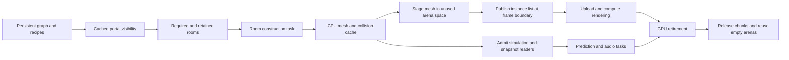

# Room streaming

Normal play uses room residency on desktop and in the browser. The loader lives
in `src/app/streaming/`. It uses the shared task pool, collision snapshots, and
renderer inputs. Game code does not use platform synchronization objects.

## Construction and persistent state

Level construction records asset builders, owned parameter values, added parts,
and material edits. It assigns room, portal, and collider identities. Graph
connections, room frames, controller state, lights, and collision instance records
stay resident. Door motion survives room eviction and regeneration.

Construction currently builds geometry once to establish collider identities and
layouts. After startup admission, the combined render mesh is released. A missing
room is rebuilt from its recorded inputs. The worker returns a render mesh and
an immutable collision chunk. It does not replace live door or object state.
Assets supplied without a replay recipe are explicitly pinned for the lifetime
of the level. This includes the older labyrinth and direct room fixtures.

A loader owns its jobs and copied recipe inputs. Shutdown joins its last job
before releasing storage. Results cannot cross a level replacement. Within a
construction, a result outside the retention set is discarded. Changes to a
room recipe require a new construction; immutable visibility and collider layouts
belong to that construction.

## Visibility and loading

Room visibility uses convex portal polygons and the actual connection transforms,
including rotation and scale. Traversal retains distinct recursive path states.
Only the result merges room identities. Logical global room positions do not
determine visibility. Doors are treated as open for visibility.

Visibility rows are cached on demand. A row includes rooms potentially visible
from anywhere in its source room. Polygon or traversal work exhaustion keeps all
room candidates. An incomplete geometric calculation cannot hide a room.

The current row is mandatory. The next visibility wave is prefetched. A further
wave retains cached assets. One asset construction job runs at a time. Required
rooms take priority when the current job retires. Optional prefetch stops at the
CPU cache budget. Loading does not advance simulation time.

The required set also includes the hook, tether path, live particles, and an
unresolved prediction frontier. Audio retains all rooms that its portal search
can visit above the transmission threshold. These dependencies are independent
of renderer visibility.

## Admission and publication



A simulation step runs against reusable speculative state. If collision is
missing, the loader requests that room and retries the same command. Only a
complete step changes the player's state or clock. Particle motion uses the
same retry rule. Input events continue to be processed during admission waits. The window title
shows loading status. Escape cancels the run.

Prediction and audio refresh their snapshot membership only between jobs. Their
immutable chunks remain alive until readers release them. An incomplete
prediction suppresses its markers and requests its unresolved room. Loading time
is removed from the next frame's simulation credit.

GPU meshes are written into unused arena ranges. The next instance list is built
separately. Capacity checks finish before it replaces the current list. Failed
staging leaves the published list intact. Transfers precede rendering in the same
GPU submission. A GPU submission failure is reported and ends the run.

The application changes residency between frames, after prediction, audio, and
GPU work has retired. It then releases excluded collision chunks and mesh ranges.
Other collision snapshots retain their own references. Texture banks and door
render assets remain shared and resident.

## Memory

`--room-memory N` sets the room geometry arena budget in MiB. Defaults and arena
size are defined in `src/app/streaming/storage.crs`. The CPU asset cache uses a
budget derived from that value. Persistent topology, visibility rows, controllers,
worker construction scratch, snapshot pins, and other renderer storage are
separate costs.

A mesh is split into fixed-size arena pieces. Multiple meshes can share an arena.
An empty arena reuses its reserved extent. Allocation occupancy is separate from
the published instance list. The renderer uses bounded retained storage and
partial dirty-range uploads on both backends; its device binding limits still
apply to the backing store.

Under pressure, inactive GPU cache entries and optional CPU entries are released
first. A mandatory set that exceeds the available capacity produces an explicit
error. GPU diagnostics report live, trapped, requested, and budget bytes. CPU
cache diagnostics report live, requested, and budget bytes. The loader does not
retry an impossible allocation indefinitely.

## Checks

```sh
crust tests.crs residency levels/shafts.crs --width 640 --height 480
crust tests.crs residency levels/service.crs --width 640 --height 480
crust tests.crs residency-budget levels/shafts.crs --width 640 --height 480 --room-memory 9
crust tests.crs recipes levels/shafts.crs
crust tests.crs collision --sanitize
crust main.crs --web
```

The residency check uses production loading and rendering. It compares flight
state and images with full residency across remote visits and a return visit,
with an attached hook. Recipe checks compare regenerated triangles, UVs,
collision, portals, lights, and door identities. The collision suite checks
snapshot retention, missing-room admission, and retry. Test output belongs in
ignored build storage.

The budget check fills the production arenas, rejects the next required set,
and compares the retained frame with its previous image.
