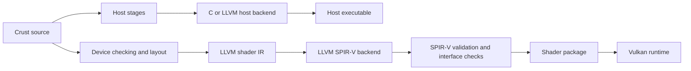

# Crust to Vulkan Shader SPIR-V

## Current status: 2026-10-14

Crust is pinned to `54d2ffa`. It includes the
first Vulkan compute stage and a Vulkan dispatch harness written in Crust.
The upstream history also includes the device enumeration correction.

- The seed, C backend, and LLVM host backend support shared `f32` semantics.
- LLVM field and element access uses typed addressing.
- The external shader stage generates compute entries, buffer and R32f image
  bindings, workgroup storage, invocation IDs, and barriers.
- Device errors use invocation status. The stage rejects raw pointers, `usize`,
  recursion, `trap`, and barrier placements that violate its device contract.
- Shader publication requires successful Vulkan 1.2 SPIR-V validation.
- The shader stage selects LLVM single-exit lowering. Host LLVM emission uses
  direct returns by default. The shader stage runs `mem2reg` and
  `structurizecfg` before SPIR-V emission. This permits clipped-geometry helpers
  with returns inside nested control flow.
- Invocation status accumulates failure across ordered dispatches. Clear it
  before each frame. The caller must keep dispatch counts within the configured
  maximum and provide storage memory dependencies between dispatches.

See the [shader tutorial](../crust/examples/shader/README.md) for the implemented
profile and commands. It currently requires `shaderInt8` and specified float
controls. Resource-name byte arrays still cause the `Int8` requirement; removing
it requires LLVM emission to discard those values before capability collection.

The shader suite passed eleven dispatch cases and ten source-rejection checks on
both an AMD Radeon PRO W7900 Dual Slot and an Intel Arc Pro B60. Both used Mesa
25.2.8 on Linux. The tests cover buffer exchange, workgroup synchronization,
failure propagation, helper exits, repeated dispatch status, bounds, images,
float conversions, and zero initialization.
Failed-tool output preservation and allocation-failure checks also passed.
Compilation used LLVM 23.1.3 and SPIRV-Tools 2025.1.

The Crust dispatch harness passed 1,025 ABI checks across 42 records against
the Vulkan C headers. Four injected enumeration and setup cases and three
malformed-input checks also passed. Its bindings use the Linux x86-64 ABI.
The game now compiles host and shader inputs from shared Crust buffer constants.
Its [renderer tests](renderer-build.md) complete the visible-image and
multiple-workgroup gates. The game bindings passed 1,177 checks across 53 Vulkan
records. The compiler's eleven dispatch cases each use one four-invocation
workgroup. Windows and NVIDIA were not tested.

The repeated-dispatch test exposed a status loss on Intel with Mesa 25.2.8.
Generated machine code reused the dispatch-bound predicate register for mutable
failure state, then tested that changed register before the status write. The
shader entry now writes status unconditionally under the caller's dispatch-bound
precondition. This removes the redundant predicate from the compiler output.
The conditional-failure test passes on both tested devices.

## Initial investigation: 2026-10-13

The remaining sections preserve the initial investigation at `408f466`. Its
missing-feature statements and estimates describe that revision. Use the current
status above and Crust's shader tutorial for implemented behaviour.

### Result

Use Crust for host and device code. The recommended device path is a Crust shader
stage that emits LLVM IR for the LLVM SPIR-V backend. Keep this stage in Crust.
Implement missing language features there. Do not change game algorithms to
compensate for missing compiler support.

This is a compiler feature, not a target-flag change. Small integer functions
already translate. Device types, interfaces, memory operations, and failure
semantics require work. Floating-point support is also absent from the inspected
Crust stages.

This investigation used Crust commit
`408f4660f0b6e43b102eca2908a1f1d81780b321` on 2026-10-13. It includes source
inspection and compilation probes. It does not establish GPU execution,
performance, or support across the target device list.

## Paths considered

| Path | Assessment |
| --- | --- |
| Crust shader stage → LLVM IR → LLVM SPIR-V backend | Recommended first experiment. Reuse scalar lowering and LLVM optimization. Add the device contracts listed below. |
| Crust → OpenCL C → clspv | Feasible with a new device C emitter. The current host C output is not valid input. It offers no clear reduction in Crust language work. |
| Crust shader stage → SPIR-V directly | Feasible. Gives direct control over interfaces and capabilities. Requires an instruction writer, type and ID management, structured control flow, and an optimization plan. Reconsider if the LLVM experiment fails its gates. |

LLVM documents a logical `spirv` target and a Vulkan target environment. Use its
native SPIR-V backend. The separate `llvm-spirv` translator currently targets
OpenCL `Kernel` modules. It does not supply the Vulkan `Shader` path.
Sources: [LLVM SPIR-V target](https://llvm.org/docs/SPIRVUsage.html) and
[translator scope](https://github.com/KhronosGroup/SPIRV-LLVM-Translator#llvmspir-v-bi-directional-translator).

The C route needs explicit OpenCL address spaces and kernel interfaces.
Crust's [C prelude](../crust/stages/c/emit.crs) requires Linux x86-64, eight-byte
pointers, and GCC assembly constraints. Its address operations use integer
representations of pointers. These assumptions conflict with
[clspv's logical-pointer restrictions](https://github.com/google/clspv/blob/main/docs/OpenCLCOnVulkan.md#pointers).
Changing the C compiler command cannot repair them.

## Recommended compilation boundary



The host C compiler still builds the seed. Host compilation programs load the
device compiler as an ordinary Crust stage. Device compilation produces a shader
package, not a native shared library. Reuse package input capture and caching
where applicable. Do not send shader outputs through `objcopy` or the host linker.

Generate host bindings and shader declarations from one checked interface.
Record entry points, descriptor bindings, push constants, member offsets, array
strides, workgroup sizes, and required device features. This interface is the
boundary between the host and GPU. A shared source record alone is not an ABI.

## Required Crust work

| Area | Current mechanism | Required change |
| --- | --- | --- |
| Floating point | The seed type list and inspected C/LLVM stages have no floating-point type. `f32` is rejected. | Add real `f32` values, literals, arithmetic, comparisons, conversions, and layout to a shared Crust language stage. Provide host and device lowering. Define NaN, rounding, contraction, and fast-math rules. |
| Target layout | The checker fixes pointers and `usize` at eight bytes. It resolves layout queries before emission. | Select device layout during checking. Keep host pointers separate from device references. Define index widths and resource layouts explicitly. |
| Memory spaces | `ll_type` emits `ptr` for every pointer. Loads and stores use address space zero. | Preserve function, private, workgroup, storage-buffer, uniform, and push-constant storage through types and lowering. |
| Address operations | Fields and indices become byte offsets. Casts can produce `ptrtoint` and `inttoptr`. | Emit typed resource access and valid access chains. Define which pointer operations the device profile accepts. Diagnose unsupported casts at source locations. |
| Entry and bindings | `ll_emit` emits an x86 target and an optional C `main` adapter. Names pass through a native symbol map. | Emit `GLCompute` entries, local size, descriptor bindings, invocation IDs, and resource types. Resolve helper functions inside the shader module. |
| Synchronization | The current raw emitter has no device atomics or barriers. | Add operations with explicit memory order, scope, and storage domain. Preserve LLVM convergence semantics. Check the required uniform control flow for barriers. |
| Control flow | Crust permits labels, jumps, recursion, and function values. | Define device legality before emission. Use LLVM's shader control-flow passes. Reject unsupported recursion and unresolved indirect calls. Do not assume arbitrary host control flow is valid shader control flow. |
| Failure | Arithmetic guards and `trap` emit `llvm.trap` followed by `unreachable`. | Define observable device failure. Do not accept a backend that removes the failure operation. Error handling must preserve barrier participation. |
| Capabilities | Host booleans use `i8`; indices use `i64`; memory copies use host layouts. | Derive capabilities from the final shader. Avoid accidental narrow-integer or 64-bit requirements. Check packed memory access and aggregate-copy semantics. |
| Renderer resources | No image, sampler, or device builtin interface exists in the inspected stages. | Add storage images, texture/buffer reads, invocation IDs, and the operations required by the first rendering pass. |

Source locations:
[seed types](../crust/include/crust0.h),
[checking and layout](../crust/src/check.c),
[LLVM types and memory](../crust/stages/llvm/base.crs),
[LLVM expressions](../crust/stages/llvm/expression.crs),
[LLVM module emission](../crust/stages/llvm/program.crs), and
[LLVM tool invocation](../crust/stages/llvm/build.crs).

The [Crust specification](../crust/docs/crust0-spec.md) permits stages with their
own trees, types, and backend adapters. Prefer that extension boundary for the
shared numeric and device language. The existing expression callback alone is
not sufficient: its inputs are already checked raw types with host layout facts.
Adding an LLVM `fadd` case cannot make the reader or checker accept `f32`.

The [LLVM shader pipeline](https://github.com/llvm/llvm-project/blob/e20b852b5a3fa96a0653493262c4904dd56f60fa/llvm/lib/Target/SPIRV/SPIRVTargetMachine.cpp)
already includes loop preparation and a SPIR-V structurizer. Preserve
[convergence information](https://llvm.org/docs/ConvergentOperations.html) for
collective operations. These passes do not define Crust's device memory model.

The initial logical-addressing profile should use resource references and typed
indices. Device addresses can be a separate, explicit feature when a program
requires them. Vulkan permits `PhysicalStorageBuffer64` with the corresponding
features; it does not make ordinary host pointers valid on the GPU.
Source: [Vulkan SPIR-V environment](https://docs.vulkan.org/spec/latest/appendices/spirvenv.html).

## Compilation evidence

Tools tested: LLVM 23.1.3, an installed LLVM 24 development build, and
SPIRV-Tools 2025.1. Every validation below used `--target-env vulkan1.3`.
Vulkan 1.3 was an experiment setting, not a change to the game's minimum version.

The tested `llc` executables had these SHA-256 hashes. The LLVM source links below
identify the inspected tests and code; they do not identify the development
binary's build revision.

| Executable | SHA-256 |
| --- | --- |
| LLVM 23.1.3 `llc` | `9f294abce5106717cb0fe94cd564c32b825789f11783f0921b44009c4af7ae6c` |
| LLVM 24 development `llc` | `731d8d798deefe4149a7f866ab192807c5ac22402133a5e2320f490781e63d79` |

| Probe | Observed result |
| --- | --- |
| Crust integer function with a loop and branch | The unchanged function body plus an explicit LLVM shader wrapper compiled and passed validation with both LLVM versions. |
| Typed storage buffers with integer and floating-point members | Passed compilation and validation with both versions. The test used LLVM IR, not Crust floating-point source. |
| Workgroup barrier | Passed compilation and validation with both versions. |
| Workgroup 32-bit atomics | Passed compilation and validation with both versions. |
| An `i32` store through byte-buffer storage | LLVM 23.1.3 crashed in `SPIRVLegalizePointerCastImpl::transformStore`. The LLVM 24 build compiled it and passed validation. |
| Crust pointer-to-integer conversion | Both versions emitted `OpConvertPtrToU` under logical addressing. Validation rejected the missing addressing capability. |
| Crust guarded integer division | The failure branch lost `llvm.trap` and retained `OpUnreachable`. Validation passed, but Crust's trap behaviour was not preserved. |
| Crust function with an `f32` parameter and result | The checker reported `unknown name 'f32'`. |

The LLVM probes came from the inspected source revision's
[buffer test](https://github.com/llvm/llvm-project/blob/e20b852b5a3fa96a0653493262c4904dd56f60fa/llvm/test/CodeGen/SPIRV/pointers/structured-buffer-access.ll),
[barrier test](https://github.com/llvm/llvm-project/blob/e20b852b5a3fa96a0653493262c4904dd56f60fa/llvm/test/CodeGen/SPIRV/hlsl-intrinsics/group_memory_barrier_with_group_sync.ll),
[atomic test](https://github.com/llvm/llvm-project/blob/e20b852b5a3fa96a0653493262c4904dd56f60fa/llvm/test/CodeGen/SPIRV/atomicrmw-storage-class-semantics-vulkan.ll), and
[byte-buffer test](https://github.com/llvm/llvm-project/blob/e20b852b5a3fa96a0653493262c4904dd56f60fa/llvm/test/CodeGen/SPIRV/pointers/byte-address-buffer-store.ll).

The byte-buffer failure occurs when the legalizer cannot find an element type
compatible with the typed store inside byte storage. The inspected LLVM history
contains [a fix for this case](https://github.com/llvm/llvm-project/commit/4d984357a60a31dd3bb5fe325f19aa2bfe90a910).
Select a toolchain that passes this witness, or carry the tested fix in the
toolchain. Do not add a game-level workaround.

The successful probes are not a portable shader package. The wrapped Crust
probe still declares `Int8`; its resource-name string survives initial lowering
as byte storage. The buffer probe also declares `Int64`. The LLVM 23 atomic
probe retains `Linkage`. Audit the complete capability list and remove unused
requirements in compiler emission or finalization. Device feature checks remain
necessary after `spirv-val` succeeds.

Resource names must become compiler metadata, without residual device storage.
Use logical booleans and the selected device index width during lowering.
Internalize helper functions before final shader emission. These are compiler
contracts; enabling extra GPU features must not conceal unwanted output.

The Crust probe used this source:

```crs
fn shade(index:u32)->u32 {
    var color:u32=0u32;
    var step:u32=0u32;
    while step<4u32 {
        if (index&1u32)==0u32 { color=color+step; }
        else { color=color+index; }
        step=step+1u32;
    }
    return color|4278190080u32;
}
```

Build `build/llvm-test-driver` in Crust. Its `raw --library --export shade --emit`
mode emits this function. For the experiment, replace the module target, make
the helper internal, and add a `void main()` LLVM wrapper. The wrapper reads
`llvm.spv.thread.id.i32`, calls the emitted helper, and writes a storage buffer
through `llvm.spv.resource.handlefrombinding` and `llvm.spv.resource.getpointer`.
Set `hlsl.shader=compute` and `hlsl.numthreads=8,1,1` on the entry. These LLVM
attribute names do not require HLSL source.

The resulting shader IR used this tool sequence:

```sh
opt -S -passes='default<O2>' shader.ll -o shader.opt.ll
llc -O2 -mtriple=spirv-unknown-vulkan1.3-compute \
    -filetype=obj shader.opt.ll -o shader.spv
spirv-val --target-env vulkan1.3 shader.spv
spirv-dis shader.spv -o shader.spvasm
```

The wrapper is an experiment input. Production compilation must generate the
entry, resources, types, and layout inside Crust. Text edits to host IR are not
the proposed compiler architecture.

## Bounded implementation experiment

Start with one Crust host program that dispatches one Crust compute shader.
Use an indexed texture, a palette/light table, and a stable dither pattern.
Write an image that can be displayed. Use the same interface description for
host upload and shader access. Include an image width that is not a multiple of
the workgroup width.

Compare every output pixel with a CPU reference. Require zero mismatches for
the integer shading pass, zero validation errors, and only the declared device
capabilities. Include two workgroups, resource bounds, packed palette reads,
and a correctly synchronized workgroup operation. Test the selected error
contract with an injected failure. Stop expansion if any of these checks fails.

Then add a triangle pass with `f32` transforms, edge tests, and depth. Define
numerical tolerances before testing it. Measure compiler-stage time, LLVM tool
time, driver compilation time, and GPU execution separately. Preserve the same
input when comparing toolchain revisions.

Do not expand into portal traversal or a general GPU framework until this slice
produces the intended image through the actual host/device interface. Validate
on AMD, Intel, and NVIDIA, and on both operating systems, before claiming that
support matrix. No GPU dispatch was run during this investigation.

For traps, an error buffer alone is insufficient. A failing invocation must not
skip a barrier that other invocations reach. Specify error propagation through
helpers and workgroup synchronization, then make the host reject the failed
output. Alternatively, an explicit device feature can supply the required abort
semantics. Until the contract is implemented, reject the affected device code.

## Effort estimate

These are planning estimates for one engineer familiar with Crust and LLVM.
They are not measured implementation times. Stages below are cumulative.

| Deliverable | Estimated effort |
| --- | --- |
| Integrated integer shader stage, generated interface, and first verified Vulkan dispatch | About 1–2 weeks |
| Renderer subset with shared host/device `f32`, buffers, images, workgroup memory, atomics, barriers, layout checks, and diagnostics | About 4–8 weeks |
| Tested Windows/Linux and three-vendor shader path, with failure semantics and compiler regression coverage | About 8–12 weeks, subject to device access and compiler defects |

The estimates exclude the renderer itself and the Windows port of Crust's host
runtime. Arbitrary host programs are not the acceptance criterion: host IO,
native callbacks, and recursive call graphs do not transfer directly to Vulkan
shaders. Specify a useful device profile and implement its features in Crust.
