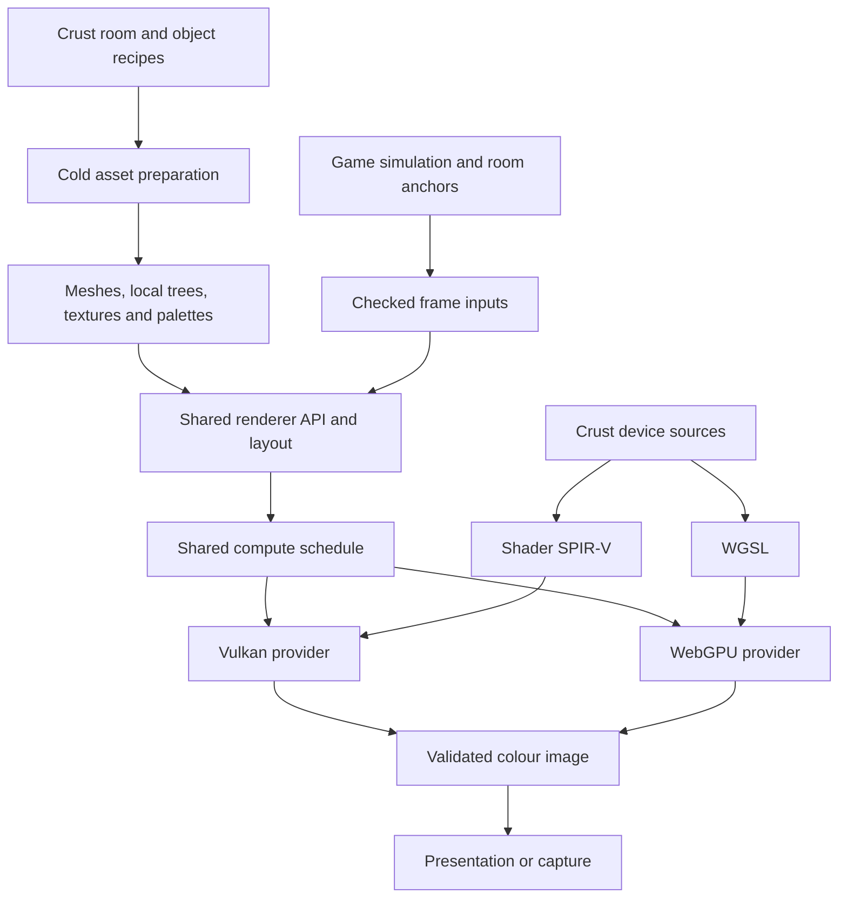
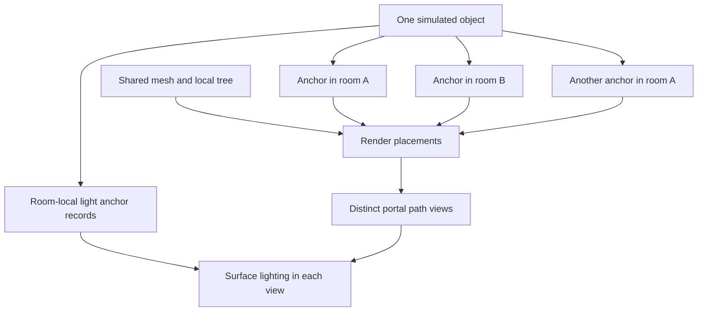
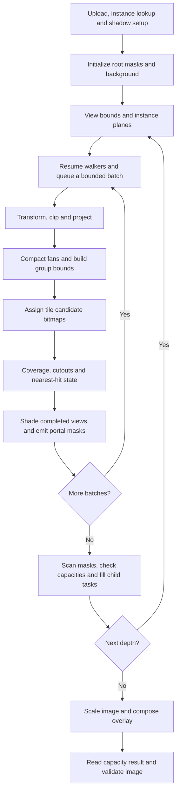
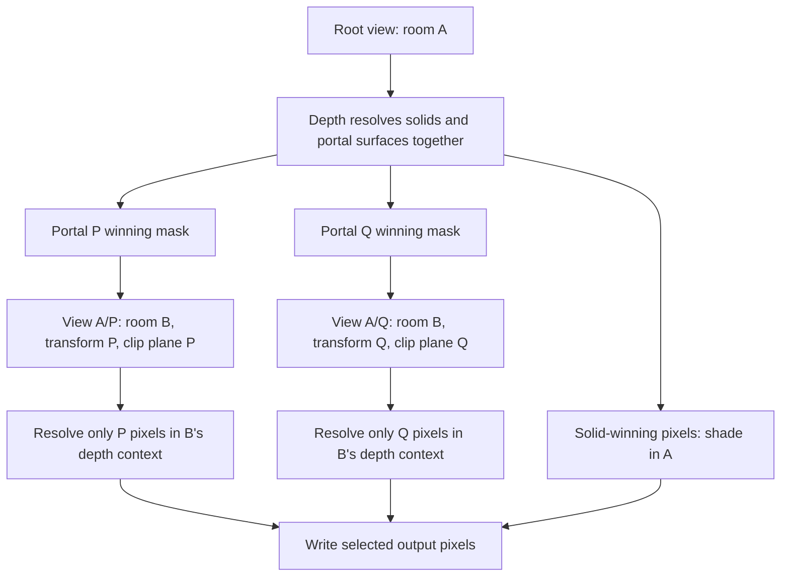
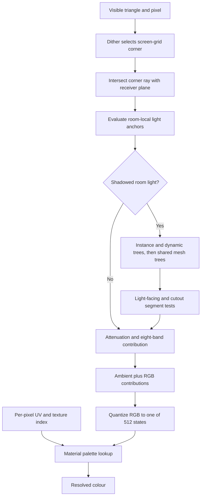
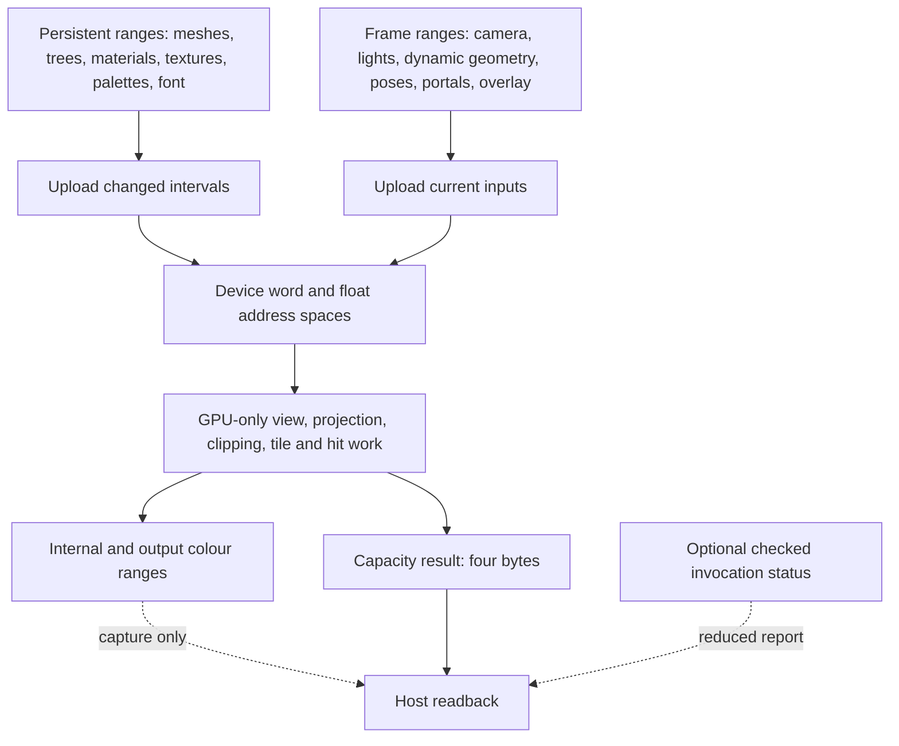
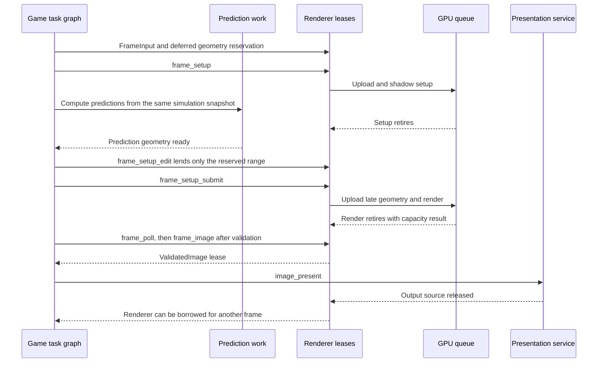
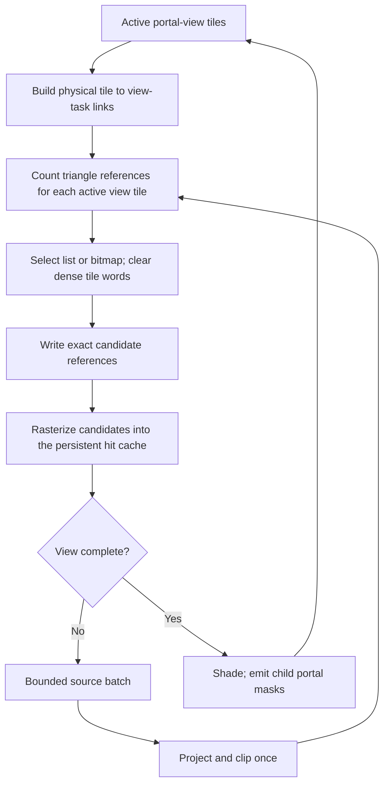
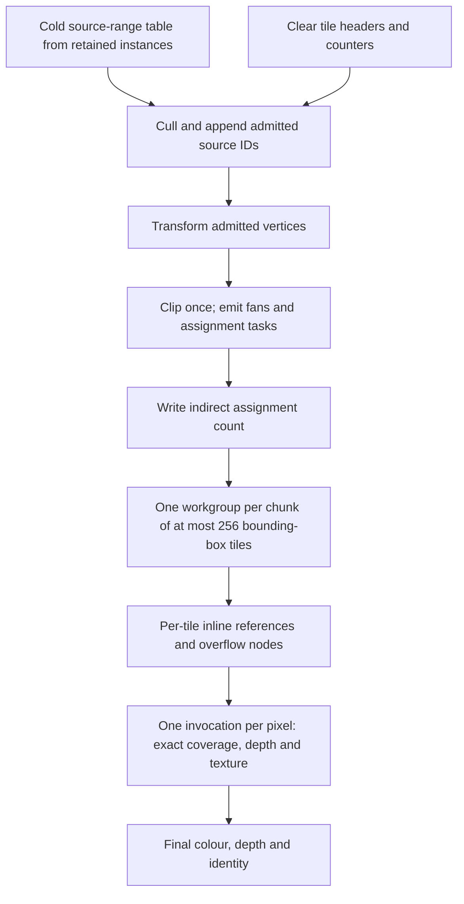

# Rendering architecture

This is the rendering reference for SPINWARD. It defines the application path,
scene and image contracts, resource ownership, and measured experiments.
The application uses GPU compute for image generation on Vulkan and WebGPU.
Crust supplies the host and device code. The rendering core has no game rules,
room recipes, input handling, animation frame numbers, or palette generator.

Related contracts: [task graph](../runtime/task-graph.md),
[scaling portals](../game/scaling-portals.md),
[parametric assets](../content/parametric-assets.md),
[room format](../content/room-format.md), [bootstrap](../build/bootstrap.md),
and [web build](../build/web.md).

## Contents

- [Architecture and status](#architecture-and-status)
- [Scene data](#scene-data)
- [Application frame data flow](#application-frame-data-flow)
- [Portal views and visibility](#portal-views-and-visibility)
- [Materials and image style](#materials-and-image-style)
- [Lighting and shadows](#lighting-and-shadows)
- [Storage and capacity](#storage-and-capacity)
- [Ownership and completion](#ownership-and-completion)
- [Backends and presentation](#backends-and-presentation)
- [Experiments and performance gates](#experiments-and-performance-gates)
- [Build, checks, and measurement](#build-checks-and-measurement)
- [Source map](#source-map)

## Architecture and status

The application keeps meshes and their spatial trees on the device. Each frame
supplies camera data, room connections, changed instance poses, dynamic
triangles, lights, and overlays. Compute traverses visible room instances,
projects geometry in bounded batches, resolves per-pixel depth, shades completed
views, and follows the winning portal pixels. Composition produces the final
colour buffer.



| Path | Status | Geometry and completion model |
| --- | --- | --- |
| Application renderer | Default | Persistent mesh trees; resumable geometry batches; tile candidate bitmaps; separate visibility and shading. |
| Tile-owned traversal | Rejected experiment | One workgroup traverses, clips, and rasterizes all geometry for its tile. Repeated setup makes it much slower. |
| Bounded tile lists | Full-featured opt-in path | Assign candidates from triangles; use lists for sparse tiles and bitmaps for dense tiles. |
| Projected-tree binning | Test-selectable experiment | Share projection, then search projected bounds per tile. Retains batch and screen-search costs. |
| Direct tile lists | Checkpoint in tests | Triangle-driven assignment produces enumerable tile references. Matches isolated images but fails the two-times hardware gate. |
| Vulkan graphics | Test reference | Hardware clipping, rasterization, interpolation, and depth for the geometry-and-texture comparison. |

The same application shader sources target Vulkan Shader SPIR-V and WGSL.
The direct tile-list and hardware graphics benchmarks currently run through
Vulkan test entry points. Their timing is not a WebGPU result.

Linux runs on Intel Arc Pro B60 and AMD Radeon PRO W7900 provide the recorded
native evidence. Windows and NVIDIA remain platform targets. Windows requires
the host ABI profile, bindings, and build linkage described in the bootstrap
contract; there is no recorded Windows or NVIDIA execution result here.

## Scene data

### Spaces, objects, and instances

A space owns local coordinates. Its ID is an unsigned 32-bit value. Interiors
and outdoor geometry use the same interface. Connections can make a world that
has no single Euclidean placement. A room ID alone cannot identify a rendered
view.

The game owns physical objects and room anchors. One object can have several
placements in the same room through different portal paths. Each placement has
its own transform; simulation state stays with the object. The game supplies
visible placements and light anchors to the renderer. Collision shares the
anchor model but remains a separate component.



`Mesh` owns generated triangles and bounds. Each vertex has XYZ and independent
UV coordinates. Triangle metadata contains a space or instance association,
material, portal ID, and flags. The first flags select cutout coverage,
one-sided coverage, and disabled shadow casting. Additional named flags in
[the shared interface](../../src/render/interface.crs) select inactive geometry,
sprites, and detail near clipping. Use those names when submitting geometry.

Call `input_mesh` or `input_mesh_slice` with a scoped `FrameInput` borrow. The
renderer copies the source and returns a `MeshRange`. The source can then be
released. The range is valid only in its originating renderer, until close or
`input_clear_meshes`, including across storage growth. Keep the range unchanged.
Mesh storage is append-only between clears.

Call `input_frame` before each frame. Submit dynamic triangles before retained
instances. Each `MeshInstance` has a mesh range, row-major 3 by 4 affine
transform, space ID, and material override. Override `0xffffffff` selects the
mesh materials. `InstanceList` owns a reusable list of placements;
`input_instances` submits it. Empty meshes are permitted. Positions, UVs,
transforms, and transformed positions must be finite.

Instance transforms support finite affine maps, including singular and mirrored
maps. Negative scale reverses winding. Portal transforms have a stricter
positive-uniform-scale contract. Keep these two contracts separate.

### Persistent geometry and invalidation

Cold mesh preparation builds a mesh-local binary tree with conservative bounds,
escape links, source triangle indices, and shadow/sprite flags. Leaves hold at
most four triangles. Visibility can accept a subtree with at most 64 triangles
as one work item. Source IDs preserve equal-depth order after spatial
partitioning. Vertex attributes currently remain separate for each triangle.

The host sorts space ranges for instances and dynamic triangles. It does not
sort every retained triangle each frame. Retained instance lookup uses offsets
independent of the dynamic prefix. Camera motion and particle count changes
preserve this lookup. The normal renderer reads local vertices through instance
transforms. An expanded triangle copy is produced for debug reference checks.

| Change | Current work and required lifetime |
| --- | --- |
| Camera or portal view | Recompute visible work using existing mesh trees. |
| Instance pose | Update its transform and bounds; preserve its mesh tree. |
| Instance mesh selection or count | Update instance lookup and space ranges. |
| Mesh upload or clear | Build the changed mesh tree and upload persistent ranges. |
| Material or palette | Upload changed asset intervals; preserve geometry. |
| Dynamic geometry count | Update the transient ranges; preserve static identities. |
| Portal connection | Upload connection data and regenerate path views. |
| Resize or buffer growth | Retire readers, replace storage, preserve live scene inputs. |

Generated room decals use room-local cutout triangles and normally disable
shadow casting. They are excluded from collision meshes by the asset system.
The application currently submits the player body as dynamic geometry. It uses
anchors for copies across room openings. Persistent moving-part instances are
an architectural option, not a completed migration of every game object.

### Sprites

`input_sprite` submits a full-bright rectangle with a room, material, centre,
width, and height. Dimensions are positive finite room distances. The transform
pass faces it toward the camera of each portal view, including scaled views.
It uses the full texture region, optional cutout, normal depth, and portal
clipping. It casts no shadow and emits no light. The application owns particle
motion, lifetime, emission, and overlap placements.

## Application frame data flow

[The shared schedule](../../src/render/host/schedule.crs) orders the following
passes. Every arrow between dependent GPU passes includes the required memory
dependency. A workgroup barrier alone cannot order separate workgroups or
dispatches.



This diagram shows logical work. The host records a conservative number of
geometry rounds from source counts, instance counts, portal connectivity, and
view capacity. GPU counts suppress inactive work. Empty recorded rounds still
have command and dependency costs.

At each portal depth, up to 64 lanes traverse disjoint mesh subtrees. Saved node,
subtree-end, and partial-leaf cursors permit continuation after a traversal
quantum or projection batch fills. Dynamic geometry shares the same nearest-hit
state. The default projection batch holds 8192 source triangles across views.
`input_batch_limit` changes the active maximum; zero restores the default.
A smaller batch increases resumptions without changing the image.

Clipping reserves up to eight fan triangles per source. Shared intersections
use the inside endpoint first. Coverage evaluates shared edges in one canonical
endpoint order, then uses direction for the sign and top-left rule. Opposite
faces must not independently round a shared edge and both reject its pixel.
Depth and UV interpolation retain their own arithmetic. Surface transparency
uses binary cutout. Blended surfaces require an explicit per-view ordering and
colour-composition contract before content can request them.

Each pixel keeps depth, stable source/fan identity, and interpolation data across
batches. Equal depths use the stable primitive key. Cutout sampling precedes
winner selection; an empty texel cannot hide a surface or portal. Opaque texture
sampling and lighting run after the view's geometry is complete. Continuing
portal winners emit masks without first shading the portal surface. At the
crossing limit, the portal material is shaded as a terminal result.

## Portal views and visibility

A directed portal has a destination space, a similarity transform, and a
destination clip plane. Translation, rotation, and positive uniform scale are
supported. Reflections are invalid. Reverse connections use inverse transforms.
The game preserves rational scale composition; shaders use the validated finite
float representation. See the scaling-portal contract for numeric bounds.

Portal IDs in triangle metadata are one-based; zero denotes a solid surface.
Records are indexed from zero. Portal metadata includes an optional reciprocal
index plus one. A declared reciprocal must lead back through the same aperture.
A child suppresses that immediate return, while other recursive paths remain
valid.



A view is identified by its portal path. Each child is keyed by parent view and
directed portal. Two views into the same space retain different transforms,
clip planes, masks, and depth contexts. A global visited-room flag would remove
valid views. A rectangle can bound traversal, but cannot replace exact coverage.

A task owns one view and one 8 by 8 tile. Two unsigned words hold its exact
64-pixel mask, including disconnected regions. Parent solids and portal
surfaces compete in one depth test. Only portal-winning pixels create children.
Child depth is resolved in the child context; it is never compared directly
with parent depth.

Clip apertures against the eye plane. An opening inside the ordinary geometry
near distance must remain visible until the camera crosses it. A portal through
the eye has zero projected area. Clip child geometry to the exact destination
plane, including its boundary. Offsetting that plane removes valid crossing
surfaces. Objects that overlap a portal need correctly transformed and clipped
placements on both sides.

`TRIANGLE_DETAIL_NEAR` selects the larger of `DETAIL_NEAR` and the normal near
plane after each view transform. This hides nearby markers while preserving
farther recursive copies. It does not change aperture clipping.

A tile writes at most 64 nonempty portal records, each with a portal ID and
64-bit mask. The first selecting pixel owns the record. Child masks partition
parent pixels, so the live task count at one depth is at most the internal
pixel count. A smaller task budget can still fail when a tile splits between
many portals. View count is a separate resource bound. Disjoint active masks
share per-pixel hit and colour storage. The renderer does not allocate a full
colour and depth image for every view.

The scene selects a finite crossing limit and terminal material. Reaching the
limit is successful termination. Task, view, or geometry work exhaustion is a
frame error. The renderer must reject that image before presentation; it must
never discard geometry or reuse previous-frame pixels to conceal failure.

## Materials and image style

### Textures and palette tables

Each source texel selects one of 256 palette entries. Final colour output has
no 256-colour restriction. Textures can have any positive dimensions allowed by
storage, including non-square and non-power-of-two regions. The current layout
stores each eight-bit index in one four-byte word.

`input_assets` selects material count and payload size. Descriptors occupy
`material_count * MATERIAL_WORDS` words at the start of the asset allocation.
Texture and palette offsets are relative to that allocation. Fill every
referenced range before drawing. `input_material` validates dimensions, stride,
ranges, palette extent, and modes. Descriptor rejection preserves the old
material. Invalid word offsets or texture indices in the checked setters trap.

| Material field | Meaning |
| --- | --- |
| `texture` | Offset of the region's top-left texel. |
| `width`, `height`, `stride` | Positive dimensions and row stride of at least the width. |
| `palette` | Offset of a complete 256 by 512 packed-colour table. |
| `style` | Perspective (0), affine (1), or short-span correction (2); bit 2 enables vertex snapping. |
| `unlit` | Select maximum light instead of scene lighting. |
| `address_u`, `address_v` | Independent repeat or clamp modes. |
| `transparent_index` | Discarded index when the triangle enables cutout. |

Materials can share palettes or atlas storage. An atlas region keeps the atlas
row stride and selects its own origin and dimensions. Addressing remains inside
that region. Nearest sampling selects indices; indices are never interpolated
as colours.

One U unit spans the region width; one V unit spans its height. Vertices accept
arbitrary finite UVs. Repeat uses `q = uv - floor(uv)`, then
`floor(q * dimension)`. Negative values wrap, and exact integers select texel
zero. Clamp maps values at or below zero to the first texel and values at or
above one to the last. The final range check handles Float32 edge rounding.
At magnitude 8,388,608 or greater, every finite Float32 value is integral; use
local UVs when fractional precision is required.

A palette occupies 512 KiB: 256 entries times 512 light states times four bytes.
Entry `c`, state `s` is at `palette + c * 512 + s`. Distance shading uses states
0 through 63. Coloured lighting uses eight levels per RGB channel, or 512 states.
Full-bright entries store the same colour at every state. No palette range is
reserved. These texels obey depth, cutouts, and portals, and emit no light.

### Dithering, resolution, and overlay

The image style combines accurate depth, indexed textures, discrete light
bands, and visible screen-space dithering. Internal resolution is configurable,
including native output resolution. Lower resolution is optional.

Lighting selects corners of a 16 by 16 internal-pixel grid. The default checker
uses alternating column and row parity, repeating a 2 by 2 pattern of corner
samples. Bayer mode uses a 4 by 4 threshold with bilinear corner weights.
Quantization occurs at the grid nodes. There is no per-pixel brightness ramp.
All views share the same screen origin and unchanged frames retain the pattern.
Nearest-neighbour enlargement preserves it.

`PROJECTION` is the positive tangent of half the vertical field of view.
Projection, light-grid rays, and the CPU reference share it. Mapping style and
vertex snapping cannot change portal connectivity. Coverage and depth use the
same snapped geometry when snapping is enabled.

Compute composition fits the internal image into the output while preserving
aspect ratio. Unused output pixels are opaque black. Exact integer scaling
handles products above 32 bits. Integer rounding can move a viewport edge by
one pixel; each viewport dimension is at least one pixel.

The optional text overlay accepts an 80 by 6 cell grid and 128 eight-row glyphs.
Zero cells are transparent. Two caller-supplied colours have opaque alpha.
`OVERLAY_SCALE` zero or one uses native eight-pixel glyphs; larger values scale
by that integer. Overlay coordinates are output pixels. The renderer supplies
no font, labels, or game status.

The visual reference is ship3d's combined palette and coarse light sampling.
Its six-bit colour and light indices are historical reference values. SPINWARD
uses the explicit table contract above. Source references:
[palette](https://github.com/hardcode84/ship3d/blob/fff58ad70d101859e3498b2ed0d910cd9f5721a5/ship3d/ship3d/game/renderer/palette.d#L95-L132)
and [light sampling](https://github.com/hardcode84/ship3d/blob/fff58ad70d101859e3498b2ed0d910cd9f5721a5/ship3d/ship3d/game/renderer/rasterizerhybrid2.d#L275-L366).
The independent renderer reference defines correctness; ship3d does not provide
a general depth oracle.

## Lighting and shadows

The renderer derives one normal per triangle from transformed positions.
The visible surface normal faces the camera. One-sided camera rejection and
light-facing shadow rejection use separate directions. Curved assets retain
their geometric facets.

For a point light, with distance `d` and radius `R`:

`amount = sqrt(max(dot(unit_normal, unit_to_light), 0)) / (1 + d/R)^2`

Headlamps and the camera lamp use the Lambert angle term without the square
root. Each light's peak RGB intensity scales its contribution. Truncate the
contribution to one of eight bands before adding lights, preserving the RGB
ratios. Values below the first band are exactly zero. Ambient light is then
part of the final quantized RGB state. Full-bright palette entries bypass its
visual effect.



The grid corner is projected onto the receiving triangle plane and can lie
outside the triangle. Coverage, depth, and texture lookup remain per-pixel.
A parallel ray or intersection behind the camera contributes only the allowed
ambient/unlit result. Room-light shadows use the same grid corner as intensity.
Current shading repeats this evaluation per pixel; it has no distinct-sample
lighting cache.

### Light records and propagation

`input_lights` selects the active count and reserves storage. Fill all active
records and call `input_light_space` for their unsigned 32-bit room IDs.
`LIGHT_DATA` addresses eight-float records: XYZ, radius squared, non-negative
RGB intensity, and mode. `LIGHT_SPACE` addresses a separate word array. Zero
radius disables a light. Storage grows from an initial reservation of 32;
there is no fixed light-count limit. Invalid counts, non-finite or negative
values, and unsupported modes reject submission.

| Mode | Position and visibility |
| --- | --- |
| `LIGHT_ROOM` | Room-local; shadow query against that room. |
| `LIGHT_VIEW` | View-relative; intended for camera-space effects. |
| `LIGHT_UNSHADOWED` | Room-local; no shadow query, used by the hook. |
| `LIGHT_HEADLAMP` | Room-local; Lambert response and no shadow query, used by the player. |

The separate `CAMERA_LIGHT` input is view-relative. Physical game lamps use
room anchors so camera motion cannot move their sources. The game propagates
anchors through apertures within light range and the frame crossing limit.
It requires the source to be inside the outgoing plane and suppresses the
immediate reverse link. Different paths may create anchors in the same room.
Scaled connections transform positions and ranges according to the shared
scale contract. Fixed lamps remain shadowed in each anchor's room. Hook and
player light cross connections without prop occlusion.

`SPACE_LIGHT` supplies ambient RGB. `SHARED_AMBIENT=1` uses one ambient value
for all room IDs. Zero selects the bounded per-space ambient table and requires
IDs within it. This does not restrict room IDs in geometry or light records.

### Shadow acceleration and exclusions

Room lights use per-frame trees over matching instances and dynamic casters.
Queries then use the persistent mesh-local trees. Escape links bound traversal
without a fixed-depth stack. Leaves hold at most four candidates. Independent
nodes build by depth with compute barriers between levels. Mesh trees survive
camera, light, pose, and dynamic-count changes. Bounds are transformed for the
query without requiring an invertible instance transform.

A blocker must face the light unless it is two-sided. A cutout blocks only at
opaque texture samples. Full-bright texels can block like other opaque texels.
The receiver triangle is excluded. Segment fractions at or below 0.00001 and
at or above 0.99999 are excluded as endpoint contact; these intervals scale with
segment length and constrain placement of separate blockers.

The game marks hooks, tethers, predictions, and convex room shells as non-shadow
casters. Interior props still cast shadows. A convex shell cannot block a segment
between interior points. Excluding it also prevents a grid sample outside a face
from seeing a false blocker at an adjacent shell face. These exclusions do not
change collision or camera visibility.

## Storage and capacity

### Shared layout and uploads

[The interface](../../src/render/interface.crs) defines offsets into counted
four-byte word and float bindings. Host native record layout is not the shader
ABI. [The layout planner](../../src/render/host/geometry.crs) calculates sizes
with wide arithmetic and checks each range against device storage limits.

The Vulkan provider owns a device buffer and coherent, cached staging memory.
WebGPU uses WebAssembly staging memory and explicit transfers. Staging reserves
the same word/float offsets as device storage, including scratch ranges; reserved
bytes are not all live asset bytes. Checked invocation status exists only on
the device.



Identical asset writes do not mark dirty intervals. A successful draw uploads
changed ranges once. Unchanged meshes, materials, instances, and fonts are not
uploaded again. Buffer replacement marks persistent ranges for upload into the
new allocation. Normal window rendering reads no image pixels and reads no
visibility counts to control subsequent GPU work.

### Independent bounds

| Capacity | Meaning and failure rule |
| --- | --- |
| Source geometry, meshes, instances, assets, lights | Grow from demand up to device range and allocation limits. Preserve input on rejected growth. |
| Projection batch | Reusable source-triangle scratch; continuation handles remaining geometry. |
| `portal_budget` | Directed portal records; zero is valid. |
| `view_budget` | Total path views including root; positive. Exhaustion rejects the frame. |
| `task_budget` | Masked tiles at one depth; positive. Exhaustion rejects the frame. |
| `crossing_limit` | Finite path depth; zero renders only the root and terminal portals. |
| Internal/output extents | Positive, within window-coordinate, address, device-range, and allocation bounds. |

Portal/view/task/depth configuration controls allocation and command recording.
A frame can select a smaller crossing limit. Root input cannot raise it beyond
the configured limit. Resize can increase task capacity to fit the root tiles.
Other configuration changes require a new renderer.

Image passes use bounded dispatches with at most 2,097,152 invocations and stride
across larger images. Portal task dispatches use batches of at most 32,768 tiles.
These are dispatch sizes, not image or scene limits. The complete root tile set
must fit the task reservation. Every dispatched group reaches required barriers,
including inactive edge lanes.

Let `P`, `V`, `T`, `B`, `I`, and `L` denote portal, view, task, projection-source,
instance, and light capacities. Significant storage terms are:

| Range | Size |
| --- | --- |
| Portal and view transforms | `17 * (P + V)` floats, including uniform scale. |
| Two task lists | `8 * T` words. |
| Child mask records and counts | `193 * T` words. |
| Child view lookup | `V * P` words. |
| Group key bitsets | `ceil(T / 64) * ceil(V * P / 32)` words. |
| Task indirect commands | `12 * ceil(T / 32768)` words. |
| Tile candidate lists or bits | `T * ceil(B * 8 / 32)` words. |
| Tile heads, task links, reference counts and cursors | `4 * T` words. |
| Instance visibility and culling planes | `I * V` words and `48 * I * V` floats. |
| Retained source pool | 176 bytes per triangle for vertices, metadata, spatial index, and tree. |
| Instance records | 92 bytes each. |
| Shadow storage | `84 * ((L + 1) * G + L * I)` bytes for reserved triangle capacity `G`. |
| Timestamp queries | `4 + 2 * (crossing_limit + 1)` entries. |

These are selected terms, not a complete allocation formula. Header, overlay,
image, hit, compact, cursor, and prefix ranges add storage. Use the layout
planner and reported allocation sizes for totals. Large products such as
`V * P`, `I * V`, and tile bitmaps can dominate memory even with bounded batches.

### Trust and errors

Public input and platform boundaries validate finite values, extents, indices,
capabilities, tools, and allocation results. Internal passes consume verified
producer state. Raw production shaders require initialized ranges and valid
arithmetic; they do not repeat public validation in pixel loops. There is no
external asset parser or CPU rendering fallback.

`SHADER_RAW` uses word and float bindings without compiler invocation status.
`--debug-shaders 1` selects matching checked modules. Debug mode keeps an 8 MiB
status buffer, reduces it to 4 KiB of reports, and preserves failures across
passes. It reports the first failed invocation, counts, and status bits.
Capture alone does not enable checked shaders.

The four-byte normal readback is the runtime capacity result. GPU visibility
determines capacity demand, so this result cannot be replaced by a host count.
It rejects incomplete frames independently of shader debug checks. A later
valid frame resets traversal and can recover on the same renderer. Allocation,
IO, submission, and device failures remain explicit errors.

## Ownership and completion

`Renderer` is an owned, noncopyable resource. `renderer_inputs` lends a mutable
`FrameInput`. No draw, resize, destruction, or conflicting access can overlap
that borrow. Growth and draw can replace storage; release borrows and acquire
mapped addresses again afterward. Shader byte ranges can be released after
pipeline creation. The renderer owns an accepted native surface; the application
keeps its window alive until renderer destruction.

The synchronous `renderer_draw` waits for rendering and selected readback.
The game's default task path uses asynchronous operations with one GPU frame
in flight. `--serial` selects the synchronous loop. Native completion uses a
dedicated service; browser completion uses promises. Game code sees neither
pthread objects nor Vulkan synchronization handles.



`input_defer` reserves inactive, non-shadow-casting dynamic slots before retained
instances. Setup admits the reservation before submission. `DeferredInput`
permits one bounded write after setup retirement, for non-portal,
non-shadow-casting triangles. It cannot grow storage. Scope exit restores the
complete scene count. The second submission reuses staging and commands only
after setup retires and preserves the first submission's timestamps.

`SubmittedFrame` holds the exclusive renderer loan until retirement and
validation. `frame_poll` returns pending, success, or failure. `frame_image`
requires success and returns a `ValidatedImage`. `Presentation` holds that
image until the provider releases the source. Dropping pending operations drains
accepted work. A released source is not proof of display scanout. A hidden
browser surface can discard an unsubmitted copy with an explicit completion
status.

Storage replacement waits for readers, allocates the new storage before freeing
the old, preserves inputs, and updates descriptors. Peak memory includes both
allocations. Rejected planning or allocation preserves the active allocation.
Command or swapchain failure stops submission and the caller closes the renderer.
Shutdown also waits for presentation use before releasing its resources.

## Backends and presentation

The native renderer consumes compute Shader SPIR-V validated for Vulkan 1.2.
The current device profile requires `shaderInt8`, Float32 round-to-nearest-even
and signed-zero/Inf/NaN preservation, at least three storage bindings, storage
offset alignment no greater than 256 bytes, 64-lane workgroups, sufficient X
dispatch capacity, and at least 2 KiB of shared memory for the application raster
pass. Optional experiment kernels can require more shared storage. No path
assumes that 64 lanes form one subgroup. The portable contract needs neither
hardware ray tracing, mesh shaders, nor 64-bit atomics.

The native provider writes an output buffer, then transfers it into the acquired
swapchain image. It requires transfer-destination support, opaque alpha, and
RGBA8 or BGRA8 UNORM in the supported SRGB nonlinear colour space. It reports
unsupported surface capabilities. Direct storage writes into swapchain images
are not the implemented presentation path.

WebGPU uses the same layout, schedule, and shader algorithms through its own
resource and command provider. Its canvas presentation and asynchronous mapping
stay below the shared API. See the web build contract for browser requirements,
packaging, and deployment. Compiler acceptance alone does not establish matching
browser images or latency.

`renderer_set_extent` changes internal and output dimensions without a live
input borrow. It preserves assets, geometry, instances, lights, and camera data.
Output changes do not force internal resolution changes. The application checks
the drawable size before presentation. A zero-size or minimized surface suspends
drawing; restoration prepares a valid swapchain. Out-of-date acquisition or
presentation requests replacement. Suboptimal presentation completes and requests
replacement for the next draw. Pending replacement cannot present an old image
as a successful new frame.

Native swapchain replacement waits for completion and destroys the old swapchain
before creating its replacement. Buffer-allocation rollback does not imply that
a retired swapchain can be restored. Colour alpha stays opaque and nearest
scaling preserves palette values. Display compositor and scanout behaviour are
outside the image contract.

## Experiments and performance gates

### Measured failure mechanisms

The group-scan reference visits projected groups for every active tile. Each
pixel then searches a dense candidate bitmap. Spatial culling alone leaves
these screen-area multipliers. Tile-list assignment removes full group scans
and uses direct lists for sparse tiles. Conservative global batch
rounds also retain dispatch and barrier costs when indirect work is empty.
An indirect dispatch cannot create another producer/consumer dispatch sequence.
Cross-workgroup spinning has no portable forward-progress guarantee.

Current lighting selects a coarse grid sample per pixel but still repeats the
normal, plane, light-list, and shadow work. A possible exact reuse key is
`(view, receiver triangle, grid corner)`. Sharing by an authored plane ID would
first require canonical plane arithmetic and receiver-exclusion semantics.
A matching plane label alone does not establish equal results.

The tile-owned experiment duplicated transforms and clipping across small tiles,
with sparse eight-slot chunks and repeated synchronization. Generic fixes for
workgroup-only barriers and inside-plane clipping reduced its cost, but did not
make it competitive. The projected-tree experiment shared setup but retained
tile searches and pixel bitmap scans. Neither passed the production gate.

The course geometry was also reduced from 117,110 to 81,998 source triangles by
using octagonal pipes, then to 43,342 through bend and straight-run cleanup.
These are different content versions. Compare renderer variants within each
version. Triangle reduction does not establish that the scheduling design meets
its frame budget.

### Bounded tile lists for complete frames

Use `crust main.crs --tile-lists` or
`crust demo.crs levels/prefabs.crs --tile-lists` to select triangle-driven
candidate assignment. The web setup has a **Tile-list renderer** option.
The render regression runner tests this path by default.
`SPINWARD_TILE_LIST=1` selects it in the course benchmark.
`SPINWARD_REFERENCE=1` selects the previous binning path for the scene regression
cases, including `render 7`.
The tile-list path shares the retained scene, batch planner, projection, hit
cache, shading, portal traversal, and presentation with the group-scan reference. It supports dynamic triangles, sprites, scaled portal
views, material mapping modes, lighting, shadows, and output scaling.
The shader build selects the candidate format for each raster entry point.
Both entry points use shared raster source. No per-pixel renderer selector is
needed.



The tile map has one head per physical tile and one link per active task.
Each task has a unique `(view, tile)` pair. Each nonempty task owns at least one
pixel in that tile. Distinct task masks do not overlap. Thus, a physical tile
has at most 64 task links, including recursive views of the same room.
A compute barrier publishes links before triangle assignment starts.

Each projected fan visits tiles in its screen bounding rectangle, intersected
with the active view rectangle. It applies the shared triangle-tile coverage test and finds the task with its view ID.
The count pass and the write pass use the same predicate. A tile with at most
`tile_bit_stride()` references stores a direct list of fan IDs. A tile with more
references stores a bitmap of the batch fan slots. The count selects the
representation; neither representation can overflow its allocation. A compute
barrier separates counts, dense clears, writes, and rasterization. Atomic OR
combines bitmap bits. Atomic add reserves list entries. Equal-depth fragments
use the shared source-identity tie rule, independent of insertion order.

The four existing tile-stat words hold the tile head, task link, reference
count, and list cursor. The candidate region keeps its existing allocation.
The source batch and portal work continue through the existing planner. The
static checkpoint's inline-list pool and assignment queue limits do not apply.
One workgroup visits a fan's tiles in parallel. Large dispatches use a fixed
workgroup stride; they do not truncate fan counts.

The [full-frame comparison](tile-list-full.csv) uses the prefab course on Intel
Arc Pro B60, eight warm-up frames, and 64 measured frames per case. It includes
lighting, shadows, dynamic geometry, and recursive portals. All six tile-list
captures match the group-scan reference byte for byte. Device and staging
allocations are equal. The rotor scenes improve, but the passage regresses.
The measured 1080p GPU p99 values exceed the 10 ms gate. The application default
therefore remains the group-scan renderer.

The regression suite checks tiny geometry batches, recursive masks, cutouts,
lighting, retained storage, and image resize through the tile-list path.
Hook-light, body-view, scaling, and particle fixtures also select it explicitly.
Crust tests execute atomic OR for SPIR-V and WGSL, including repeated bits,
returned values, invalid indices, and failed invocations.

### Direct tile-list checkpoint

This test uses real retained room meshes, transforms, materials, and textures.
It isolates a static root room with full-bright perspective mapping. Portal
surfaces are terminal at zero crossings. It excludes dynamic geometry, lights,
shadows, UI, presentation, and simulation. These exclusions match the hardware
reference workload.



Each tile has 32 inline references by default. Further references use a shared
two-word node pool. Atomic exchange links unique node allocations to tile heads.
A dispatch barrier makes heads and node contents visible before rasterization.
The shader skips no candidate because a list is full.

The experiment allocates no extra device or staging buffers. It reuses batch
IDs for two-word source ranges, primitive scratch for admitted IDs, compact
scratch for material data and assignment tasks, clipping scratch for tile
bounds, and bitmap scratch for inline lists and overflow nodes. Hit and debug
ranges hold contiguous depth and identity. The final pixel is written directly,
so this isolated path needs no separate pixel clear or composition pass.

Projection, assignment queue, and node pool exhaustion reject the image.
The pool allocation counter is clamped at capacity on failure. Its capacity
plus concurrently active allocations cannot wrap the unsigned word counter.
This experiment also requires at most 32,768 eight-by-eight tiles and source
ranges that fit its dispatch and scratch bounds. The full-featured path above
uses the shared batch planner and bounded list/bitmap storage to handle
arbitrary input sizes and portal views. That storage replaces the finite node pool.

The [checkpoint CSV](scatter-raster.csv) contains paired runs on Intel Arc Pro
B60, with eight warm-up frames and 128 measured frames. All six direct-list
captures match normal compute byte for byte. Complete GPU times in milliseconds:

| Room | Resolution | Normal p50 | Tile lists p50 / p99 | Hardware p50 / p99 |
| --- | --- | ---: | ---: | ---: |
| Passage | 1920 by 1080 | 4.284 | 0.268 / 0.291 | 0.096 / 0.097 |
| Shaft | 1920 by 1080 | 7.436 | 0.390 / 0.397 | 0.150 / 0.166 |
| Hub | 1920 by 1080 | 9.483 | 0.394 / 0.399 | 0.165 / 0.167 |
| Passage | 1024 by 768 | 2.109 | 0.149 / 0.150 | 0.045 / 0.045 |
| Shaft | 1024 by 768 | 3.563 | 0.310 / 0.317 | 0.074 / 0.074 |
| Hub | 1024 by 768 | 4.660 | 0.243 / 0.248 | 0.093 / 0.094 |

P50 is 2.39 to 4.19 times hardware. The two-times gate fails. This checkpoint
has no application consumer and makes no full-game frame-rate claim.

A representative hub capture spends about 0.013 ms clearing tiles, 0.089 ms in
culling/projection/clipping, 0.039 ms assigning references, and 0.258 ms in
rasterization/texturing. These are single-frame stage intervals, not percentile
components. The inspected raster shader has no register spills.

Chunking large-triangle assignment reduced passage assignment from about
0.49 ms to 0.03 ms. Removing a shared error-word atomic from every assignment
lane reduced hub assignment from about 0.26 ms to 0.04 ms. Explicit exhaustion
handling remains. The checkpoint rejects shared candidate staging, multiple
pixels per lane, extra edge precomputation, full-tile flags, split shading,
smaller tiles, fused setup, and an extra clipping fast path because their paired
results did not improve the complete workload. Full linked lists increased
allocation contention. Do not restore these variants without a new witness.

Hardware graphics uses the same storage-buffer textures and palettes, with
hardware clipping, rasterization, interpolation, and depth. Its images can
differ at subpixel edges, equal-depth ties, and nearest-texel boundaries. The
[original hardware comparison](geometry-raster.csv) records image differences;
these must be investigated rather than hidden by a wider tolerance.

### Acceptance and next proof

The isolated geometry-and-texture gate requires compute complete GPU p50 and
p99 no greater than twice hardware in every recorded room and resolution.
Include all warm setup, scratch clears, assignment, rasterization, texturing,
and composition. Exclude cold preparation, capture, and presentation equally.
Report submission time and peak memory separately.

A replacement must also prove the complete application
ownership path and final moving image: recursive and scaled portal masks,
cutouts, equal-depth ties, near-eye crossings, sprites, room shadows, portable
lights, anchors, resize, and storage retirement. Small work capacities must
finish through continuation. Unreachable rooms must not add triangle work;
transient counts must not invalidate static geometry. Preserve resolution,
geometry, lighting, depth budget, and input-to-display behaviour.

The full-game targets at 1920 by 1080 on the measured Intel device are GPU p99
at most 10 ms and complete non-pacing frame p99 at most 12 ms. The 16.67 ms
interval is the display deadline. Measure frame maxima, presentation misses,
and input timing on long moving routes after warm-up. Stationary 128-frame
probes locate costs; they do not establish steady presented-frame latency.

Keep the application default unchanged until these gates pass. Build a bounded
experiment around a named cost and stop condition before adding another layer.
Remaining contracts include persistent room membership, exact indexed vertex
reuse across UV seams, separation of dynamic/shadow capacity from total scene
capacity. Their implementation
requires final-image and whole-frame evidence, not only synthetic tests.

### Evidence index

The CSV files preserve separate experiments. They are not interchangeable
baselines. Old content and shader versions explain different triangle counts
and timings. Git preserves the full superseded narrative.

| Evidence | Scope and interpretation |
| --- | --- |
| [Full-frame tile lists](tile-list-full.csv) | Exact captures with complete rendering features; rotor gains and a passage regression; equal allocation. |
| [Retained visibility](retained-visibility-results.csv) | Twelve paired stationary poses; persistent trees remove warm expansion and mesh upload, but fail full-frame timing. |
| [Architecture cost probes](architecture-cost-probes.csv) | Lighting and zero-workgroup controls; invalid-output diagnostics are cost probes only. The course has unshadowed portable lamps, so its room-shadow bypass is a negative control. |
| [Tile cost probes](tile-cost-probes.csv) | Workgroup fence scope, repeated setup, sparse chunks, and clipping-copy costs in the rejected tile-owned kernel. |
| [Projected tree](projected-proof.csv) | Exact paired images, unchanged allocation, insufficient full-renderer speedup. |
| [Octagonal pipes](octagonal-pipes.csv) | Twelve-sided versus eight-sided content, paired normal and projected renderers. |
| [Pipe cleanup](pipe-cleanup.csv) | Bend subdivision and collinear-span cleanup; same renderer pair. |
| [Hardware geometry](geometry-raster.csv) | Isolated root geometry and textures, with image-difference measurements. |
| [Direct tile lists](scatter-raster.csv) | Latest isolated checkpoint; complete GPU and submission percentiles for four paths. |

Earlier transfer checks reduced an unchanged 320 by 180 fixture upload from
589,992 to 1,496 bytes and readback from 8,388,940 to four bytes. Shared shadow
trees also removed per-light retained-triangle rebuilding. These are bounded
historical cost witnesses; they do not establish rotor-course frame time.

Research references retained from the architecture review:
[Laine and Karras software rasterization](https://research.nvidia.com/sites/default/files/pubs/2011-08_High-Performance-Software-Rasterization/laine2011hpg_paper.pdf),
[the Visibility Buffer](https://www.jcgt.org/published/0002/02/04/), and
[Aila and Laine traversal efficiency](https://research.nvidia.com/publication/2009-08_understanding-efficiency-ray-traversal-gpus).
Their algorithms motivate experiments; their hardware assumptions and timings
do not prove performance for this renderer.

## Build, checks, and measurement

Bootstrap Crust from the host C compiler as described in the build contract.
Native roots require the host toolchain, SDL2, Vulkan loader, LLVM with SPIR-V,
and SPIRV-Tools. Use `LLVM_DIRECTORY` and `SPIRV_VAL`, or the documented links
under `build/toolchain/`. The root builds host and shader code. Missing tools
report errors. Game, demo, and viewer builds exclude test fixtures and the CPU
reference.

```sh
crust main.crs --build-only
crust main.crs --web
crust demo.crs levels/prefabs.crs --width 1280 --height 960
crust viewer.crs assets/rooms/rotor-hub.crs
crust tests.crs
```

The interactive demo uses game flight, tether, and input code. Capture runs one
simulation tick by default; `--ticks N` changes it. The automatic 1200-frame
interior/outdoor route lives in renderer tests. Its frame indices and playback
options are fixture policy:

```sh
crust tests.crs render 0 --frame 360 --capture build/outdoor.ppm --width 1920 --height 1080
crust tests.crs render 4 --dither 0
crust tests.crs render 4 --dither 1
crust tests.crs render 0 --frames 1200 --width 640 --height 360 --capture build/tour.ppm
```

The fixture accepts mapping modes 0/1/2, vertex snapping 0/1, independent internal
and output dimensions, debug pixel capture, view budgets, and fault injection.
CPU reference image checks use perspective mapping with snapping disabled.
Capture files are binary RGB PPM. `--baseline 1` selects the full projected-slot
scan control while preserving portal masks.

| Check | Coverage |
| --- | --- |
| `crust tests.crs ownership` | Renderer resources, input borrows, resize, frame and presentation loans. |
| `crust tests.crs render 1` | Exact palette values, more than 256 output colours, channel order, scaling and overlay. |
| `crust tests.crs render 2` | Independent ray reference for portal crossings, hidden portals, cutouts, clipping and fan seams. |
| `crust tests.crs render 3` | Automatic playback input, pause, step, quit and Escape. |
| `crust tests.crs render 4` | Lighting grid, dark cutoff, full-bright texels, camera light and faceted pipes. |
| `crust tests.crs render 5` | Geometry growth, shrink, empty scenes, 4097 overlapping triangles, ties and allocation rejection. |
| `crust tests.crs render 6` | Arbitrary texture dimensions, atlas stride, shared palettes, UV seams, repeat/clamp and invalid descriptors. |
| `crust tests.crs render 7` | Retained transformed views, culling control and seven-triangle batches. |
| `crust tests.crs render 8` | Many portal paths, 64 portals in one tile, deep cycles, 65,536 tasks, exhaustion and recovery. |
| `crust tests.crs render 9` | Resize, portrait/landscape/4K/wide images, exact scaling and storage rejection. |
| `crust tests.crs render 10` | Real window resize and swapchain replacement; requires a display. |
| `crust tests.crs render 11` | Growable lights, cutout blockers, light-facing rejection, retained shadows and portable-light propagation. |
| `crust tests.crs render 12` | Dirty uploads, four-byte readback, debug reduction and retirement. |
| `crust tests.crs hook-light` | Recursive light anchors, attached-hook lighting and solid inside/outside faces. |
| `crust tests.crs body-view` | Player-body images through portals. |
| `crust tests.crs scaling` | Scaled portal geometry, prediction and propagated lights. |
| `crust tests.crs particles` | Impact particles, billboard orientation, scale and cutout. |
| `crust tests.crs viewer` | Retained instances and unchanged-mesh upload checks. |

The CPU reference is independent ray/triangle code. It has explicit rules for
outer borders, source-triangle edges, texture boundaries, and calculated light
thresholds. Internal fan seams retain source identity and remain checked.
Driver Float32 results are not assumed byte-identical to the reference.
Control-versus-experiment captures require exact equality where specified.
Never increase a tolerance to approve a faster implementation.

Use fixed camera and animation inputs, device/driver, geometry, resolution,
portal budget, and build mode. Warm pipelines. Keep the GPU otherwise idle.
Read diagnostics after timed work. GPU stage intervals, complete GPU percentiles,
CPU submission, synchronous frame time, readback, and presentation are different
metrics. Subtracting unrelated percentiles does not measure a stage cost.

The course benchmark uses recipe spawn pose zero or a numbered portal-facing
pose. It defaults to eight warm-up and 128 measured frames:

```sh
crust tests.crs course-benchmark levels/prefabs.crs 11 0 --width 1920 --height 1080 --capture build/hub.ppm
crust tests.crs benchmark 1024 768 --lit-rooms --width 1024 --height 768
```

The course reports synchronous frame and GPU percentiles, excluding presentation
and pixel capture. A separate diagnostic frame records hierarchy work and an
image. The graph benchmark samples fixed room positions rather than a playthrough.
Its first two numbers select output dimensions; explicit `--width` and `--height`
select internal dimensions.

To compare all four isolated geometry paths:

```sh
crust tests.crs course-benchmark levels/prefabs.crs --build-only
SPINWARD_GEOMETRY_PROOF=1 build/course-benchmark 11 0 --samples 128 --width 1920 --height 1080
```

Use rooms 1, 10, and 11 at both 1920 by 1080 and 1024 by 768. Set
`VK_DRIVER_FILES` to select a device. Preserve `build/geometry-compute.ppm`,
`build/geometry-projected.ppm`, `build/geometry-scatter.ppm`, and
`build/geometry-graphics.ppm` before the next case. Cold upload and pipeline
creation stay outside the timed interval. Complete GPU timing includes warm
render work through final colour output, before capture readback.

`SPINWARD_SCATTER_INLINE=1` exercises node overflow lists.
`SPINWARD_SCATTER_NODES=0` with that setting forces explicit pool exhaustion.
The checkpoint passed those cases, AMD hub image comparison, and Vulkan
synchronization validation. Generic Crust atomic tests cover SPIR-V and WGSL
storage/workgroup operations, invalid indices, and failed invocations.

For the older whole-renderer experiments, use `SPINWARD_PROJECTED_PROOF=1` or
`SPINWARD_TILE_PROOF=1` with the course benchmark or `crust tests.crs render 7`.
Do not select both. Short rejection probes do not establish tail latency.
For native instruction inspection, disable the shader cache and match driver
dumps to pipeline creation order. Driver cycle estimates are not GPU timings.

## Source map

| Source | Responsibility |
| --- | --- |
| [Shared interface](../../src/render/interface.crs) | Header fields, flags and shader constants. |
| [Renderer owner](../../src/render/host/owner.crs) | Checked renderer and input ownership. |
| [Frame API](../../src/render/api/frame.crs), [split setup](../../src/render/api/setup.crs) | Submitted frames, validated images, presentation and deferred input. |
| [Geometry layout](../../src/render/host/geometry.crs), [image storage](../../src/render/host/image.crs) | Capacity planning and replacement. |
| [Retained storage](../../src/render/host/retained.crs), [mesh trees](../../src/render/host/mesh-tree.crs) | Mesh and instance lifetime, local spatial data. |
| [Projection scheduling](../../src/render/host/projection.crs), [command schedule](../../src/render/host/schedule.crs) | Space membership, conservative work bounds and ordered passes. |
| [Transfers](../../src/render/host/transfers.crs), [completion](../../src/render/host/completion.crs) | Dirty ranges, selected readback and retirement. |
| [Tile assignment](../../src/render/device/tile-list.crs) | View-task links, exact reference counts, bounded list and bitmap writes. |
| [Device shaders](../../src/render/device/) | Visibility, clipping, rasterization, light queries and composition. |
| [Native presentation](../../src/render/host/present.crs), [WebGPU provider](../../src/render/web/) | Platform resources, commands and presentation. |
| [Shader build](../../tools/build/shaders.crs) | Shared source assembly and backend compilation. |
| [Direct-list experiment](../../tests/render/scatter/), [graphics reference](../../tests/render/graphics/) | Isolated performance comparison. |
| [Room anchors](../../src/spatial/), [game view](../../src/game/view/) | Application placements, lights, body and effects submission. |

Shader compiler details remain in [the compiler contract](../build/crust-spirv.md).
Runtime scheduling policy remains in the task-graph document. Room construction
and physics belong to their component documents. This reference owns rendering
behaviour and the boundary between those components.
