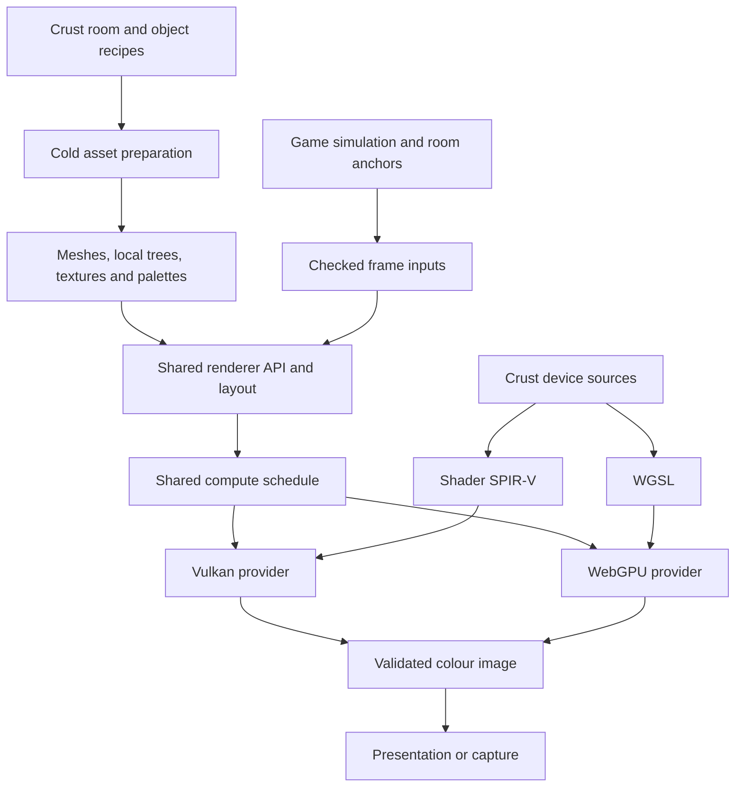
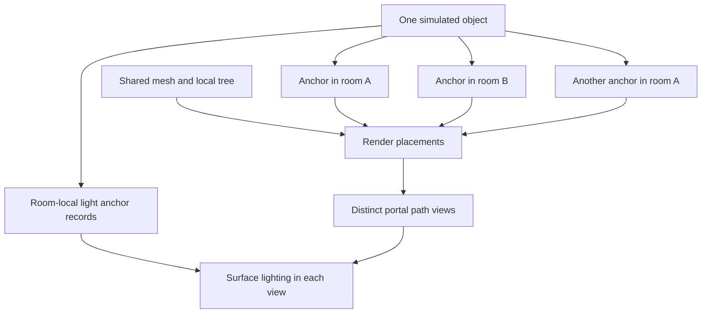
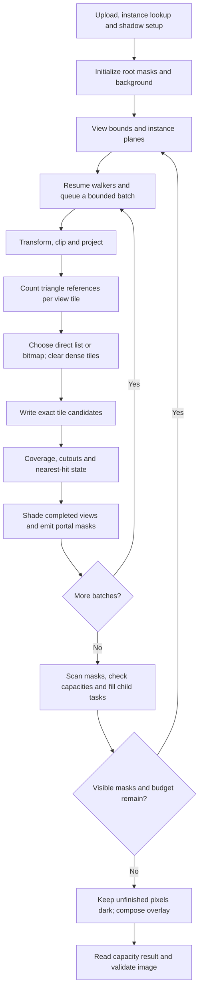
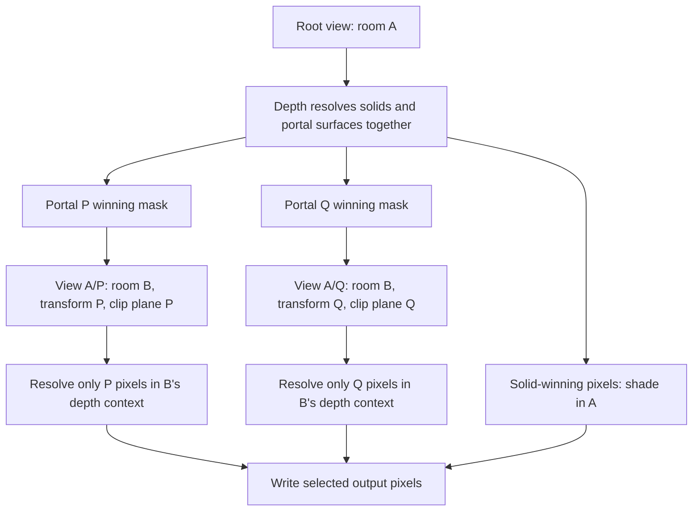
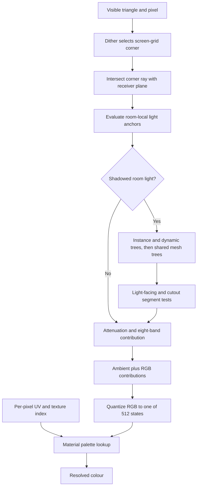
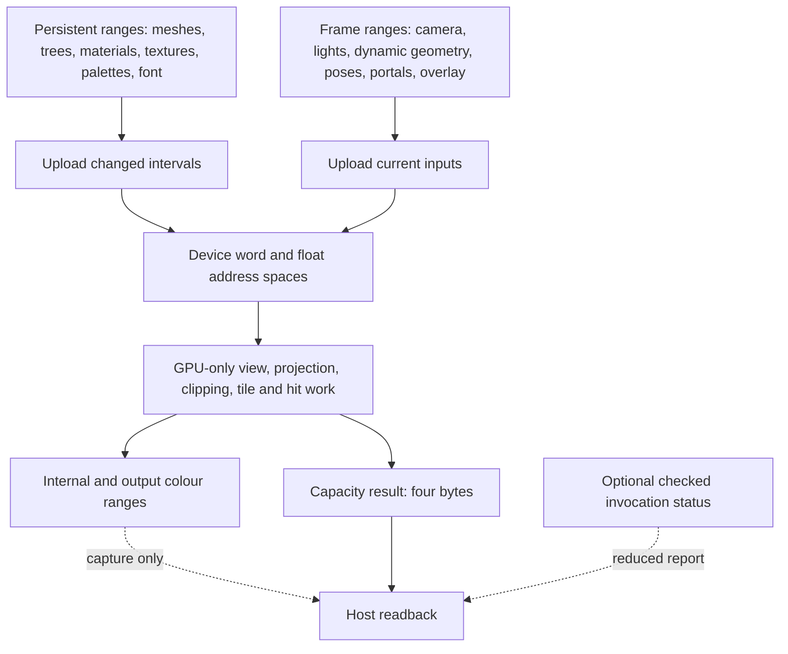
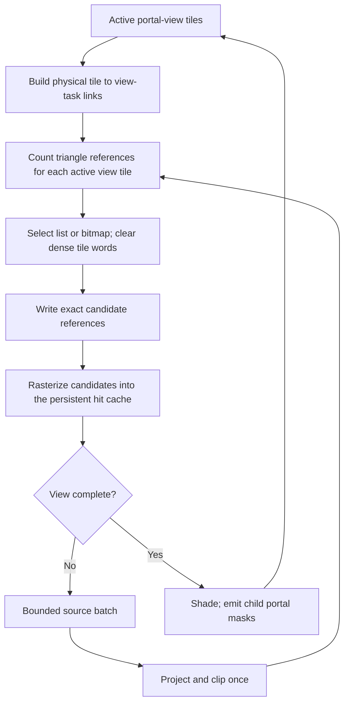

# Rendering architecture

This is the rendering reference for SPINWARD. It defines the application path,
scene and image contracts, resource ownership, and measured experiments.
The application uses GPU compute for image generation on Vulkan and WebGPU.
Crust supplies the host and device code. The rendering core has no game rules,
room recipes, input handling, animation frame numbers, or palette generator.

Related contracts: [task graph](../runtime/scheduler.md),
[scaling portals](../game/scaling-portals.md),
[parametric assets](../content/parametric-assets.md),
[room format](../content/room-format.md), [bootstrap](../build/bootstrap.md),
and [web build](../build/web.md).

## Contents

- [Architecture and status](#architecture-and-status)
- [Scene data](#scene-data)
- [Application frame data flow](#application-frame-data-flow)
- [Portal views and visibility](#portal-views-and-visibility)
- [Materials and image style](#materials-and-image-style)
- [Lighting and shadows](#lighting-and-shadows)
- [Storage and capacity](#storage-and-capacity)
- [Ownership and completion](#ownership-and-completion)
- [Backends and presentation](#backends-and-presentation)
- [Tile assignment](#tile-assignment)
- [Performance evidence and gates](#performance-evidence-and-gates)
- [Build, checks, and measurement](#build-checks-and-measurement)
- [Source map](#source-map)

## Architecture and status

The application keeps meshes and their spatial trees on the device. Each frame
supplies camera data, room connections, changed instance poses, dynamic
triangles, lights, and overlays. Compute traverses visible room instances,
projects geometry in bounded batches, resolves per-pixel depth, shades completed
views, and follows the winning portal pixels. Composition produces the final
colour buffer.



Bounded tile lists are the sole renderer for the game, demo, viewer, and tests.
Triangles assign candidates to active view tiles. Sparse tiles use direct lists;
dense tiles use bitmaps in the same bounded allocation. Rasterization preserves
hits across geometry batches. Shading runs when a view is complete.

The same shader sources target Vulkan Shader SPIR-V and WebGPU WGSL.
There is no renderer selector in the native command line or browser setup.
The test suite keeps an independent CPU ray reference for image checks.

Linux runs on Intel Arc Pro B60 and AMD Radeon PRO W7900 provide the recorded
native evidence. Windows and NVIDIA remain platform targets. Windows requires
the host ABI profile, bindings, and build linkage described in the bootstrap
contract; there is no recorded Windows or NVIDIA execution result here.

## Scene data

### Spaces, objects, and instances

A space owns local coordinates. Its ID is an unsigned 32-bit value. Interiors
and outdoor geometry use the same interface. Connections can make a world that
has no single Euclidean placement. A room ID alone cannot identify a rendered
view.

The game owns physical objects and room anchors. One object can have several
placements in the same room through different portal paths. Each placement has
its own transform; simulation state stays with the object. The game supplies
visible placements and light anchors to the renderer. Collision shares the
anchor model but remains a separate component.



`Mesh` owns generated triangles and bounds. Each vertex has XYZ and independent
UV coordinates. Triangle metadata contains a space or instance association,
material, portal ID, and flags. The first flags select cutout coverage,
one-sided coverage, and disabled shadow casting. Additional named flags in
[the shared interface](../../src/render/interface.crs) select inactive geometry,
sprites, and detail near clipping. Use those names when submitting geometry.

Call `input_mesh` or `input_mesh_slice` with a scoped `FrameInput` borrow. The
renderer copies the source and returns a `MeshRange`. The source can then be
released. The range is valid only in its originating renderer, until close or
`input_clear_meshes`, including across storage growth. Keep the range unchanged.
Mesh storage is append-only between clears.

Call `input_frame` before each frame. Submit dynamic triangles before retained
instances. Each `MeshInstance` has a mesh range, row-major 3 by 4 affine
transform, space ID, and material override. Override `0xffffffff` selects the
mesh materials. `InstanceList` owns a reusable list of placements;
`input_instances` submits fixed poses. `input_instances_at` applies each placement's
room-space pivot, linear velocity, and angular velocity at a supplied time in
seconds. The source pose stays unchanged. Room streaming splits retained ranges
at motion boundaries and preserves the motion when it reloads a range.
Empty meshes are permitted. Positions, UVs,
transforms, and transformed positions must be finite.

Instance transforms support finite affine maps, including singular and mirrored
maps. Negative scale reverses winding. Portal transforms have a stricter
positive-uniform-scale contract. Keep these two contracts separate.

### Persistent geometry and invalidation

Cold mesh preparation builds a mesh-local binary tree with conservative bounds,
escape links, source triangle indices, and shadow/sprite flags. Leaves hold at
most four triangles. Visibility can accept a subtree with at most 64 triangles
as one work item. Source IDs preserve equal-depth order after spatial
partitioning. Vertex attributes currently remain separate for each triangle.

The host sorts space ranges for instances and dynamic triangles. It does not
sort every retained triangle each frame. Retained instance lookup uses offsets
independent of the dynamic prefix. Camera motion and particle count changes
preserve this lookup. The normal renderer reads local vertices through instance
transforms. An expanded triangle copy is produced for debug reference checks.

| Change | Current work and required lifetime |
| --- | --- |
| Camera or portal view | Recompute visible work using existing mesh trees. |
| Instance pose | Update its transform and bounds; preserve its mesh tree. |
| Instance mesh selection or count | Update instance lookup and space ranges. |
| Mesh upload or clear | Build the changed mesh tree and upload persistent ranges. |
| Material or palette | Upload changed asset intervals; preserve geometry. |
| Dynamic geometry count | Update the transient ranges; preserve static identities. |
| Portal connection | Upload connection data and regenerate path views. |
| Resize or buffer growth | Retire readers, replace storage, preserve live scene inputs. |

Generated room decals use room-local cutout triangles and normally disable
shadow casting. They are excluded from collision meshes by the asset system.
The application currently submits the player body as dynamic geometry. It uses
anchors for copies across room openings. Generated moving parts use retained instances with time-based poses.

### Sprites

`input_sprite` submits a full-bright rectangle with a room, material, centre,
width, and height. Dimensions are positive finite room distances. The transform
pass faces it toward the camera of each portal view, including scaled views.
It uses the full texture region, optional cutout, normal depth, and portal
clipping. It casts no shadow and emits no light. The application owns particle
motion, lifetime, emission, and overlap placements.

## Application frame data flow

[The shared schedule](../../src/render/host/schedule.crs) orders the following
passes. Every arrow between dependent GPU passes includes the required memory
dependency. A workgroup barrier alone cannot order separate workgroups or
dispatches.



This diagram shows logical work. The host records a small chunk of work
rounds. Each round processes one geometry batch. The GPU advances to child
views when all geometry in the current view group is complete. A round can
continue a large room or process a small room and advance through its portals.
The number of room boundaries does not set the visibility limit.

At each portal depth, up to 64 lanes traverse disjoint mesh subtrees. Saved node,
subtree-end, and partial-leaf cursors permit continuation after a traversal
quantum or projection batch fills. Dynamic geometry shares the same nearest-hit
state. The default projection batch holds 8192 source triangles across views.
`input_batch_limit` changes the active maximum; zero restores the default.
A smaller batch increases resumptions. The image stays the same if the work
budget permits all required batches.

The planner stops its workgroup loop when the batch is full, the view range is
complete, or its 64-step quantum ends. The loop condition uses a workgroup
uniform load. Indirect commands select view setup, planning, rasterization,
shading, and portal expansion. The GPU sets these counts to zero when no work
remains. Later rounds in that chunk launch no workgroups. Their command and
barrier costs remain. If work remains at the chunk boundary, the existing
completion word reports pending work. After asynchronous retirement, the host
submits the next chunk. It retains geometry cursors, portal masks, and hit data.
The application and task workers do not wait for the GPU.
The host tracks the last recorded dispatch base. It omits repeated writes of that value
and their transfer barriers. A scene upload invalidates this command state. The planner
clears the initialization flag after it starts the view range. The last round
retains the completion check that rejects an unfinished frame.

Clipping reserves up to eight fan triangles per source. Shared intersections
use the inside endpoint first. Coverage evaluates shared edges in one canonical
endpoint order, then uses direction for the sign and top-left rule. Opposite
faces must not independently round a shared edge and both reject its pixel.
Depth and UV interpolation retain their own arithmetic. Surface transparency
uses binary cutout. Blended surfaces require an explicit per-view ordering and
colour-composition contract before content can request them.

Each pixel keeps depth, stable source/fan identity, and interpolation data across
batches. Equal depths use the stable primitive key. Cutout sampling precedes
winner selection; an empty texel cannot hide a surface or portal. Opaque texture
sampling and lighting run after the view's geometry is complete. Continuing
portal winners emit masks and leave the background colour in unresolved pixels.
A portal surface is never shaded as a substitute for a child view.

Distance lighting and dynamic lighting use separate shading entry points with
shared source. The host selects the entry point from the frame's lighting
model. Both support sprites, full-bright texels, portal masks, and debug output.
The barriers inside shading publish workgroup memory only. The command schedule
orders storage-buffer writes between dispatches.

## Portal views and visibility

A directed portal has a destination space, a similarity transform, and a
destination clip plane. Translation, rotation, and positive uniform scale are
supported. Reflections are invalid. Reverse connections use inverse transforms.
The game preserves rational scale composition; shaders use the validated finite
float representation. See the scaling-portal contract for numeric bounds.

Portal IDs in triangle metadata are one-based; zero denotes a solid surface.
Records are indexed from zero. Portal metadata includes an optional reciprocal
index plus one. A declared reciprocal must lead back through the same aperture.
A child suppresses that immediate return, while other recursive paths remain
valid.



A view is identified by its portal path. Each child is keyed by parent view and
directed portal. Two views into the same space retain different transforms,
clip planes, masks, and depth contexts. A global visited-room flag would remove
valid views. A rectangle can bound traversal, but cannot replace exact coverage.

A task owns one view and one 8 by 8 tile. Two unsigned words hold its exact
64-pixel mask, including disconnected regions. Parent solids and portal
surfaces compete in one depth test. Only portal-winning pixels create children.
Child depth is resolved in the child context; it is never compared directly
with parent depth.

Clip apertures against the eye plane. An opening inside the ordinary geometry
near distance must remain visible until the camera crosses it. A portal through
the eye has zero projected area. Clip child geometry to the exact destination
plane, including its boundary. Offsetting that plane removes valid crossing
surfaces. Objects that overlap a portal need correctly transformed and clipped
placements on both sides.

`TRIANGLE_DETAIL_NEAR` selects the larger of `DETAIL_NEAR` and the normal near
plane after each view transform. This hides nearby markers while preserving
farther recursive copies. It does not change aperture clipping.

A tile writes at most 64 nonempty portal records, each with a portal ID and
64-bit mask. The first selecting pixel owns the record. Child masks partition
parent pixels, so the live task count at one depth is at most the internal
pixel count. If a split exceeds task capacity, child expansion stops.
View count is a separate resource bound. Disjoint active masks
share per-pixel hit and colour storage. The renderer does not allocate a full
colour and depth image for every view.

### Dynamic traversal and termination

`work_rounds` bounds geometry batches across the whole frame. `view_budget`
bounds all path views, including the root. `task_budget` bounds the live masked
tiles. `tile_work_budget` can also bound the sum of admitted masked tiles across
all views. Zero selects the product of task capacity and the round budget,
saturated to the counter range. Each root tile consumes one unit.

A child group is admitted only when the entire group fits the view and tile
budgets. If it does not fit, traversal stops. Completed solid pixels remain
visible. Unresolved pixels keep the caller's `BACKGROUND` colour. The game uses
darkness. Geometry from an incomplete view is never shaded. Capacity cutoffs
are valid frames; invalid source data and shader failures remain errors.
Diagnostic capture reports the stop reason and completed round count.

`view_distance` is an optional radial distance from the viewer. Zero disables
it. Each hit uses its composed camera-space position, in viewer units. This is
the length of the unfolded sightline through the portal transforms, including
scale. Both solid hits and portal hits at or beyond this distance use the
background colour. Portal hits within the distance can create child views.

Distance alone cannot bound all recursion. A cube with recursive connections
can create many visible paths. Repeated shrinking views can remain inside a
finite distance. View, tile, and work-round budgets bound both cases. Repeated
room IDs remain valid views; each path has its own transform and pixel mask.
Before a child enters the queue, the GPU checks its composed transform against
the finite arithmetic envelope. An unsafe composition ends traversal with the
same background result. The host validates source geometry and individual
connections before submission.

The scheduler is shared by Vulkan and WebGPU. Both backends submit bounded
chunks. The chunk size is defined by `RENDER_CHUNK_ROUNDS` in the shared
[interface](../../src/render/interface.crs). Completed work sets later indirect
dispatch sizes to zero. Short sightlines therefore record only one small chunk.
Deep sightlines continue through more submissions until they finish or consume
the frame budget.

`SubmittedFrame` holds the renderer and all frame input through every chunk.
`frame_poll` can submit a continuation and return pending. A continuation does
not upload the scene again or rebuild shadows. The normal completion readback
also reports continuation state. Only the completed frame can produce a
`ValidatedImage`. Synchronous callers wait through the same continuation path.

Native timestamp spans include queue idle time between chunks. Use dispatch
measurements to separate GPU execution from continuation delay. The browser
profile records each chunk as a submission.

## Materials and image style

### Textures and palette tables

Each source texel selects one of 256 palette entries. Final colour output has
no 256-colour restriction. Textures can have any positive dimensions allowed by
storage, including non-square and non-power-of-two regions. The current layout
stores each eight-bit index in one four-byte word.

`input_assets` selects material count and payload size. Descriptors occupy
`material_count * MATERIAL_WORDS` words at the start of the asset allocation.
Texture and palette offsets are relative to that allocation. Fill every
referenced range before drawing. `input_material` validates dimensions, stride,
ranges, palette extent, and modes. Descriptor rejection preserves the old
material. Invalid word offsets or texture indices in the checked setters trap.

| Material field | Meaning |
| --- | --- |
| `texture` | Offset of the region's top-left texel. |
| `width`, `height`, `stride` | Positive dimensions and row stride of at least the width. |
| `palette` | Offset of a complete 256 by 512 packed-colour table. |
| `style` | Perspective (0), affine (1), or short-span correction (2); bit 2 enables vertex snapping. |
| `unlit` | Select maximum light instead of scene lighting. |
| `address_u`, `address_v` | Independent repeat or clamp modes. |
| `transparent_index` | Discarded index when the triangle enables cutout. |

Materials can share palettes or atlas storage. An atlas region keeps the atlas
row stride and selects its own origin and dimensions. Addressing remains inside
that region. Nearest sampling selects indices; indices are never interpolated
as colours.

One U unit spans the region width; one V unit spans its height. Vertices accept
arbitrary finite UVs. Repeat uses `q = uv - floor(uv)`, then
`floor(q * dimension)`. Negative values wrap, and exact integers select texel
zero. Clamp maps values at or below zero to the first texel and values at or
above one to the last. The final range check handles Float32 edge rounding.
At magnitude 8,388,608 or greater, every finite Float32 value is integral; use
local UVs when fractional precision is required.

A palette occupies 512 KiB: 256 entries times 512 light states times four bytes.
Entry `c`, state `s` is at `palette + c * 512 + s`. Distance shading uses states
0 through 63. Coloured lighting uses eight levels per RGB channel, or 512 states.
Full-bright entries store the same colour at every state. No palette range is
reserved. These texels obey depth, cutouts, and portals, and emit no light.

### Material animation

Call `input_material_animation` after `input_material` to attach a repeating
sequence. Store all frames in the asset allocation before drawing. Replacing
the material clears the sequence. Invalid descriptors leave it unchanged.

`MaterialAnimation` gives the frame count and ticks per frame. A nonzero
`texture_stride` selects successive texture frames at that word spacing. Each
frame uses the base dimensions, row stride, and address modes. Zero keeps the
base texture. `palette_first` and `palette_count` select a consecutive colour
range. `palette` points to frame-major replacement tables, with `LIGHT_STATES`
words per colour. A zero count keeps the base palette. Texture and palette
frames can share storage across materials.

Set `input_animation_tick` after `input_frame`. The default tick is zero. The
GPU selects `(tick / ticks_per_frame) % frames` for texture sampling, cutouts,
shadows, and palette lookup. The caller owns this unsigned clock, including
pause, seek, and wrap. The game derives it from simulation time; the viewer
uses elapsed time at `MATERIAL_ANIMATION_HZ`. Headless viewer frames advance
one tick each. `--animation-tick N` freezes the viewer clock for inspection or
capture. All portal views use the same tick. Animation changes one frame-input
word; it requires no asset upload, allocation, readback, or extra dispatch.

Generated panels can pulse full-bright colour 248 with `emission_period`.
Its nonzero period must be a multiple of `PANEL_PULSE_FRAMES`. The generator
stores only that colour's animated states. Other texels retain their base
palette values. See [panel upload](../../src/assets/materials/upload.crs).

### Dithering, resolution, and overlay

The image style combines accurate depth, indexed textures, discrete light
bands, and visible screen-space dithering. Internal resolution is configurable,
including native output resolution. Lower resolution is optional.

Lighting selects corners of a 16 by 16 internal-pixel grid. The default checker
uses alternating column and row parity, repeating a 2 by 2 pattern of corner
samples. Bayer mode uses a 4 by 4 threshold with bilinear corner weights.
Quantization occurs at the grid nodes. There is no per-pixel brightness ramp.
All views share the same screen origin and unchanged frames retain the pattern.
Nearest-neighbour enlargement preserves it.

`PROJECTION` is the positive tangent of half the vertical field of view.
Projection, light-grid rays, and the CPU reference share it. Mapping style and
vertex snapping cannot change portal connectivity. Coverage and depth use the
same snapped geometry when snapping is enabled.

Compute composition fits the internal image into the output while preserving
aspect ratio. Unused output pixels are opaque black. Exact integer scaling
handles products above 32 bits. Integer rounding can move a viewport edge by
one pixel; each viewport dimension is at least one pixel.

The optional text overlay accepts an 80 by 6 cell grid and 128 eight-row glyphs.
Zero cells are transparent. Two caller-supplied colours have opaque alpha.
`OVERLAY_SCALE` zero or one uses native eight-pixel glyphs; larger values scale
by that integer. Overlay coordinates are output pixels. The renderer supplies
no font, labels, or game status.

The visual reference is ship3d's combined palette and coarse light sampling.
Its six-bit colour and light indices are historical reference values. SPINWARD
uses the explicit table contract above. Source references:
[palette](https://github.com/hardcode84/ship3d/blob/fff58ad70d101859e3498b2ed0d910cd9f5721a5/ship3d/ship3d/game/renderer/palette.d#L95-L132)
and [light sampling](https://github.com/hardcode84/ship3d/blob/fff58ad70d101859e3498b2ed0d910cd9f5721a5/ship3d/ship3d/game/renderer/rasterizerhybrid2.d#L275-L366).
The independent renderer reference defines correctness; ship3d does not provide
a general depth oracle.

## Lighting and shadows

Each lighting evaluation resolves the triangle's storage and instance once.
It fetches each transformed vertex once, then uses the same positions for the
normal and grid-ray intersection. The renderer derives the normal from these
transformed positions.
The visible surface normal faces the camera. One-sided camera rejection and
light-facing shadow rejection use separate directions. Curved assets retain
their geometric facets.

For a point light, with distance `d` and radius `R`:

`amount = sqrt(max(dot(unit_normal, unit_to_light), 0)) / (1 + d/R)^2`

Headlamps and the camera lamp use the Lambert angle term without the square
root. Each light's peak RGB intensity scales its contribution. Truncate the
contribution to one of eight bands before adding lights, preserving the RGB
ratios. Values below the first band are exactly zero. Ambient light is then
part of the final quantized RGB state. Full-bright palette entries bypass its
visual effect.



The grid corner is projected onto the receiving triangle plane and can lie
outside the triangle. Coverage, depth, and texture lookup remain per-pixel.
A parallel ray or intersection behind the camera contributes only the allowed
ambient/unlit result. Room-light shadows use the same grid corner as intensity.
Current shading repeats this evaluation per pixel; it has no distinct-sample
lighting cache.

### Light records and propagation

`input_lights` selects the active count and reserves storage. Fill all active
records and call `input_light_space` for their unsigned 32-bit room IDs.
`LIGHT_DATA` addresses eight-float records: XYZ, radius squared, non-negative
RGB intensity, and mode. `LIGHT_SPACE` addresses a separate word array. Zero
radius disables a light. Storage grows from an initial reservation of 32;
there is no fixed light-count limit. Invalid counts, non-finite or negative
values, and unsupported modes reject submission.

Frame preparation builds a sorted index of view-relative lights and room-local
lights. Each index entry contains a category, room ID, and original light ID.
The index requires 12 bytes per reserved light plus one count word. Shading
finds the receiver's room by binary search and merges its light IDs with the
view-relative IDs in original submission order. This preserves floating-point
addition order, shadow-tree IDs, and distinct anchors in the same room. It also
supports rooms with no lights and all unsigned 32-bit room IDs. Index storage
grows with the light reservation and is included in device capacity checks.

| Mode | Position and visibility |
| --- | --- |
| `LIGHT_ROOM` | Room-local; shadow query against that room. |
| `LIGHT_VIEW` | View-relative; intended for camera-space effects. |
| `LIGHT_UNSHADOWED` | Room-local; no shadow query, used by the hook. |
| `LIGHT_HEADLAMP` | Room-local; Lambert response and no shadow query, used by the player. |

The separate `CAMERA_LIGHT` input is view-relative. Physical game lamps use
room anchors so camera motion cannot move their sources. The game propagates
anchors through apertures within light range. Each source uses the frame view
budget as its placement-count limit. This also bounds CPU work in recursive rooms.
Recursive light placements stop before their coordinates or ranges exceed the
renderer arithmetic envelope.
It requires the source to be inside the outgoing plane and suppresses the
immediate reverse link. Different paths may create anchors in the same room.
Scaled connections transform positions and ranges according to the shared
scale contract. Fixed lamps remain shadowed in each anchor's room. Hook and
player light cross connections without prop occlusion.

`SPACE_LIGHT` supplies ambient RGB. `SHARED_AMBIENT=1` uses one ambient value
for all room IDs. Zero selects the bounded per-space ambient table and requires
IDs within it. This does not restrict room IDs in geometry or light records.

### Shadow acceleration and exclusions

Room lights use per-frame trees over matching instances and dynamic casters.
Queries then use the persistent mesh-local trees. Escape links bound traversal
without a fixed-depth stack. Leaves hold at most four candidates. Independent
nodes build by depth with compute barriers between levels. Mesh trees survive
camera, light, pose, and dynamic-count changes. Bounds are transformed for the
query without requiring an invertible instance transform.

Dynamic shadow capacity counts only active triangles that can cast shadows.
Triangles marked `TRIANGLE_NO_SHADOW` or `TRIANGLE_INACTIVE` require no tree
entries. With no active `LIGHT_ROOM` light, shadow storage does not grow.
Prediction markers and sparks can increase visible geometry without replacing
the scene buffers for shadow storage.

A blocker must face the light unless it is two-sided. A cutout blocks only at
opaque texture samples. Full-bright texels can block like other opaque texels.
The receiver triangle is excluded. Segment fractions at or below 0.00001 and
at or above 0.99999 are excluded as endpoint contact; these intervals scale with
segment length and constrain placement of separate blockers.

The game marks hooks, tethers, predictions, and convex room shells as non-shadow
casters. Interior props still cast shadows. A convex shell cannot block a segment
between interior points. Excluding it also prevents a grid sample outside a face
from seeing a false blocker at an adjacent shell face. These exclusions do not
change collision or camera visibility.

## Storage and capacity

### Shared layout and uploads

[The interface](../../src/render/interface.crs) defines offsets into counted
four-byte word, float, tile, and asset bindings. Host native record layout is not the shader
ABI. [The layout planner](../../src/render/host/geometry.crs) calculates sizes
with wide arithmetic and checks each binding range against device storage limits.

The backing buffer has separate aligned regions for scene words, assets, floats,
and tiles. Bindings 0, 1, 2, and 3 select scene words, floats, tiles, and assets.
Checked shaders use binding 4 for status. Asset bytes do not consume the scene-word
binding limit. Each region has its own count header. Host asset offsets remain
relative to the mapped word address space; device asset offsets are relative to
the asset binding. A shared backing allocation can exceed one binding's range
limit when each bound region fits.

The Vulkan provider owns a device buffer and coherent, cached staging memory.
WebGPU uses WebAssembly staging memory and explicit transfers. Staging reserves
the same word/float offsets as device storage, including scratch ranges; reserved
bytes are not all live asset bytes. Checked invocation status exists only on
the device.



Identical asset writes do not mark dirty intervals. A successful draw uploads
changed ranges once. Unchanged meshes, materials, instances, and fonts are not
uploaded again. Buffer replacement marks persistent ranges for upload into the
new allocation. Mesh edits track a dirty interval. Tree preparation expands that
interval to complete intersecting meshes, rebuilds their trees, and uploads the
same interval in the five mesh arrays. Separate edits can include unchanged data
between them. Reserved free extents are skipped during tree construction.
Normal window rendering reads no image pixels and reads no visibility counts to
control subsequent GPU work.

### Reused host and browser storage

The game session owns the serial prediction scratch and the view-anchor list.
The prediction task owns a separate forecast drone. Each forecast copies state
into that owner. Cable path assignment and clear retain path capacity. View
passes clear and reuse the session anchor list in sequence. Anchor clear retains
slot storage, including exact-scale backing storage. Spark storage is allocated
when the effect owner is created.

The browser renderer retains word-upload chunks, readback slots, timestamp
readback storage, and row-padding storage. Each recorded word copy has a separate
source offset. The renderer uploads these chunks before it submits their copies.
A readback slot can be reused after mapping, copying, and unmapping finish.
Queue order protects row-padding storage between presentation copies.

These buffers grow when demand exceeds capacity. They are released with the
renderer. WebGPU command encoders, command buffers, mapping results, and API
promises still have per-operation lifetimes. The browser resource test counts
application GPU resource creation after warm-up. Run
`bun tests/web/profile.mjs --disabled --defer-present --allocations` with the
browser test harness described in [the web build guide](../build/web.md).

Collision queries still create temporary anchor lists and contact results.
Large exact-scale arithmetic still creates temporary integers. These paths need
caller-owned query and arithmetic workspaces before the complete frame loop can
have an allocation-free contract. Renderer storage growth starts before capacity
is exhausted. Other capacity changes require an explicit admission pause.
Repeated creation of the same temporary storage is not capacity growth.

### Background storage growth

The game enables `renderer_background` with its scheduler context. The scope must
remain open until renderer shutdown. Setup can use synchronous allocation before
this call. Renderer code owns the allocation and copy tasks; game code has no
platform memory handles.

When live use reaches the threshold in
[the growth policy](../../src/render/host/growth.crs), a scheduler task allocates a
larger device buffer and staging buffer. It clears staging memory in bounded
steps. Frames continue to use the old buffers. The task never reads live inputs.

After allocation completes, frames copy retained meshes, mesh trees, and assets
from the old device buffer to the new device buffer and staging buffer. Each
frame has the byte limit in [the copy policy](../../src/render/host/growth-transfer.crs).
The existing GPU completion event covers each batch. No worker waits for the
GPU. Input edits during the copy remain in a separate dirty range.

After the last copy frame retires, the next input boundary transfers current frame inputs
and edits made after the snapshot. It preserves CPU mesh-hole records, which
need not exist on the GPU. It updates descriptor bindings before another frame
is submitted. The old buffers stay alive through the first frame on the new buffers. Its
completion also covers a presentation copy queued before the switch. A scheduler
task then frees the old buffers. Unchanged retained data needs no full upload.

Capacity admission runs outside scheduler callbacks. Room upload reserves its
required storage before its worker task starts. A capacity request waits only if
the active buffers cannot hold the request.
It uses the pending replacement when that replacement is large enough. A larger
request or an image resize replaces an obsolete plan. Shutdown drains pending
work before it destroys the device. Allocation errors reject the operation and
preserve active storage.

`crust tests.crs render 12` checks rendered output during growth, input preservation,
capacity exhaustion, and shutdown with a pending allocation.

### Independent bounds

| Capacity | Meaning and failure rule |
| --- | --- |
| Source geometry, meshes, instances, assets, lights | Grow from demand up to device range and allocation limits. Preserve input on rejected growth. |
| Projection batch | Reusable source-triangle scratch. Reduce the batch to fit the device buffer range, including tile bitmaps. Continue until all geometry is processed or the frame work budget is reached. |
| `portal_budget` | Directed portal records; zero is valid. |
| `view_budget` | Total path views including root; positive. Exhaustion ends child expansion. |
| `task_budget` | Live masked tiles; must hold the root image. Child exhaustion ends expansion. |
| `work_rounds` | Positive maximum number of geometry batches across all views. |
| `tile_work_budget` | Total admitted masked tiles; zero selects the derived maximum. |
| `view_distance` | Non-negative distance in viewer units; zero disables the cutoff. |
| Internal/output extents | Positive, within window-coordinate, address, device-range, and allocation bounds. |

Portal, view, task, and round configuration controls allocation and command
recording. Resize can increase task capacity to fit the root tiles. An explicit
tile-work budget must also fit the resized root. Other configuration changes
require a new renderer.

Image passes use bounded dispatches with at most 2,097,152 invocations and stride
across larger images. Portal task dispatches use batches of at most 32,768 tiles.
These are dispatch sizes, not image or scene limits. The complete root tile set
must fit the task reservation. Every dispatched group reaches required barriers,
including inactive edge lanes.

Let `P`, `V`, `T`, `B`, `I`, and `L` denote portal, view, task, projection-source,
instance, and light capacities. Let `D` be the dynamic shadow triangle capacity,
with a minimum of one for an empty root. Significant storage terms are:

| Range | Size |
| --- | --- |
| Portal and view transforms | `17 * (P + V)` floats, including uniform scale. |
| Two task lists | `8 * T` words. |
| Child mask records and counts | `193 * T` words. |
| Child view lookup | `V * P` words. |
| Group key bitsets | `ceil(T / 64) * ceil(V * P / 32)` words. |
| Task indirect commands | `12 * ceil(T / 32768)` words. |
| Tile candidate lists or bits | `T * ceil(B * 8 / 32)` words. |
| Tile heads, task links, reference counts and cursors | `4 * T` words. |
| Instance visibility and culling planes | `I * V` words and `48 * I * V` floats. |
| Retained source pool | 176 bytes per triangle for vertices, metadata, spatial index, and tree. |
| Instance records | 92 bytes each. |
| Shadow storage | `84 * L * (D + I)` bytes. Retained triangle capacity does not enter this term. |
| Timestamp queries | Eight entries for setup, traversal, composition, readback, and the deferred-input gap. |

The game uploads the drone mesh once. Body anchors submit scaled retained
instances, including multiple placements in the same room. Portal overlap adds
instances without duplicating the mesh into dynamic shadow storage.

Dynamic shadow capacity grows from the submitted dynamic triangle count during
frame preparation. Retained instances use shared mesh trees and a separate
per-light instance tree. Growth preserves frame inputs. Rejected growth preserves
the live allocation and rejects the frame.
Steady frames reuse storage. `crust tests.crs render 11` checks full images,
retained-scene growth at fixed dynamic capacity, and allocation rejection.

These are selected terms, not a complete allocation formula. Header, overlay,
image, hit, cursor, and prefix ranges add storage. Use the layout
planner and reported allocation sizes for totals. Large products such as
`V * P`, `I * V`, and tile bitmaps can dominate memory even with bounded batches.

### Trust and errors

Public input and platform boundaries validate finite values, extents, indices,
capabilities, tools, and allocation results. Internal passes consume verified
producer state. Raw production shaders require initialized ranges and valid
arithmetic; they do not repeat public validation in pixel loops. There is no
external asset parser or CPU rendering fallback.

`SHADER_RAW` uses word and float bindings without compiler invocation status.
`--debug-shaders 1` selects matching checked modules. Debug mode keeps an 8 MiB
status buffer, reduces it to 4 KiB of reports, and preserves failures across
passes. It reports the first failed invocation, counts, and status bits.
Capture alone does not enable checked shaders.

The four-byte normal readback is the runtime capacity result. GPU visibility
determines capacity demand, so this result cannot be replaced by a host count.
It rejects incomplete frames independently of shader debug checks. A later
valid frame resets traversal and can recover on the same renderer. Allocation,
IO, submission, and device failures remain explicit errors.

## Ownership and completion

`Renderer` is an owned, noncopyable resource. `renderer_inputs` lends a mutable
`FrameInput`. No draw, resize, destruction, or conflicting access can overlap
that borrow. Growth and draw can replace storage; release borrows and acquire
mapped addresses again afterward. Shader byte ranges can be released after
pipeline creation. The renderer owns an accepted native surface; the application
keeps its window alive until renderer destruction.

The synchronous `renderer_draw` waits for rendering and selected readback.
The game's default task path uses asynchronous operations with one GPU frame
in flight. Native completion uses a
dedicated service; browser completion uses promises. Game code sees neither
pthread objects nor Vulkan synchronization handles.

```mermaid
sequenceDiagram
    participant Game as Game task graph
    participant CPU as Prediction work
    participant R as Renderer leases
    participant GPU as GPU queue
    participant P as Presentation service
    Game->>CPU: Predict next-frame markers from a copied trial
    Game->>R: FrameInput with current scene and previous markers
    Game->>R: frame_submit
    R->>GPU: Upload, shadows and first traversal chunk
    loop Traversal work remains within frame budget
        GPU-->>R: Chunk retires; completion word reports pending
        R->>GPU: Continue retained GPU frame state
    end
    GPU-->>R: Completed image and validation result
    Game->>R: frame_poll, then frame_image after validation
    R-->>Game: ValidatedImage lease
    Game->>P: image_present
    P->>GPU: Submit output copy and presentation request
    P-->>R: Submission complete; later writes use queue order
    R-->>Game: Renderer loan released
    CPU-->>Game: Join and retain markers for next frame
```

Presentation completion releases the CPU loan after submission. GPU completion
is not required at this point. Both backends order the output copy before later
writes on the same queue. Native acquisition and presentation use GPU semaphores;
presentation semaphores belong to individual swapchain images. The next render
fence covers the previous copy before its command buffer and acquire semaphore
are reused. Storage replacement and shutdown wait before freeing native buffers.
WebGPU keeps submitted buffer uses alive after buffer destruction.

The optional split-frame API remains available for controlled renderer tests.
The game uses the full-frame operation above.

`input_defer` reserves inactive, non-shadow-casting dynamic slots before retained
instances. Setup admits the reservation before submission. `DeferredInput`
permits one bounded write after setup retirement, for non-portal,
non-shadow-casting triangles. It cannot grow storage. Scope exit restores the
complete scene count. The first submission writes root depth and hit data but
leaves root shading pending. The second submission uploads the reserved range
and the updated space index. It preserves traversal headers and root hits.
Late triangles use the same projection, tile-list and raster passes as other
geometry. Their stable source IDs resolve equal-depth ties. The last late batch
shades the root and emits its portal masks. Root setup and late geometry must
fit the frame round budget. Setup rejects a reservation whose conservative
round count exceeds that budget. Child views then consume the complete
scene, including late geometry in other rooms and recursive copies.

The second submission reuses staging and commands only after setup retires.
Both submissions retain the same resource loan. A zero-sized reservation still
completes root shading. A reservation larger than the projection batch uses
multiple late batches. The renderer admits all storage before the first submit.
GPU timestamps preserve both submissions and mark the gap between them. Timing
reports exclude that gap from GPU execution time.

`SubmittedFrame` holds the exclusive renderer loan until retirement and
validation. `frame_poll` returns pending, success, or failure. `frame_image`
requires success and returns a `ValidatedImage`. `Presentation` holds that
image until the provider releases the source. Dropping pending operations drains
accepted work. A released source is not proof of display scanout. A hidden
browser surface can discard an unsubmitted copy with an explicit completion
status.

Storage replacement waits for readers, allocates the new storage before freeing
the old, preserves inputs, and updates descriptors. Peak memory includes both
allocations. Rejected planning or allocation preserves the active allocation.
Command or swapchain failure stops submission and the caller closes the renderer.
Shutdown also waits for presentation use before releasing its resources.
`renderer_shutdown` drains GPU submissions, presentation, and background storage
tasks, then joins completion services. It retains buffers and device resources.
The application then drains and joins its scheduler. Renderer destruction releases
the retained resources after that join. Both backends use this shutdown order.

## Backends and presentation

The native renderer consumes compute Shader SPIR-V validated for Vulkan 1.2.
The current device profile requires `shaderInt8`, Float32 round-to-nearest-even
and signed-zero/Inf/NaN preservation, four storage bindings (five with shader checks), storage
offset alignment no greater than 256 bytes, 64-lane workgroups, sufficient X
dispatch capacity, and at least 2 KiB of shared memory for the application raster
pass. Optional experiment kernels can require more shared storage. No path
assumes that 64 lanes form one subgroup. The portable contract needs neither
hardware ray tracing, mesh shaders, nor 64-bit atomics.

The native provider writes an output buffer, then transfers it into the acquired
swapchain image. It requires transfer-destination support, opaque alpha, and
RGBA8 or BGRA8 UNORM in the supported SRGB nonlinear colour space. It reports
unsupported surface capabilities. Direct storage writes into swapchain images
are not the implemented presentation path.

WebGPU uses the same layout, schedule, and shader algorithms through its own
resource and command provider. Its canvas presentation and asynchronous mapping
stay below the shared API. See the web build contract for browser requirements,
packaging, and deployment. Compiler acceptance alone does not establish matching
browser images or latency.

`renderer_set_extent` changes internal and output dimensions without a live
input borrow. It preserves assets, geometry, instances, lights, and camera data.
Output changes do not force internal resolution changes. The application checks
the drawable size before presentation. A zero-size or minimized surface suspends
drawing; restoration prepares a valid swapchain. Out-of-date acquisition or
presentation requests replacement. Suboptimal presentation completes and requests
replacement for the next draw. Pending replacement cannot present an old image
as a successful new frame.

Native swapchain replacement waits for completion and destroys the old swapchain
before creating its replacement. Buffer-allocation rollback does not imply that
a retired swapchain can be restored. Colour alpha stays opaque and nearest
scaling preserves palette values. Display compositor and scanout behaviour are
outside the image contract.

## Tile assignment



The tile map has one head per physical tile and one link per active task.
Each task has a unique `(view, tile)` pair. Each nonempty task owns at least one
pixel in that tile. Distinct task masks do not overlap. Thus, a physical tile
has at most 64 task links, including recursive views of the same room.
A compute barrier publishes links before triangle assignment starts.

Each list-assignment phase has a separate shader entry point. The schedule
does not update a phase word between dispatches. The batch planner writes the
indirect fan count together with the projection and task counts, so assignment
needs no separate launch pass.

Each projected fan visits tiles in its screen bounding rectangle, intersected
with the active view rectangle. It applies the shared triangle-tile coverage test and finds the task with its view ID.
The count pass and the write pass use the same predicate. A tile with at most
`tile_bit_stride()` references stores a direct list of fan IDs. A tile with more
references stores a bitmap of the batch fan slots. The count selects the
representation; neither representation can overflow its allocation. A compute
barrier separates counts, dense clears, writes, and rasterization. Atomic OR
combines bitmap bits. Atomic add reserves list entries. Equal-depth fragments
use the shared source-identity tie rule, independent of insertion order.
Assignment proves tile overlap for every stored candidate. The tile-list raster
therefore runs per-pixel coverage and depth tests without repeating tile overlap.

Tile candidates and the four task-stat words use a separate storage binding.
The scene metadata binding uses ordinary loads and stores in every pass.
Only the link, count, and write passes declare the tile binding as atomic.
The clear, reset, and raster passes declare an ordinary view of that range.
Compute dependencies order these views. The bindings cover separate aligned
ranges in the device buffer. The checked status buffer follows the tile range.

Crust resource declarations select atomic access explicitly. The compiler
emits barriers directly. Shader authors must keep workgroup participation
uniform, including after a checked failure. WGSL validation remains enabled.

The four existing tile-stat words hold the tile head, task link, reference
count, and list cursor. The candidate region keeps its existing allocation.
The source batch and portal work continue through the existing planner. The
static checkpoint's inline-list pool and assignment queue limits do not apply.
One workgroup visits a fan's tiles in parallel. Large dispatches use a fixed
workgroup stride; they do not truncate fan counts.

## Performance evidence and gates

The renderer uses persistent geometry, bounded projection batches, exact tile
assignment, and separate raster and shade passes. The [full-scene measurements](tile-list-full.csv)
and [isolated geometry measurements](tile-list-geometry.csv) retain only this
renderer. They use fixed poses on Intel Arc Pro B60 and AMD Radeon PRO W7900.
The full-scene table is Intel-only. Capture and presentation are outside timing.
These measurements precede removal of unused pipeline and scratch allocations.

At 1920 by 1080, the full-scene Intel GPU medians are 9.763 ms for the passage,
8.777 ms for the shaft, and 9.487 ms for the hub. GPU p99 is below 10 ms in those
stationary tests. Synchronous frame p99 is 12.776 to 13.087 ms in the rotor rooms.
These results do not establish steady 60 Hz presentation or input latency.

Count and write remain separate because lists and dense bitmaps share storage.
A one-pass replacement must preserve bounded storage and complete images under
high overlap. Empty recorded geometry rounds still cost commands and barriers.
The host records a conservative round count; zero indirect counts suppress
shader work but cannot remove those commands.

### Tile raster and shade fusion experiment

The [fusion results](fused-tiles.csv) compare the current bounded tile-list
path with four temporary shader variants. The test uses the shaft and hub at
1920 by 1080, pose zero, on Intel Arc Pro B60 and AMD Radeon PRO W7900. Each
case has eight warm-up frames and 64 measured frames. The full scene includes
lighting and recursive portal views. The geometry case uses the isolated root
room and full-bright textures. A fresh baseline uses the same test settings.

The hot path under test is rasterization and shading within one geometry
batch. The fused shader keeps hit depth, identity, and UV values in registers.
It writes those values to the continuation buffer only for unfinished views.
For a finished view, it shades the hit directly and produces the same child
portal masks. The host omits the separate raster dispatch. Planning, clipping,
tile assignment and capacity rules stay unchanged.

The other variants load projected triangle records into workgroup memory in
chunks of 16 or 64. All lanes participate in chunk loads and barriers, including
lanes outside the tile's active pixel mask. Candidate count and write passes
remain separate dispatches. A fourth variant removes two uniform shared loads
per chunk; ordinary shared loads after a workgroup barrier supply those values.
The remaining uniform loop-condition load still contains storage-memory fences
in the current SPIR-V compiler. The driver output confirms those fences.

GPU medians in milliseconds:

| GPU and workload | Baseline | Fused | LDS 16 | LDS 64 | LDS 64, fewer fences |
| --- | ---: | ---: | ---: | ---: | ---: |
| Intel, shaft geometry | 2.615 | 3.137 | 3.333 | 3.333 | 3.301 |
| Intel, hub geometry | 3.475 | 3.991 | 4.226 | 4.228 | 4.206 |
| Intel, shaft full scene | 8.777 | 8.593 | 8.867 | 8.957 | 9.113 |
| Intel, hub full scene | 9.486 | 9.356 | 9.691 | 9.715 | 9.904 |
| AMD, shaft geometry | 1.587 | 1.417 | 1.453 | 1.590 | 1.592 |
| AMD, hub geometry | 1.735 | 1.792 | 1.890 | 2.056 | 1.932 |
| AMD, shaft full scene | 6.762 | 6.380 | 6.467 | 7.176 | 7.159 |
| AMD, hub full scene | 6.690 | 6.507 | 6.634 | 7.443 | 7.427 |

All 32 variant captures match the fresh baseline byte for byte. Fusion has
small gains in some full-scene cases and in the AMD shaft geometry case. It
increases isolated Intel geometry time by 15 to 20 percent. Neither LDS chunk
size improves on fusion alone across these cases. The experiment fails the
cross-device performance gate. Keep the production shaders and schedule.

The current schedule already shades only finished views. Fusion therefore
cannot remove repeated shading of provisional hits. It removes one dispatch
and the final hit-buffer round trip, but retains earlier batch continuation,
projection, list construction, and portal traversal. LDS introduces cooperative
loads, shared-memory reads, and barriers in each tile's candidate loop.

Intel driver output, with the shader cache disabled, gives this additional
evidence. Match shaders by pipeline creation order. Instruction and spill
counts are compiler statistics, not measured execution counts.

| Shader | SIMD width | Instructions | Spills / fills |
| --- | ---: | ---: | ---: |
| Baseline list raster | 16 | 1917 | 0 / 0 |
| Baseline distance shade | 32 | 941 | 0 / 0 |
| Fused distance shade | 16 | 2743 | 0 / 0 |
| LDS 64 distance shade | 16 | 2987 | 0 / 0 |
| Baseline dynamic-light shade | 16 | 8505 | 175 / 154 |
| Fused dynamic-light shade | 16 | 10319 | 175 / 154 |
| LDS 64 dynamic-light shade | 16 | 10807 | 189 / 192 |

The fused distance path loses the separate shade pass's SIMD32 compilation.
The LDS path adds loop and synchronization instructions. The dynamic-light
shader already spills in the baseline; fusion alone leaves those counts
unchanged, while LDS increases them. These facts identify costs introduced by
the variants. They do not assign a measured time to each cost. The baseline
lighting spills also identify a separate optimization target: reduce the live
state in light and shadow queries, then inspect allocation and measure complete
frames again.

A subsequent experiment must reduce these costs before a larger ownership
change. It must measure shader register allocation and shared-memory traffic,
use the same complete images, and preserve continuation when geometry exceeds
the batch capacity. These measurements do not reject tile ownership or shared
memory in general. They reject this fusion of the current batch pipeline.

### Batch scheduling and root raster overlap

A further hub-corner probe found 35 recorded geometry rounds and six rounds
with triangles. Detailed GPU timestamps measured planning plus projection at
2.00 ms, tile lists at 1.71 ms, raster at 1.45 ms, and shading at 2.45 ms.
These extra timestamps added approximately 0.8 ms to the frame. They identify
costs but are excluded from the performance comparison below.

Skipping unchanged dispatch-base writes and increasing the traversal quantum
from eight to 64 steps reduced the recorded rounds to 18. Five contained
triangles. The same corner's GPU median fell from 8.96 ms to 7.38 ms before the
submission split. The host retains the conservative completion bound and the
last-round failure check.

The earlier task path overlapped prediction with root geometry rasterization.
It adds one late-geometry round for the reserved markers. At 1920 by 1080 on
the Intel Arc Pro B60, 128 measured frames at each of eight hub corners gave:

| Measurement | Before this change | Root raster overlap |
| --- | ---: | ---: |
| Frame median across corners | 13.61–14.59 ms | 9.80–10.80 ms |
| Worst corner frame p99 | 15.42 ms | 11.64 ms |
| GPU median across corners | 8.76–9.41 ms | 7.98–8.63 ms |
| Worst corner GPU p99 | 9.57 ms | 8.85 ms |

The before column uses the preceding lighting-optimization sweep. A fresh run
of corner 118 before the batch changes measured 14.18 ms frame median and
8.96 ms GPU median. All eight final captures match their preceding captures
byte for byte. The split adds GPU work for late geometry but reduces elapsed
frame time by overlapping prediction. Warm mesh uploads remain zero. The split
uploads approximately 58 KiB per frame and retains the same buffer capacities.

### Prediction as an independent task

The current game uses previous-frame markers. Current prediction has no edge
into rendering or presentation. One native worker starts after simulation;
the application prepares and submits the complete scene. This removes the late
marker upload and its extra raster round. The frame joins prediction before
it reuses the context. Camera and physics state remain current.

A paired sweep on the same Intel GPU used 128 measured frames at each of the
eight hub corners, at 1920 by 1080. The camera stayed fixed. Both paths used the
same scene and forecast after eight warm-up frames.

| Measurement | Same-frame split | Independent prediction |
| --- | ---: | ---: |
| Frame median across corners | 9.60–10.72 ms | 7.72–8.33 ms |
| Worst corner frame p99 | 11.59 ms | 8.77 ms |
| GPU median across corners | 7.86–8.48 ms | 7.35–7.97 ms |
| Worst corner GPU p99 | 8.49 ms | 7.98 ms |

All eight captures match byte for byte. The timed samples exclude simulation,
presentation, and pixel readback. They measure the production render task and
prediction join at each fixed pose. Moving-flight checks below verify the
one-frame prediction delay separately.

The tests compare 80 moving task frames with synchronous output, including
hook launch and reeling. Targeted checks compare late markers through scaled
recursive views, a late wall in a newly populated destination space, three-
triangle batches, and an empty reservation. Native AMD and web production
captures match exactly for the ordinary and scaled game fixtures. These checks
establish image behaviour. The stationary timing sweep excludes presentation;
it does not establish the long-route display-latency gate below.

### Acceptance gates

Changes must prove the complete application
ownership path and final moving image: recursive and scaled portal masks,
cutouts, equal-depth ties, near-eye crossings, sprites, room shadows, portable
lights, anchors, resize, and storage retirement. Small work capacities must
finish through continuation. Unreachable rooms must not add triangle work;
transient counts must not invalidate static geometry. Preserve resolution,
geometry, lighting, traversal budgets, and input-to-display behaviour.

The full-game targets at 1920 by 1080 on the measured Intel device are GPU p99
at most 10 ms and complete non-pacing frame p99 at most 12 ms. The 16.67 ms
interval is the display deadline. Measure frame maxima, presentation misses,
and input timing on long moving routes after warm-up. Stationary 128-frame
probes locate costs; they do not establish steady presented-frame latency.

Measure complete GPU and frame time, upload bytes, and peak memory on the same
inputs before and after a change. Keep exact captures for comparisons. A faster
isolated stage cannot justify a slower frame or incomplete rendering.

The hub corner probe also separates setup, batched projection/raster/lighting,
portal expansion, and composition with GPU timestamps. Lighting dispatches are
inside the batch interval. Do not label that interval as geometry alone.

On the Intel device, disabling only shadow evaluation in the same corner view
reduced GPU time by less than 0.2 ms. Disabling all lighting evaluation reduced
it by approximately 2.6 ms. Both ablations kept geometry and portal traversal.
They are measurements of removed shader paths, including compiler effects.
They are not separate production modes.

Resolving triangle storage once per lighting evaluation and indexing lights by
room reduced the eight corner GPU medians from 10.2–10.9 ms to 8.8–9.4 ms.
Complete synchronous frame p99 ranged from 14.2 to 15.4 ms over 128 measured
frames per corner. All eight captures matched the baseline byte for byte.
These stationary probes exclude presentation and task overlap. The selected
dynamic-light shader compiles to 7192 instructions at SIMD16 on Intel, with
189 spills and 192 fills. Register spills remain; the measured gain comes with
fewer repeated geometry operations and fewer irrelevant light visits.

Two distinct-sample shared-memory experiments were rejected. One retained the
first matching pixel as sample owner. The other packed sample owners into
consecutive lanes. Both preserved captures but increased complete GPU time.
Moving shadow rays into mesh-local space also failed to give a useful frame
improvement in this witness. These experiments are excluded from production.

Research references:
[Laine and Karras software rasterization](https://research.nvidia.com/sites/default/files/pubs/2011-08_High-Performance-Software-Rasterization/laine2011hpg_paper.pdf),
[the Visibility Buffer](https://www.jcgt.org/published/0002/02/04/), and
[Aila and Laine traversal efficiency](https://research.nvidia.com/publication/2009-08_understanding-efficiency-ray-traversal-gpus).
Their algorithms motivate experiments; their hardware assumptions and timings
do not prove performance for this renderer.

## Build, checks, and measurement

Bootstrap Crust from the host C compiler as described in the build contract.
Native roots require the host toolchain, SDL3, Vulkan loader, LLVM with SPIR-V,
and SPIRV-Tools. Use `LLVM_DIRECTORY` and `SPIRV_VAL`, or the documented links
under `build/toolchain/`. The root builds host and shader code. Missing tools
report errors. Game, demo, and viewer builds exclude test fixtures and the CPU
reference.

```sh
crust labyrinth.crs --build-only
crust labyrinth.crs --web
crust demo.crs levels/prefabs.crs --width 1280 --height 960
crust viewer.crs assets/rooms/shaft-hub.crs
crust tests.crs
```

Use the full prefab course for corner-to-centre hub measurements:

```sh
crust tests.crs course-benchmark levels/prefabs.crs 15 118 --samples 64 --width 1920 --height 1080
```

Poses 100 and above select hull face `pose - 100`. The camera moves two
metres inward and two metres sideways from its centre, then faces the room
origin. Hub corner poses are 118 through 125. The report separates prediction,
scene preparation, and submission plus GPU time. It also reports GPU timestamps.
The default probe is synchronous and excludes presentation. Set
`SPINWARD_OVERLAP=1` to use the same root raster and late-geometry submission
boundary from the earlier game schedule. Both modes use the current prediction snapshot.
Use `SPINWARD_TASKS=1` for the current game task graph with previous-frame markers
and a pool worker. `--workers 0` measures its calling-thread schedule.
The overlap report measures elapsed frame time; its CPU prediction and remaining
submission times include simultaneous GPU execution and must not be added to
GPU time.

Set `SPINWARD_BATCH_PROFILE=1` for per-round timestamps. The report separates
planning plus projection, tile lists, raster, and shading. It also reports the
recorded round count. Compare that count with diagnostic nonempty batches.
A round without triangles can still complete a view and schedule shading.
Extra timestamps change execution cost. Use runs without this option to assess
performance.
The diagnostic capture also reports empty planner rounds. An active empty round
touches an unfinished view without emitting triangles. An idle empty round
has no view work. These counts separate useful completion or traversal from
unused scheduled rounds.

A planner-gating experiment used the hub corner 119 with the current game task
graph on Intel Arc Pro B60 at 1920 by 1080. Each run had eight warm-up frames
and 128 measured frames. The GPU wrote indirect planner arguments; one cleanup
round cleared downstream arguments after view completion. Idle planner calls
fell from 14 to 7. All captures matched byte for byte.

Three gated runs and three subsequent control runs gave these medians of run
medians: frame time 9.667 ms gated versus 9.664 ms control; GPU time 9.270 ms
versus 9.276 ms. The change did not improve frame time and was removed. The
command stream still contained the downstream indirect dispatches and barriers.
Further experiments must measure savings from the complete idle command
sequence.


The interactive demo uses game flight, tether, and input code. Capture runs one
simulation tick by default; `--ticks N` changes it. The automatic 1200-frame
interior/outdoor route lives in renderer tests. Its frame indices and playback
options are fixture policy:

```sh
crust tests.crs render 0 --frame 360 --capture build/outdoor.ppm --width 1920 --height 1080
crust tests.crs render 4 --dither 0
crust tests.crs render 4 --dither 1
crust tests.crs render 0 --frames 1200 --width 640 --height 360 --capture build/tour.ppm
```

The fixture accepts mapping modes 0/1/2, vertex snapping 0/1, independent internal
and output dimensions, debug pixel capture, view budgets, and fault injection.
CPU reference image checks use perspective mapping with snapping disabled.
Capture files are binary RGB PPM. All GPU checks use the application renderer.

| Check | Coverage |
| --- | --- |
| `crust tests.crs ownership` | Renderer resources, input borrows, resize, frame and presentation loans. |
| `crust tests.crs render 1` | Exact palette values, more than 256 output colours, channel order, scaling and overlay. |
| `crust tests.crs render 2` | Independent ray reference for portal crossings, hidden portals, cutouts, clipping and fan seams. |
| `crust tests.crs render 3` | Automatic playback input, pause, step, quit and Escape. |
| `crust tests.crs render 4` | Lighting grid, dark cutoff, full-bright texels, camera light and faceted pipes. |
| `crust tests.crs render 5` | Geometry growth, shrink, empty scenes, 8193 overlapping triangles, ties and allocation rejection. |
| `crust tests.crs render 6` | Arbitrary texture dimensions, atlas stride, shared palettes, UV seams, repeat/clamp and invalid descriptors. |
| `crust tests.crs render 7` | Retained transformed views, culling control, a 64 MiB buffer budget, and seven-triangle batches. |
| `crust tests.crs render 8` | Deep chains, recursive and shrinking cubes, scaled distance, 64 portals in one tile, split tasks, budget cutoffs and reset. |
| `crust tests.crs render 9` | Resize, portrait/landscape/4K/wide images, exact scaling and storage rejection. |
| `crust tests.crs render 10` | Real window resize and swapchain replacement; requires a display. |
| `crust tests.crs render 11` | Lighting-model switches, growable lights, cutout blockers, light-facing rejection, retained shadows and portable-light propagation. |
| `crust tests.crs render 12` | Dirty uploads, four-byte readback, debug reduction and retirement. |
| `crust tests.crs hook-light` | Recursive light anchors, attached-hook lighting and solid inside/outside faces. |
| `crust tests.crs body-view` | Player-body images through portals. |
| `crust tests.crs scaling` | Scaled portal geometry, prediction, propagated lights and late marker batches through recursive views. |
| `crust tests.crs particles` | Impact particles, billboard orientation, scale and cutout. |
| `crust tests.crs viewer` | Retained instances and unchanged-mesh upload checks. |

The CPU reference is independent ray/triangle code. It has explicit rules for
outer borders, source-triangle edges, texture boundaries, and calculated light
thresholds. Internal fan seams retain source identity and remain checked.
Driver Float32 results are not assumed byte-identical to the reference.
Control-versus-experiment captures require exact equality where specified.
Never increase a tolerance to approve a faster implementation.

Use fixed camera and animation inputs, device/driver, geometry, resolution,
portal budget, and build mode. Warm pipelines. Keep the GPU otherwise idle.
Read diagnostics after timed work. GPU stage intervals, complete GPU percentiles,
CPU submission, synchronous frame time, readback, and presentation are different
metrics. Subtracting unrelated percentiles does not measure a stage cost.

The course benchmark uses recipe spawn pose zero or a numbered portal-facing
pose. It defaults to eight warm-up and 128 measured frames:

```sh
crust tests.crs course-benchmark levels/prefabs.crs 11 0 --width 1920 --height 1080 --capture build/hub.ppm
crust tests.crs benchmark 1024 768 --lit-rooms --width 1024 --height 768
```

The course reports synchronous frame and GPU percentiles, excluding presentation
and pixel capture. A separate diagnostic frame records hierarchy work and an
image. The graph benchmark samples fixed room positions rather than a playthrough.
Its first two numbers select output dimensions; explicit `--width` and `--height`
select internal dimensions.

To measure only root-room geometry and full-bright textures:

```sh
crust tests.crs course-benchmark levels/prefabs.crs --build-only
SPINWARD_GEOMETRY_ONLY=1 build/course-benchmark 11 0 --samples 128 --width 1920 --height 1080 --capture build/hub-geometry.ppm
```

Use rooms 1, 10, and 11 at both 1920 by 1080 and 1024 by 768. Set
`VK_DRIVER_FILES` to select a device. Cold upload and pipeline creation stay
outside the timed interval. Complete GPU timing includes warm render work
through final colour output, before capture readback. The report includes root
instance and source-triangle counts. The geometry-only mode disables dynamic
geometry, lights, overlays, and portal recursion; it uses the same renderer.

For native instruction inspection, disable the shader cache and match driver
dumps to pipeline creation order. Driver cycle estimates are not GPU timings.

## Source map

| Source | Responsibility |
| --- | --- |
| [Shared interface](../../src/render/interface.crs) | Header fields, flags and shader constants. |
| [Renderer owner](../../src/render/host/owner.crs) | Checked renderer and input ownership. |
| [Frame API](../../src/render/api/frame.crs), [split setup](../../src/render/api/setup.crs) | Submitted frames, validated images, presentation and deferred input. |
| [Geometry layout](../../src/render/host/geometry.crs), [image storage](../../src/render/host/image.crs) | Capacity planning and replacement. |
| [Retained storage](../../src/render/host/retained.crs), [mesh trees](../../src/render/host/mesh-tree.crs) | Mesh and instance lifetime, local spatial data. |
| [Projection scheduling](../../src/render/host/projection.crs), [command schedule](../../src/render/host/schedule.crs) | Space membership, conservative work bounds and ordered passes. |
| [Transfers](../../src/render/host/transfers.crs), [completion](../../src/render/host/completion.crs) | Dirty ranges, selected readback and retirement. |
| [Tile assignment](../../src/render/device/tile-list-data.crs) | View-task links, exact reference counts, bounded list and bitmap writes. |
| [Shading](../../src/render/device/shade-data.crs) | Distance and dynamic lighting, final colour, and child portal masks. |
| [Device shaders](../../src/render/device/) | Visibility, clipping, rasterization, light queries and composition. |
| [Native presentation](../../src/render/host/present.crs), [WebGPU provider](../../src/render/web/) | Platform resources, commands and presentation. |
| [Shader build](../../tools/build/shaders.crs) | Shared source assembly and backend compilation. |
| [Geometry benchmark](../../tests/render/geometry-benchmark.crs) | Isolated geometry and texture measurements with the application renderer. |
| [Room anchors](../../src/spatial/), [game view](../../src/game/view/) | Application placements, lights, body and effects submission. |

Shader compiler details remain in [the compiler contract](../build/crust-spirv.md).
Runtime scheduling policy remains in the task-graph document. Room construction
and physics belong to their component documents. This reference owns rendering
behaviour and the boundary between those components.

### Unfinished portal destinations

Portal metadata includes destination readiness. When rasterized portal pixels
need an unfinished destination, frame completion reports that portal instead of
providing a valid image. The application awaits the room geometry task, stages
the completed mesh, and retries the same simulation snapshot. Presentation must
consume only a valid image. This result uses the existing completion status
readback on both GPU backends. Visibility planning alone does not make a frame
wait. See [room streaming](../content/streaming.md).
