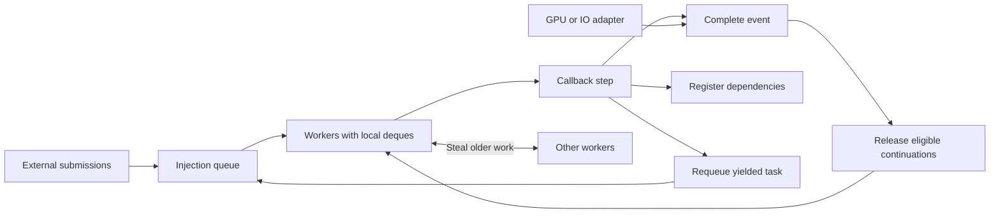

# Autonomous task scheduler

## Status

The independent native library is in [src/runtime/scheduler](../../src/runtime/scheduler/).
Run its checked API, concurrency, rejection, and fatal-contract tests with
`crust tests.crs scheduler`; add `--sanitize` for AddressSanitizer and
UndefinedBehaviorSanitizer. Use `--thread-sanitize` for ThreadSanitizer.
The game still uses [task-graph.md](task-graph.md).
The room and GPU examples below specify the consumer integration. That integration
must pass the delivery gate before the game changes executors.

## Public types and operations

| Type | Contract |
| --- | --- |
| `Scheduler` | Owns workers, queues, and reusable storage. |
| `Scope` | Tracks tasks and external operations through retirement. |
| `Context` | Submission authority for a scope. A callback receives child submission authority. |
| `Task!(State)` | Owns access to the final callback state. |
| `Event` | Shared completion handle: pending, success, failure, or cancellation. |
| `Completion` | Unique authority to resolve an external event. |
| `Dependencies` | Owns event references until registration completes. |
| `Step` | Complete, fail, yield, or await dependencies. |

```crust
// Public signatures. Failed opens leave an empty, droppable owner.
fn scheduler_new() -> Scheduler;
fn scheduler_open(scheduler: mut Scheduler, workers: u32) -> bool;
fn scope_new() -> Scope;
fn scope_open(scope: mut Scope, scheduler: read Scheduler) -> bool;
fn scope_context(scope: read Scope) -> Context;
fn scope_finish(scope: mut Scope) -> Event;
fn scope_cancel(scope: read Scope) -> unit;

fn spawn!(State)(
    context: read Context,
    state: State,
    callback: fn(mut State, read Context) -> Step,
    after: Dependencies
) -> Task!(State) transfers(state);

fn task_empty!(State)() -> Task!(State);
fn task_event!(State)(task: read Task!(State)) -> Event;
fn task_take!(State)(task: mut Task!(State)) -> State;
fn task_replace!(State)(target: mut Task!(State), replacement: Task!(State)) -> unit;
fn deps_new() -> Dependencies;
fn deps_add(deps: mut Dependencies, event: Event) -> unit;
fn event_clone(event: read Event) -> Event;
fn event_join(event: read Event) -> bool;
fn event_error(event: read Event) -> TaskError;

fn done() -> Step;
fn fail(error: TaskError) -> Step;
fn yield_task() -> Step;
fn await_tasks(deps: Dependencies) -> Step;
fn cancelled(context: read Context) -> bool;
```

- `spawn` transfers state. Admission failure returns its state inline in a failed
  handle; its terminal event requires no allocation. `task_take` requires terminal
  completion, empties the handle, and returns state after success or failure. Inspect its event first.
  Taking a pending or empty task, or requesting an empty task event, traps.
- Dependencies must succeed before a callback runs. The first unsuccessful
  dependency observed supplies the terminal outcome and cause. Concurrent failures
  have no fixed order. Cancellation propagates as cancellation.
- `fail(task_cancelled())` cancels the task. Other errors fail it. `event_error`
  requires unsuccessful terminal completion. Empty `Await` acts as `Yield`.
- `event_join` is a blocking boundary for non-worker threads. It reports success;
  `event_error` returns the failure or cancellation reason. Workers must use `Await`. A join from a worker of the event's scheduler traps.
  This check does not enforce the non-worker precondition across separate pools.
- `scope_finish` closes root submission. Accepted callbacks can still submit
  children. Its event includes all children and external completions.
- Dropping a task handle releases ownership; it does not cancel accepted work.
  Dropping an unfinished scope cancels and drains it on a non-worker thread.
  An unfinished scope has a nonterminal finish event. Draining it on a worker
  traps. Scope and scheduler owners cannot transfer into task state.
- Scheduler drop requires no live scopes and a non-worker caller; otherwise it
  traps. Shutdown wakes and joins the workers. Retired result handles can outlive
  the workers through retained storage ownership.

## Launch, wait, and read a result

```crust
record Sum {
    next: u64;
    end: u64;
    result: u64;
}

fn sum_step(state: mut Sum, context: read Context) -> Step {
    if cancelled(read context) {
        return fail(task_cancelled());
    }
    var stop: u64 = min_u64(state.next + 4096u64, state.end);
    while state.next < stop {
        state.result = state.result + state.next;
        state.next = state.next + 1u64;
    }
    if state.next < state.end {
        return yield_task();
    }
    return done();
}

fn example() -> i32 {
    var scheduler: Scheduler = scheduler_new();
    if !scheduler_open(mut scheduler, 4u32) {
        return 1i32;
    }
    var scope: Scope = scope_new();
    if !scope_open(mut scope, read scheduler) {
        return 1i32;
    }
    var context: Context = scope_context(read scope);
    var task: Task!(Sum) = spawn!(Sum)(read context,
        make Sum { next: 0u64, end: 100000u64, result: 0u64 },
        sum_step, deps_new());
    var complete: Event = task_event!(Sum)(read task);
    var scope_complete: Event = scope_finish(mut scope);
    if !event_join(read complete) {
        report_task_error(event_error(read complete));
        // Scope cleanup cancels and drains before scheduler cleanup.
        return 1i32;
    }
    var result: Sum = task_take!(Sum)(mut task);
    print_u64(result.result);
    if !event_join(read scope_complete) {
        report_task_error(event_error(read scope_complete));
        return 1i32;
    }
    return 0i32;
}
```

`yield_task()` returns the worker to the scheduler. The next invocation receives
the same owned state. No stack is saved. A task can resume on another worker.
The chunk size above is example workload data, not scheduler policy.

## Dependencies: run C after A and B

```crust
var a: Task!(BuildMesh) = spawn!(BuildMesh)(read context,
    mesh_work(), build_mesh_step, deps_new());
var b: Task!(BuildTexture) = spawn!(BuildTexture)(read context,
    texture_work(), build_texture_step, deps_new());

var after: Dependencies = deps_new();
deps_add(mut after, task_event!(BuildMesh)(read a));
deps_add(mut after, task_event!(BuildTexture)(read b));

var c: Task!(UploadAsset) = spawn!(UploadAsset)(read context,
    upload_work(move a, move b), upload_asset_step, move after);
```

`UploadAsset` owns the two task handles. Its callback uses `task_take` to obtain
successful results. A and B can finish before or during C's submission.
There is no separate graph declaration, node numbering, seal, or start call.

## Spawn a child, then resume the parent

```crust
resource ForecastWork {
    input: ForecastInput;
    room: Task!(RoomBuild);
    phase: u32;
    result: Forecast;
}
// forecast_work() initializes all fields, including an empty task handle.
// Field resources retain their ordinary cleanup contracts.

fn forecast_step(state: mut ForecastWork, context: read Context) -> Step {
    if state.phase == 0u32 {
        task_replace!(RoomBuild)(mut state.room, spawn!(RoomBuild)(read context,
            room_build_input(read state.input), room_build_step, deps_new()));
        var after: Dependencies = deps_new();
        deps_add(mut after, task_event!(RoomBuild)(read state.room));
        state.phase = 1u32;
        return await_tasks(move after);
    }
    var room: RoomBuild = task_take!(RoomBuild)(mut state.room);
    state.result = forecast_in_room(read state.input, read room);
    return done();
}
```

The parent event stays pending during suspension. Child failure fails the parent
without a second callback invocation. Its state is still destroyed correctly.
Production room requests deduplicate work in the room manager and return an
`Event` plus a result owner; the scheduler does not cache rooms.

Dependencies must be acyclic. A task must not await its own scope finish event.
These are caller preconditions. Submission and continuation registration examine
only the supplied dependencies; they perform no graph traversal or cycle checks.

## Await an external GPU operation

The renderer returns an ordinary `Event` and retains submission resources until
GPU retirement. All state passed to `spawn` must satisfy `transfers`; the callback
can run on any worker. Submission rejection produces a failed event, so the
second invocation is skipped.

```crust
resource RenderWork {
    renderer: RenderQueue;
    frame: FramePacket;
    output: RenderOutput;
    phase: u32;
}

fn render_step(state: mut RenderWork, context: read Context) -> Step {
    if state.phase == 0u32 {
        var gpu: Event = render_submit(read context, read state.renderer,
            move state.frame, read state.output);
        state.frame = frame_packet_empty();
        var after: Dependencies = deps_new();
        deps_add(mut after, move gpu);
        state.phase = 1u32;
        return await_tasks(move after);
    }
    publish_render_output(read state.output);
    return done();
}
```

Presentation completion is another event. A dependent callback can consume the
output without a CPU join. Window and presentation adapters post operations to
the required platform thread and resolve completion tokens. Posting wakes the
platform event loop. Their thread-bound state stays inside the adapter.

## External adapter: submit and complete

Only platform/backend adapters need this interface:

```crust
fn external_begin(context: read Context) -> ExternalPair;
fn external_admitted(pair: read ExternalPair) -> bool;
fn external_event(pair: read ExternalPair) -> Event;
fn external_completion(pair: ExternalPair) -> Completion;
fn complete(token: Completion) -> unit;
fn complete_failed(token: Completion, error: TaskError) -> unit;
```

```crust
fn render_submit(context: read Context, queue: read RenderQueue,
    packet: FramePacket, output: read RenderOutput) -> Event {
    var pair: ExternalPair = external_begin(read context);
    var event: Event = external_event(read pair);
    if !external_admitted(read pair) {
        // The event already contains admission failure; packet is dropped.
        return move event;
    }
    var token: Completion = external_completion(move pair);
    // The adapter owns token, packet, and an output owner through retirement.
    backend_submit(read queue, move packet, output_clone(read output), move token);
    return move event;
}

fn gpu_retired(operation: GpuOperation, status: GpuStatus) -> unit {
    // Called by the completion service after resource retirement.
    if gpu_success(status) {
        complete(move operation.completion);
    } else {
        complete_failed(move operation.completion, gpu_error(status));
    }
}
```

`external_begin` failure returns an inline failed event with no completion token.
`external_completion` requires an admitted pair. Dropping an admitted pair before
taking its token traps. `backend_submit` consumes all owners on success and
rejection; rejection resolves failure after cleanup. Completion can occur before
`render_submit` returns.

Dropping an unresolved token is a fatal contract violation. It must terminate with
a diagnostic; it must not hang or declare unretired GPU work complete. Cancellation
never resolves an external event. Only its token does. The adapter retains the
token and GPU resources until actual retirement. No worker blocks on a GPU wait.

## Scheduler structure



| Mechanism | Required behavior |
| --- | --- |
| Pool size | Any positive worker count supported by platform resources; automatic sizing at startup. |
| Local work | Push/pop newest work on the owner end of a work-stealing deque. |
| Stealing | Take older work under that deque's mutex. Each worker owns a separate deque. |
| External work | Injection queue, serviced periodically even while local work exists. |
| Yield | Queue for a later turn; service other eligible work before repeatedly choosing it. |
| Idle | Search the queues, then wait on a semaphore. Each enqueue posts a retained wake token. |
| Completion | Completing thread publishes results and queues successors directly. |
| Dependency registration | Atomically subscribe or observe terminal completion. |
| Multiple dependencies | Pending count with a registration guard; exactly one enqueue at zero. |
| Callback retirement | Resume cannot execute before the previous callback returns. |
| Memory ordering | Release result publication; acquire before dependent callback execution. |
| Storage | Reusable task/event/edge pools; checked admission failure; explicit capacity growth outside steady frames. |
| Failure | Preserve error and callback state; cancel dependent execution; retire accepted external work. |
| Cancellation | Queued and suspended tasks retire without another invocation; running tasks finish or return a step. External operations remain outstanding. |
| Platform | Private thread, wait, atomic, and event-loop providers. |

No application polling, reserved foreground worker, game-specific priority,
full-table completion scan, or second frame executor. Long callbacks must split
work or yield. Work stealing cannot preempt them.

Native GPU services wait for queue retirement and resolve tokens. WebGPU
callbacks resolve tokens. Browser CPU parallelism requires WebAssembly workers,
shared memory, and cross-origin isolation. A single-thread provider schedules
bounded callbacks through the browser event loop; it provides no CPU parallelism.

## Ownership and scope admission

- Runtime erasure retains typed state and its destructor. `transfers(state)`
  checks the capture; application callbacks receive no raw payload pointer.
- Each callback has exclusive state access. A handle cannot inspect live state.
- Dropping a retired task destroys its state on the caller. Dropping a live task
  handle leaves state owned by execution; retirement destroys it on a worker.
- Results and events have independent retained lifetimes. Slot reuse requires
  retirement of all references. References keep their slots allocated.
- Scopes retain runtime storage. Contexts retain scope control; root submission
  after close or cancellation fails admission. Callback contexts are valid only
  for the invocation and cannot be retained as new child submission authority.
- Events and retired tasks retain storage, not worker threads. They remain usable
  after scheduler shutdown.
- Scope close races with child submission through one outstanding-work protocol.
  A running callback counts as outstanding until child admission is complete.
- Keep root scope owners on non-worker threads. Callbacks receive child contexts.
  An event or context from an unrelated scope does not transfer its lifetime duty.
- Admit task and dependency storage before publishing work. Failure must retain
  enough storage to report failure and retire already accepted operations.
- Cancellation marks suspended waiter registrations inactive. A racing completion
  either queues one continuation or retires it; it cannot do both. Inactive links
  retain safe storage until detached. No callback resumes after task retirement.
- Cancelled state stays owned by a retained task handle; without a handle, a worker
  destroys it. Scope completion still waits for child tasks and external tokens.
- No completion path runs user callbacks inline under a scheduler lock.

## Storage admission

`scheduler_open_capacity(mut scheduler, workers, bytes)` reserves the initial
pool. `scheduler_reserve(read scheduler, bytes)` adds storage while no scopes
are live. Task admission uses that storage. Exhaustion produces a failed task
that retains its input state. Ordinary completion returns slots to the pool.
`scheduler_open_auto` uses the platform logical CPU count.

## Delivery gate

First implement one production chain: cold room build, suspended prediction,
real GPU submission, completion callback, dependent CPU task, final image.
The application thread must not poll the scheduler to make that chain progress.

Test with one, two, and several workers. Force completion before, during, and after
waiter registration. Test fan-in, stealing, repeated yield, nested submission,
allocation failure, cancellation during GPU execution, and shutdown. Compare the
final image with the reference. Record runnable-to-start delay, task overhead,
worker occupancy, application allocations, and presented frame time against the
current shaft witness before migrating the remaining consumers.

Then remove the current graph executor, continuation scheduler, manual node
selection, and game-owned CPU/GPU join loops in the same migration.

## References

- [oneTBB scheduling rules](https://uxlfoundation.github.io/oneTBB/main/tbb_userguide/How_Task_Scheduler_Works.html): local depth-first execution and stealing older work.
- [oneTBB task arena](https://github.com/uxlfoundation/oneAPI-spec/blob/main/source/elements/oneTBB/source/task_scheduler/task_arena/task_arena_cls.rst): autonomous enqueue and concurrency controls.
- [oneTBB async node](https://github.com/uxlfoundation/oneAPI-spec/blob/main/source/elements/oneTBB/source/flow_graph/async_node_cls.rst): external completion integration.
