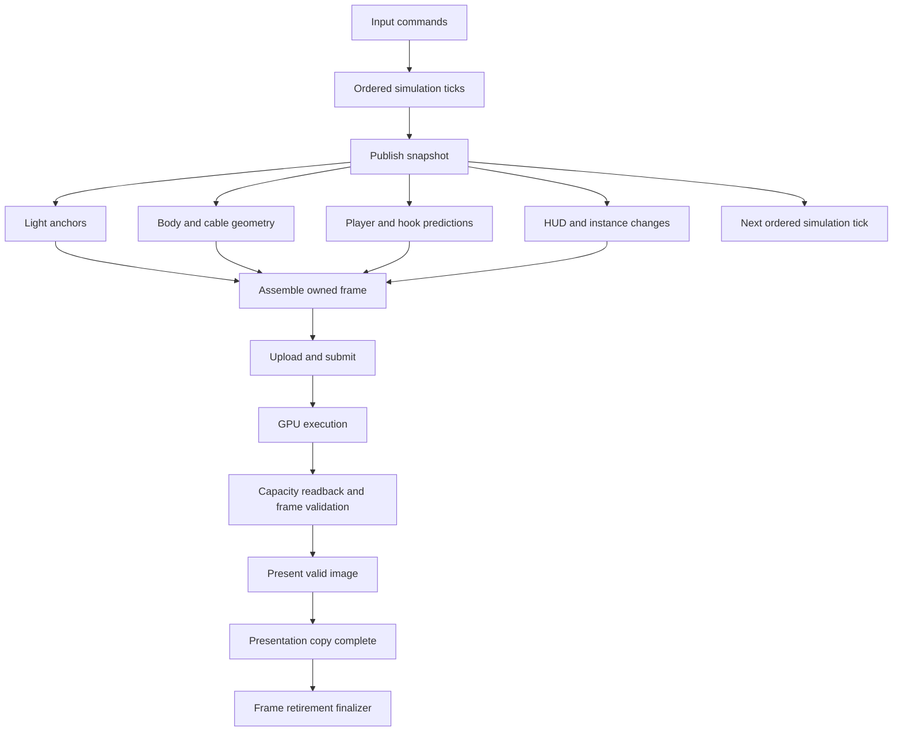

# Task graph architecture

## Status and purpose

This document defines the target architecture and the current implementation.
The default game loop uses same-frame CPU/GPU overlap and asynchronous render
and presentation operations. Run it with `crust main.crs`. Use `--serial`
to select the synchronous loop for comparisons.
The [transfer contract](../render/transfers.md) describes current resource use.
Keep that contract until each replacement passes the delivery gates below.

### Current implementation

The common runtime owns preallocated graph nodes, dependency edges, and ready
queue links. It checks cycles before execution. External results require both
submission return and completion delivery. Cancellation removes eligible work
and retains running external work until it completes. The graph storage can be
reused after drain. Optional spans record ready, start, submission, and finish
times for the most recent execution. Completion spans record executor observation
time, not the device timestamp. Read spans before starting the next execution.

The default task graph prepares the scene after simulation, then submits GPU
shadow setup. Prediction runs on the application thread while setup is pending.
After setup retires, the game writes markers into a reserved geometry range.
Portal rasterization and presentation follow. All work uses the same snapshot.
Inactive reserved triangles preserve the relative order of visible triangles.
Game input and recording have a separate owner from the renderer.
Input events remain active during asynchronous GPU and presentation waits.
Both window loops use the same delay before the next simulation step.

The native pool has bounded job storage, completion generations, and joined
shutdown. A job retains its pool loan until cleanup. The prediction operation
also retains its collision input and exclusive result context until cleanup.
Crust checks structural transfer and sharing capabilities at `transfers` capture
boundaries. Shared collision storage has a trusted `share` contract. Ordinary
computation needs no execution annotation. The typed game adapter contains
the provider callback; checked frame code contains no raw callback or pointer.

The split GPU schedule is the default on native and browser builds, with zero
prediction workers. Use `--tasks` to select it explicitly.
Use `--tasks --workers 1` to compare the earlier CPU worker schedule, where GPU
submission follows prediction. The browser provider requires zero
workers and reports an error for a nonzero worker count. Pool admission failure
fails the frame. Cancellation joins accepted prediction work before its context
can be reused. GPU and presentation waits use the separate completion service.

`SubmittedFrame` holds an exclusive renderer loan through validation or scope
exit. `ValidatedImage` requires successful validation. `Presentation` holds the
image loan until the output service releases the source. A native completion
service waits outside the application executor. Browser promises retain readback
and output storage until completion. The application processes events between
completion checks. Native presentation uses the existing queue-drain protocol
on the service thread. It does not introduce present-wait semaphores.

Crust checks opaque resources with explicit borrowed fields through destruction
and moves. It also distinguishes loans from separate opaque owners embedded in
one record. Compiler tests cover rejected reuse, early destruction, escaped
loans, and source-free imported interfaces.

This experiment uses one renderer allocation. Its submission owns a scoped loan
of packed frame storage. It does not yet supply the owned scene description,
general typed task captures, child scopes, affinity checks, or the cross-service
admission budgets specified below. The CPU pool implements bounded admission and
generation checks for its own jobs.
These contracts must be implemented before the full runtime can replace the
application loops. Demo and viewer remain on their synchronous paths.

### Data and authority at execution boundaries

The compiler has no function classification for pool execution. Transfer and
sharing capabilities describe values. The runtime uses those capabilities at
capture boundaries. A channel uses the same rules for messages. See the
[Crust contract](../../crust/docs/ownership-model.md#transfer-and-sharing-capabilities).

A moved capture must permit transfer. A shared loan must refer to shareable
storage. An exclusive loan must refer to transferable storage and remain
exclusive until retirement. The result owner retains these loans through
completion and cleanup. The same rules apply to zero-worker execution, so
changing the worker count cannot change which programs are accepted.

Thread-bound authority belongs in an opaque value with neither capability.
Game window and input operations require `GameControl` or a containing
`GameSession`. `GameControl` cannot be transferred, shared across threads, or
constructed by checked clients. The trusted application entry creates it.
`game_session` requires a raw launch pointer, which checked code cannot supply.
Raw SDL declarations have no checked foreign contract. Checked code must use
an API that requires the correct authority.

Trusted APIs must support every call their input contracts permit. A function
that requires a specific thread must take the corresponding authority. Constructors
must not expose a way to manufacture that authority on another thread. Opaque
transfer promises include destruction on the destination thread. Opaque sharing
promises include concurrent calls through shared loans. Raw provider declarations
remain private to the provider; exported interfaces retain the checked API.

Prediction receives a copied `Trial` and a retained shared `CollisionScene` loan.
Its helpers use ordinary function signatures. The result context remains exclusive
until the job is dropped. Window state is absent from the capture. Renderer and
input owners stay on the application thread.

### Experiment decision

The initial correction kept this path opt-in. It removed the extra snapshot
interval. It preserves asynchronous output and scoped resource loans. It gives
up the previous cross-frame CPU/GPU overlap. Further architecture work requires
a separate measured benefit and the ownership proofs below.

The previous graph submitted snapshot N before it ran simulation N+1. A key
received during that frame could reach simulation early, but its image had to
wait for the next submission. Two browser pairs measured presentation-request
p95 of 46.3 and 46.4 ms in task mode, against 28.0 and 28.6 ms in serial mode.
The graph now requires the new state before submission in the same iteration.
A pending presentation has no remaining CPU dependency in this graph. Accepted
output operations still drain on failure and cancellation before their loans end.

The focused native flight uses seed 1, complexity 3, 640 by 480 pixels, and 80
fixed ticks with thrust, boost, hook launch, reel, and release. The first 16
frames are warm-up. Both modes must render the command from the current
iteration. The timing report checks simulation, prediction, assembly, submission,
and frame-end order for commands 16 through 79. Final simulation hashes and
capture bytes must match. Graph checks require simulation and prediction to
complete before render becomes ready, and retain pending output through drain.

The previous headless flight on an AMD Radeon PRO W7900 Dual Slot measured
frame p50 of 8.8–9.7 ms in serial mode and 4.9–5.0 ms with cross-frame overlap.
That faster frame rate included an older snapshot. Command arrival at the frame
boundary incurred 0.47–0.49 ms before simulation. The median drain after prediction
was below one microsecond. Those timings did not establish interactive latency:
the fixture bypassed SDL, the real tick accumulator, and presentation. They also
did not establish GPU storage retirement as the bottleneck. Do not add a second
renderer allocation as an assumed latency fix.

#### Interactive latency check

Use `--latency-log FILE` to record non-repeat key presses, applied simulation
steps, submitted snapshots, and presentation requests. The log uses a monotonic
simulation counter. The expedition timer can stop or reset and cannot identify
these snapshots. Each prepared snapshot retains its input sequence and tick
through output.

The optional log allocates space for 65,536 records. It writes the file at normal
shutdown. Allocation, capacity, and file errors stop the run with an error.
Without the option, the log allocates no storage and performs no file IO. Input
records identify polled keys; a record alone does not prove that a command ran.
The check also verifies the level-toggle command in its first simulation step.

Run the native window check:

```sh
crust tests.crs latency --serial --width 640 --height 480 --latency-log build/serial.swlt > build/serial.txt
crust tests.crs latency --tasks --width 640 --height 480 --latency-log build/tasks.swlt > build/tasks.txt
bun tests/game/latency-report.mjs build/serial.swlt build/serial.txt
bun tests/game/latency-report.mjs build/tasks.swlt build/tasks.txt
```

This check uses the demo room and the production window loop. A separate input
thread sends 32 level-toggle key presses at absolute 103.7 ms intervals. The
production 120 Hz accumulator remains active. There is a 500 ms warm-up and a
500 ms drain interval. The check leaves the drone at its initial position.
Both native loop modes draw the initial image before their first input tick.
The fixture waits up to five seconds for keyboard focus after that image.
It measures the stationary control path; it cannot establish flight-load costs.
SDL event injection is thread-safe and copies the event. See the
[SDL event contract](https://wiki.libsdl.org/SDL2/SDL_PushEvent).

For the browser, build `crust main.crs --web`, run
`bun tools/web/serve.mjs`, and open a browser with remote debugging on port 9227.
Then run:

```sh
bun tests/web/latency.mjs
bun tests/game/latency-report.mjs build/latency-web-serial.swlt build/latency-web-serial.txt
bun tests/web/latency.mjs --tasks
bun tests/game/latency-report.mjs build/latency-web-tasks.swlt build/latency-web-tasks.txt
```

The browser check uses the main labyrinth, seed 1, complexity 3, at 640 by 480.
A worker schedules messages on absolute deadlines independently of game frames.
The main thread sends each delivered key through SDL. Browser availability is
main-thread delivery time. Timer jitter is measured from deadline to wake-up on
the worker clock. It excludes message queue delay. Native availability is the
time immediately before SDL enqueue. These sources have different boundaries; compare modes within each
backend. Browser trace timestamps and delivery timestamps use the same page
performance clock. Worker times are used only for local timer intervals.
Do not compare timestamps from different performance time origins.

The report checks that each command reaches a simulation step and a presented
snapshot. It rejects lost or coalesced commands, invalid timestamp order, and
arrival coverage of fewer than three frame quarters. It reports p50, p95, p99,
submission and presentation intervals, and frames with zero or multiple
simulation steps. With 32 samples, p99 is the maximum sample. Repeat pairs before drawing a performance conclusion.

Native output time is the call to queue presentation. Browser output time is
submission of the canvas copy. Neither time measures display scanout. The
initial promotion gate required repeated interactive measurements within five
percent on the target presentation hardware. A software Vulkan window can check
causal ordering, but cannot establish that hardware gate.

Three repeated browser pairs after the correction produced these p95 times.
The browser used the Vulkan backend at a 60 Hz presentation cadence. Values are
serial / task mode in milliseconds. Each run applied all 32 commands and covered
all four arrival quarters.

| Run | Input to submission | Input to presentation request | Presentation interval |
| --- | --- | --- | --- |
| 1 | 16.7 / 16.5 | 28.2 / 28.4 | 16.8 / 16.8 |
| 2 | 16.9 / 16.7 | 28.8 / 28.7 | 16.8 / 16.8 |
| 3 | 16.7 / 16.6 | 28.7 / 28.5 | 16.8 / 16.8 |

All three pairs pass the five-percent input-latency threshold. Presentation
cadence is unchanged. Submission-interval p95 ranges from 17.2 to 18.7 ms;
submission timing varies within the presentation interval. The report retains
both interval measurements.

The focused native flight has matching final capture bytes and simulation hashes.
Its frame p50 is 9.49 / 8.85 ms and p95 is 10.27 / 9.28 ms on the same AMD GPU.
Command-to-submission p95 is 5.43 / 5.19 ms. Every command is rendered in its own
iteration. These offscreen measurements establish the current ordering and cost;
they cannot establish latency through a native display. The native window check
also runs through Xvfb and software Vulkan. In that check, input-to-presentation
p95 is 18.54 / 19.39 ms. Presentation-interval p95 is 10.47 / 11.04 ms, a 5.4
percent increase. The provider measurements below isolate that result from
the game loop. The native input measurements follow those results.

#### Native presentation cost

The optional trace also records fence completion observation, validation,
presentation entry and return, and source release observation. These are host
timestamps. A presentation request does not measure when a pixel reaches the
display. Additional clock reads run only with `--latency-log`.

Use the focused provider check to compare synchronous and asynchronous output:

```sh
crust tests.crs presentation --serial --width 640 --height 480 --latency-log build/present-serial.swlt
crust tests.crs presentation --tasks --width 640 --height 480 --latency-log build/present-tasks.swlt
bun tests/game/presentation-report.mjs build/present-serial.swlt build/present-tasks.swlt
```

This check uses the generated demo room, production scene preparation, renderer,
and window. It presents 128 stationary frames and excludes the first 16 from
the distributions. It pumps events between frames. It does not run simulation,
the task graph, or the game's input polling during pending output. Use the
interactive check above to measure those costs. The report rejects incomplete
traces, duplicate frame events, and invalid lifecycle order.

Three paired runs on Intel Arc Pro B60 through Wayland at 640 by 480 produced
these presentation-interval p95 values:

| Pair | Synchronous | Asynchronous |
| --- | --- | --- |
| 1 | 17.30 ms | 17.15 ms |
| 2 | 17.37 ms | 17.19 ms |
| 3 | 17.27 ms | 17.34 ms |

Asynchronous completion delivery, presentation dispatch, and source release
each had a p95 from 6.7 to 11.8 microseconds across these runs. Submission to
fence observation was about 3.3 to 3.6 ms at p50. Presentation request to provider
return was about 11 ms at p50. The display wait dominates these service costs.
One software Vulkan provider pair had interval p95 of 10.55 / 10.49 ms. These
results do not reproduce the earlier software game-loop interval increase.
One repeated software game-loop pair gave input-to-presentation p95 of
18.69 / 18.38 ms and presentation-interval p95 of 10.59 / 11.00 ms. This pair
passes the five-percent thresholds, but the interval increase is still larger
than in the isolated provider check. That check excludes input polling during
pending work; it cannot assign the remaining game-loop cost to service wake-up.

An earlier diagnosis incorrectly treated the stationary expedition timer as
the simulation counter. `Trial.tick` starts with movement. `GameLoop.ticks`
counts every applied simulation step, including stationary control commands.
The console summary now labels the expedition timer explicitly. Use the trace's
monotonic tick counter for input latency.

Three Intel Wayland input pairs completed at 640 by 480. Every run applied all
32 commands, covered all four arrival-phase quarters, and recorded 503 to 505
simulation steps. Values below are serial / task mode:

| Pair | Input to submission p95 | Input to presentation request p95 | Presentation interval p95 |
| --- | --- | --- | --- |
| 1 | 17.64 / 16.51 ms | 21.09 / 20.32 ms | 17.38 / 17.20 ms |
| 2 | 16.98 / 17.58 ms | 20.33 / 21.21 ms | 17.32 / 17.35 ms |
| 3 | 16.90 / 17.61 ms | 20.21 / 21.27 ms | 17.15 / 17.22 ms |

The pooled 96-command presentation-request p95 is 20.79 / 21.13 ms, a 1.6
percent increase. Pair 3 has a 5.3 percent increase and requires separate
attention. Its p95 samples differ by 0.57 ms before simulation, 0.15 ms from
simulation to submission, and 0.35 ms from submission to presentation request.
These samples arrive at different points in the frame. The trace shows no
extra snapshot interval. Presentation interval p95 differs by less than 0.5
percent in this pair. Pooled presentation-request p99 is 22.03 / 27.82 ms;
these short runs do not establish equal tail latency. Task mode remained opt-in
at this stage.

An incomplete native attempt stalled inside `vkQueuePresentKHR`, waiting in
Wayland dispatch after GPU retirement. Keep the surface visible and focused
for the input check. The fixture rejects a paused or zero-step result; the
report requires all 32 commands to reach their presented snapshots. Successful
runs must pass that report. Console timer output is insufficient evidence.

The current correction removes the old-frame interval in browser and native
input traces. It does not prove a benefit from CPU/GPU overlap. Keep the full
architecture expansion behind the measured decision gate below.

### CPU worker decision

The bounded worker experiment uses prediction and independent scene preparation
from the same simulation result. It uses one prediction context and one admitted
job. No frame storage is duplicated. Each final capture matches the zero-worker
capture byte for byte; the simulation hash is 2903600457.

Four paired runs used the AMD Radeon PRO W7900, 640 by 480 pixels, seed 1,
complexity 3, and the 80-tick flight above. No builds ran during these pairs.
Each run excludes the first 16 ticks. Values are zero workers / one worker,
in milliseconds:

| Pair | Submission p95 | Frame p95 | Worker overlap p50 |
| --- | ---: | ---: | ---: |
| 1 | 5.183 / 5.490 | 10.088 / 9.183 | 0.259 |
| 2 | 5.218 / 5.323 | 10.098 / 10.133 | 0.270 |
| 3 | 5.551 / 5.688 | 10.434 / 10.459 | 0.277 |
| 4 | 5.487 / 5.613 | 10.328 / 10.446 | 0.259 |

The trace records overlapping CPU work in 255 of 256 measured worker frames.
Prediction execution p50 is 4.38–4.67 ms on the application thread and
4.72–4.97 ms on the worker. This increase can consume the overlap benefit.
These results do not establish a consistent critical-path improvement. Keep
the worker path opt-in. A passing build or an overlap interval alone cannot
pass the measured-benefit gate.

#### Cause of the worker cost

The follow-up comparison used a Threadripper PRO 7995WX and the same flight,
GPU, resolution, seed, and complexity. Nine pairs covered unrestricted CPU
placement, CPUs 0–7 in one L3 cache group, and CPUs 0–95. Prediction p50 was
4.30–4.46 ms inline and 4.70–4.98 ms on a worker. Restriction to one L3 cache
group did not remove the cost. The independent scene work hid 0.26–0.29 ms.

Temporary probes measured thread CPU time around `predict_paths`, the CPU
number at each end, and the floating-point control state. Linux hardware
counters measured user-mode cycles and retired instructions over the same
call. Three further pairs gave these median values. Each column contains the
range of the three run medians:

| Measurement | Application thread | Worker |
| --- | ---: | ---: |
| Prediction thread CPU time | 4.30–4.46 ms | 4.55–4.69 ms |
| Retired instructions | 42.6264 million | 42.6264 million |
| CPU cycles | 21.85–22.67 million | 21.86–21.92 million |
| Cycles divided by thread CPU time | 5.14–5.20 GHz | 4.66–4.80 GHz |

The worker executes the same instruction count at a lower effective clock
rate. Its cycle count is similar or lower. This explains the main execution
cost in these runs. The counters do not establish why the CPU selected the
lower clock rate. CPU selection and wake-up power control remain possible
causes. The CPU used the performance energy preference during these checks.

Thread CPU time was close to elapsed execution time. Both paths had the same
floating-point control state. A control run created a worker but kept the job
on the application thread. Its prediction medians were 4.36–4.42 ms, versus
4.26–4.35 ms without that worker. Thread creation alone did not reproduce the
full execution cost.

The application observes completion 5–7 microseconds after both CPU tasks end
at p50 in the unrestricted runs. This includes result collection and graph
completion. It is much smaller than the prediction cost. The timing report
now includes this interval as `predictionJoinDelay`. Temporary counter and
floating-point probes are excluded from production code and baseline timings.

The graph also has too little independent work. Moving a 4–5 ms prediction
chain to a worker only hides about 0.27 ms of scene preparation. On a roughly
9.4 ms frame, that permits about a 3 percent reduction even with free dispatch
and equal CPU speed. The application then waits for prediction. GPU work starts
after the join, and the next simulation starts after GPU completion.

Keep prediction on the application thread by default. Before extending the
pool, measure a larger independent work range on the critical path. Scene
batch preparation is a candidate; its current 0.27 ms total cannot supply a
large gain. Prediction steps depend on earlier steps and cannot be divided
into independent time ranges. Measure and reduce their physics and collision
cost first, or identify independent queries within each step. Any new split
must reduce submission and frame time with the same snapshot and output.
Adding workers or a faster queue alone cannot remove this dependency chain.

#### Same-frame shadow setup experiment

The largest measured candidate is GPU shadow preparation for the current
snapshot. It can run while the CPU calculates prediction. This keeps simulation,
camera input, and markers in the same frame.

Three runs of the same 80-tick flight added GPU timestamps and separate CPU
timers for drone and hook prediction. The first 16 ticks were excluded.
The ranges below contain the three run medians, in milliseconds:

| Work | Time | Input dependency |
| --- | ---: | --- |
| Drone prediction | 4.26–4.36 | Simulation snapshot and collision scene |
| GPU upload | 0.009–0.010 | Prepared frame data |
| GPU instance expansion | 0.014–0.018 | Retained meshes and instance placements |
| GPU shadow-build dispatch | 2.43–2.98 | Shadow-casting geometry and room lights |
| GPU shadow-top dispatch | 0.066–0.080 | Instance bounds and room lights |
| GPU image and traversal initialization | 0.008–0.016 | Camera, dimensions, and storage layout |

Separate runs without the extra stage timestamps measured total GPU setup at
2.46–3.08 ms and the whole GPU frame at 3.40–4.27 ms. These measurements establish
available work. They do not establish a speedup from a split submission.
Diagnostic printing and query reads were outside the measured calls and GPU
intervals. The probes were removed after measurement.

`draw_prediction` marks every marker triangle as non-shadow-casting.
`shadow_seed` excludes these triangles. The marker result therefore has no
semantic effect on the shadow trees. Room lights, drone geometry, tether
geometry, and retained room instances are available from the simulation
snapshot before prediction finishes. The current `game_scene_finish` function
places several of these operations after the prediction join. Move their
preparation before that join for the experiment.

The intended dependency order is:

```text
simulation snapshot
  +-- CPU prediction -----------------------+
  +-- prepare scene -> GPU shadow setup ----+-- portal raster -> compose -> present
```

The original buffer contract prevented this split. `input_instance` places
retained triangles after all dynamic triangles. Their addresses depend on the
marker triangle count. `projection_members` also needs the complete triangle
list. `upload_scene` copies shared headers and dynamic geometry together.
The renderer owns one command buffer and one submission fence. Mutating these
inputs or resetting that command buffer while setup runs would violate the
GPU ownership contract.

Use stable geometry ranges for independently produced batches. Admit their
storage before the first submission. Separate shadow-casting geometry from
late non-shadow-casting geometry, with explicit active ranges. Keep source
uploads immutable until the GPU has consumed them. The two submissions need a provider-owned dependency. Command storage can
be reused after retirement, or kept separate while both submissions are pending. Run projection-list
assembly and portal rasterization after the late batch arrives. Preserve
triangle tie order even if physical storage order changes. The game API must
expose frame operations and completion, with native and browser details in
their providers.

The implemented slice keeps one frame in flight and prediction on the application
thread. A scoped `FrameSetup` holds the renderer through both submissions.
`input_defer` reserves inactive, non-shadow-casting triangles at stable addresses.
Projection storage admits the maximum late batch before setup starts.
`DeferredInput` waits for setup retirement, bounds triangle writes to that
reservation, and restores the full scene count on scope exit. Unused slots remain
inactive. Late triangles must have no portal and must not cast shadows.

The single command buffer and staging allocation are reused only after setup
retirement. The second submission uploads the completed inputs and runs the
existing portal rasterization path. Query reset occurs once per complete frame.
No renderer storage can be borrowed through the owner while setup is live.
The task graph records setup as an external operation. This bounded schedule
needs no second frame slot, independent GPU queue, or native type in game code.

Three paired native runs used the same 80-tick flight, 640 by 480 pixels,
seed 1, complexity 3, and the Radeon PRO W7900. Each excluded 16 warm-up frames.
Values are synchronous GPU scheduling / split GPU scheduling, in milliseconds:

| Pair | Frame p50 | Frame p95 |
| --- | ---: | ---: |
| 1 | 8.376 / 6.464 | 9.168 / 7.093 |
| 2 | 9.464 / 6.401 | 10.044 / 6.972 |
| 3 | 9.239 / 6.474 | 9.783 / 7.017 |

With capture enabled, the targeted flight compares each of its 80 split frames
against a synchronous render of the same snapshot. The internal and composed image pixels and the final
simulation hash match on AMD and Intel with checked shaders enabled. Browser checks pass raw and checked
shaders, flight, tether, pause, fullscreen, capture, replay, device loss, and
shutdown. A 32-event browser pair measured input-to-presentation-request p95
at 30.4 ms synchronously and 28.5 ms with the split. These are application
request times, not display scanout times. The split task loop is now the default.
Native interactive latency remains unmeasured:
the test window received no keyboard focus, so the fixture rejected the run.
The synchronous loop remains available with `--serial` for controlled comparisons.

The large shadow-build time also needs a separate cost check. That shader uses
one active lane per tree. It can rebuild retained trees and builds dynamic
trees for room lights. Distinguish those branches before changing scheduling.
Tree reuse requires stable geometry identity and explicit invalidation for
geometry changes; a scheduling split must not become a reason to retain
unnecessary rebuilds.

Other candidates have smaller measured bounds:

- Frame geometry, HUD, and instance submission after prediction depend mostly
  on the snapshot. Their whole current assembly interval is about 0.06 ms.
  They can move earlier, but cannot supply a large gain alone.
- Drone and hook forecasts use separate drone copies. The hook marker budget
  depends on the number of drone markers. Computing a larger hook result and
  truncating it at the join would remove this dependency at extra cost.
  In the measured flight, hook prediction ran in 20 of 64 sampled frames.
  Its active-frame median was 0.083 ms. Perfect parallel execution saves only
  0.059 ms per frame on average in that run, before dispatch costs.
- Collision queries over distinct instances can produce independent candidates
  and reduce them with `collision_better`. Consecutive motion steps depend on
  resolved contacts. Measure candidate counts and query costs before adding
  per-step jobs; the current evidence does not justify that fine subdivision.

Rendering the whole world before markers arrive is a second, larger renderer
change. A late marker pass would need retained portal-path visibility and
depth intervals, including markers in an ancestor room before a portal.
The current traversal overwrites task masks and stores only final pixel color
in production. A screen-space overlay would give wrong occlusion. The implemented
shadow-setup split leaves the current portal raster path intact.

The browser serial provider passes capture, input, pause, fullscreen, replay,
device-loss, and shutdown checks. One 32-command pair measured input to
presentation-request p95 of 28.6 / 28.7 ms for the synchronous / task loops.
The current native input attempt failed its keyboard-focus precondition. The
earlier native input results above remain evidence for the serial CPU graph;
they do not establish input latency for the worker path.

Compiler checks cover data capabilities, captured cleanup authority, source-free
imports, unsafe captures, and retained context loans. Runtime checks
cover zero and two workers, admission exhaustion, failure delivery, generation
reuse, and early job drop. Memcheck and Helgrind pass the focused pool fixture.

Run the current split/worker comparison with (the earlier tables measured the
zero-worker path before GPU setup was split):

```sh
crust tests.crs tasks --tasks --workers 0 --width 640 --height 480 > build/worker-zero.txt
crust tests.crs tasks --tasks --workers 1 --width 640 --height 480 > build/worker-one.txt
bun tests/game/task-timings.mjs build/worker-zero.txt build/worker-one.txt
```

The measured scene reserves 238,959,872 device bytes and the same staging bytes.
Two complete copies would reserve about 956 MB before other allocations. Split
immutable assets from per-frame storage before adding a second GPU slot. Record
live and peak bytes for that split and repeat the production output checks.

Run the focused checks with:

```sh
crust tests.crs runtime
crust tests.crs ownership
crust tests.crs tasks --serial --width 640 --height 480 --capture build/serial.ppm
crust tests.crs tasks --tasks --width 640 --height 480 --capture build/tasks.ppm
crust tests.crs render 10
crust main.crs --web
bun tests/web/check.mjs --tasks
```

For a stage-by-stage latency report, save the two task-check logs and run:

```sh
crust tests.crs tasks --serial --width 640 --height 480 > build/serial-timing.txt
crust tests.crs tasks --tasks --width 640 --height 480 > build/task-timing.txt
bun tests/game/task-timings.mjs build/serial-timing.txt build/task-timing.txt
```

The runtime check covers completion order, rejection, cancellation drain, graph
reuse, ready fan-out, and service shutdown with accepted work. Native Helgrind
and Memcheck checks pass for this runtime fixture. The ownership check includes
renderer and presentation leases. Render case 10 requires a display and checks
resize plus asynchronous output and scope-exit drain. The browser check requires
the server and browser setup in the [web build document](../build/web.md).

The runtime must execute independent CPU work in a worker pool. A task that
requires GPU, file, timer, or presentation completion must not occupy a worker
while it waits. Native and browser applications use the same task definitions.
Game code must not use platform threads, locks, GPU fences, or GPU semaphores.

Preserve the fixed simulation step, recorded commands, portal transforms,
lighting rules, rendering results, and error reporting. A scheduling change
must not change the game rules. Concurrency does not by itself prove a speed gain.

## Component boundaries

The table gives component locations. The [component map](../README.md) lists
the directories that are implemented.

| Component | Target location | Responsibility |
| --- | --- | --- |
| Task API and graph | `src/runtime/task/` | Tasks, typed results, dependencies, scopes, cancellation, graph validation |
| Executor | `src/runtime/executor/` | Ready queues, worker pool, affinity lanes, admission, completion delivery |
| Runtime platform providers | `src/runtime/platform/` | Native threads and waits; browser workers and event integration |
| Runtime tracing | `src/runtime/trace/` | Task spans, dependencies, waits, queue depth, memory counters |
| Renderer API | `src/render/api/` | Owned frame input, asset versions, submission tickets, validated images |
| Common renderer | `src/render/common/` | Capacity planning, packing, render-pass dependencies, transfer ranges |
| Renderer providers | `src/render/host/`, `src/render/web/` | Vulkan and WebGPU resources, commands, synchronization, completion |
| Application services | `src/app/` | Input, window, clock, file and capture interfaces; platform event delivery |
| Game graph | `src/game/tasks/` | Simulation, snapshots, predictions, light anchors, geometry and HUD tasks |
| Other application graphs | `src/demo/`, `src/viewer/` | Compose the same services for their own application policy |
| Build roots | `main.crs`, `demo.crs`, `viewer.crs`, `tests.crs` | Select providers and compose the required components |

Dependencies point from the game to checked service interfaces. The renderer
and application services use the generic task API. The task runtime does not
import renderer, collision, asset, room, player, or game types. Its completion
source is generic; it has no GPU-specific branch.

Platform providers implement narrow interfaces. A native provider can use
pthreads, Windows thread APIs, or Vulkan synchronization internally. These types
must not occur in game fields, task signatures, or public results. The browser
provider applies the same rule to JavaScript promises and worker handles.

Replace direct game access to `RenderState`, mapped addresses, and native window
handles with service operations. Expose typed geometry, light, portal, and overlay
batches. Raw layout access stays inside the renderer and explicit renderer test
adapters. The build must check resolved dependencies against these boundaries.
If Crust cannot enforce an interface boundary, add the required support to Crust.
A naming convention alone is not an access check.

## Task and dependency model

A task is an operation with owned input, a declared execution lane, and typed
output. A dependency states when that input is ready. A task runs once.

Use two node kinds:

- A CPU node runs a bounded function to completion and publishes its result.
- An external node receives completion from a service provider. It does not
  enter a worker ready queue while the operation is pending.

A CPU function can start an external operation and return its completion token.
Work after completion is a dependent CPU node. No worker waits on another task,
a GPU operation, or a blocking file operation. The first implementation uses
explicit continuations. Stackful fibers are not required. Any later suspension
syntax must lower to the same ownership and dependency contracts.

Conceptual interfaces are shown below. These names specify behaviour, not
currently accepted Crust syntax.

| Operation | Result and contract |
| --- | --- |
| Create graph scope | Owns its nodes, captures, result storage, and external subscriptions |
| Add CPU node | Moves its inputs into the scope and returns a typed result handle |
| Add dependency | Connects compatible producer and consumer results before publication |
| Seal and start | Checks the graph once, then makes its ready nodes eligible to run |
| Register external source | Creates one provider-owned completion capability and a consumer token |
| Complete external source | Publishes one success, error, or cancellation result |
| Request cancellation | Stops eligible work; does not reclaim active work |
| Drain scope | Completes when all nodes and external resource owners have retired |

A result handle identifies a graph generation and node. It is not a pointer to
another task's stack. A move-only output has one consumer. Multiple readers use
an immutable published result with an owner that survives all readers.

CPU states are `waiting`, `ready`, `running`, and a terminal state: `succeeded`,
`failed`, or `cancelled`. An external node goes from `pending` to a terminal state.
A success dependency becomes ready only after all required producers succeed.
A failed or cancelled producer prevents its success consumers from running.
Explicit error handlers and finalizers can depend on terminal results.
A skipped success consumer becomes cancelled and retains the producer failure
as its cause. Every admitted node must reach a terminal state.

Validate cycles, result types, lane requirements, and resource access when the
graph is sealed. A static frame graph can be sealed once and instantiated with
new data. Internal scheduling then consumes trusted graph state. It must not
repeat graph validation at every queue operation. Dynamic batches create child
scopes with explicit inputs and a join result; they cannot mutate a running graph.

The parent scope owns each child scope until the child drains. Its drain result
includes all transitive children, their external operations, and provider cleanup.
A parent task can return after creating a child. The parent scope must remain
alive until that child's join and retirement complete. A worker that needs the
child's result returns and schedules a continuation with that dependency.

## External operation protocol

An external operation has separate submission and completion obligations. The
runtime creates an owned operation record before the provider can start work.
The record holds the payload, result storage, completion capability, and resource
leases. The scope registers this record before the provider can invoke a callback.

The result becomes available only after both events occur:

1. The submission function has returned and published its final acceptance state.
2. The provider has published the external result.

A callback may run before submission returns. Either event can arrive first.
The second event releases ready consumers through one atomic state transition.
The submission result and callback result must be visible before those consumers
run. The subscription protocol below must also handle completion before a consumer
subscribes. These are separate races and require separate checks.

On successful submission, the provider owns the obligation to complete exactly
once. On rejection, the provider guarantees that no external work or callback
remains. The runtime publishes the rejection result and closes both obligations.
A provider that can partially submit must retain the record and report failure
only after it has accounted for every accepted operation and callback.

Operation payload lifetime is explicit. Returning from the submission function
releases only its local captures. Move all data needed by callbacks or device work
into the operation record before submission. An external completion counter alone
cannot extend the lifetime of a stack variable or a borrowed upload range.

Separate result publication from resource retirement when a service has additional
consumers. Each resource lease has one retirement owner. The record and its scope
can drain only when all obligations and leases have ended. Cancellation can mark
the result unwanted, but the operation record remains until the provider stops
using it. Required completion and error delivery must never be rejected because
a normal ready queue is full.

## Ownership and memory safety

Task safety requires more than moving a pointer into a queue. Crust must check:

- Transfer: an owned capture can move to the selected execution lane.
- Sharing: a published value permits concurrent reads, including reads through
  its internal fields and provider operations.
- Exclusion: writable output storage belongs to one task, or to proven disjoint
  partitions. A shared `mut FrameInput` is not a partition.
- Lifetime: captures and result storage survive every consumer and external use.
- Affinity: a resource is accessed and destroyed on a permitted lane.

These are required language or checked-library contracts, not assumed features
of the present ownership stage. Extend Crust where proof is missing. Do not
bypass checks with raw pointers in game tasks. The trusted runtime may use raw
storage, atomics, and locks behind its checked interface. That boundary owns the
proof of queue publication, reference lifetime, and completion delivery.

Task captures initially contain owned values or handles to owned immutable
snapshots. Do not capture temporary borrows into asynchronous work. Scoped
parallel borrows require a checked join that cannot be skipped by failure or
cancellation; add that API only with compiler rejection tests.

A graph scope remains owned until its drain result completes. Dropping a token
must not free a submitted operation's resources. Task-local cleanup is immediate
only for resources with no external users. Provider cleanup can create retirement
work on the required lane. Shutdown explicitly drains such work.
If a consumer is cancelled, its unconsumed owned result still needs destruction.
Register this destruction as a retirement obligation on the required lane.
It survives cancellation and is part of scope drain.

Use reusable storage for graph instances, result batches, and frame slots.
Allocate task records in batches. Do not allocate one heap object for every
triangle, contact, light anchor, or graph edge. Do not retain every simulation
snapshot. Release a snapshot when its final reader retires.

## Executor and worker pool

The common executor schedules ready nodes. It does not decide which game work
is important. The application supplies task classes and bounded budgets.

| Lane | Contract |
| --- | --- |
| Worker | Independent CPU work; any eligible pool worker can execute it |
| Application | Window events and other operations that require the application thread |
| Serial service | Ordered access to a service such as a GPU queue; no concurrent calls |
| External completion | Provider notifications; dispatch dependants without occupying a worker |

A serial service lane is an ordering rule, not necessarily a dedicated thread.
Each provider declares whether it also requires a fixed thread. Destructors obey
the same affinity rule as ordinary operations.

Suspended work can resume on another worker. Keep its persistent state in its
owned task record. Thread-local scratch belongs to the current invocation and
must be released before it returns. A serial lane permits migration between
invocations; a fixed-thread lane requires the same thread for each access.

Use a fixed worker count selected at startup. Start with a bounded common ready
queue. Add per-worker queues and work stealing only if measurements show queue
contention. Keep the scheduling policy independent of the public graph API.
Workers park when no work is ready. Completion publication wakes eligible workers
without a busy loop or a lost wakeup.

A completion can arrive before subscription finishes. Registration and delivery
must form one atomic protocol: the subscriber observes either the pending source
or its terminal result. Terminal publication uses release/acquire ordering for
result visibility. Generation tags prevent a late callback from completing a
reused slot. A completion capability can be consumed only once.

Rendering, input, and simulation have priority over background asset work.
Reserve progress for lower-priority work so it cannot starve. Use bounded batches
for expensive generators and predictions. A long CPU function cannot be preempted
by the graph; it must provide smaller work units at defined boundaries.

Queue exhaustion applies backpressure at scope admission. It must not discard
work, spin a worker, or silently run a thread-affine task on the caller. Reserve
completion and finalization capacity for already admitted operations so a full
work queue cannot prevent retirement. Report allocation failure to the scope owner.
Store ready-list links in admitted node records. A completion that makes several
nodes ready must need neither a new allocation nor free admission capacity.

Use separate controls for CPU concurrency, pending external operations, and live
memory. A serial submission function can launch many operations before any one
finishes. Each operation must acquire an admission credit before submission and
return it at the declared retirement boundary. Frame credits cover the slot
lifetime through its final resource user. Byte budgets include old and new resource generations during
replacement. Exhaustion produces a readiness dependency or an allocation error;
it must not block a worker. Providers must reserve the capacity needed to report
completion before they accept an operation.

Reserve child-node storage and external-operation credits before admitting a
parent scope. Children use that reservation. Variable-size work uses bounded
batches and releases each batch before admitting the next. A scope must never
wait for credits from a pool while retaining the credits that prevent progress
in that pool. Apply the same rule to resource-generation replacement: reserve
the overlap memory before starting replacement, or report allocation failure.
These bounds control concurrent work; they do not limit scene geometry.

## Simulation and frame graph

Keep the 120 Hz simulation chain ordered. Input commands carry tick identities.
Player motion, hook motion, tether constraints, collision, portal transfer, and
objective changes remain in their required simulation order. Do not split a
coupled solver only to increase task count.

After the required ticks, publish an immutable render snapshot. It contains the
player and hook poses, cable state, room identities, objective and HUD state,
and references to immutable world versions. Collision queries use the matching
world version. Moving collider poses come from the snapshot's tick, not a mutable
clock read during a task.



Light, geometry, prediction, and HUD tasks write separate batches. Each batch
has a stable producer order. Assembly combines them in that order, independent
of worker completion order. Preserve triangle, light, and overlay ordering where
it affects equal-depth coverage, quantization, or overwrite rules.

Predictions use copies of simulation state. They cannot update authoritative
motion or consume input. At first, a rendered frame requires predictions from
its own snapshot. Do not silently substitute an older prediction to meet a
render deadline. Asset generation and file operations use separate scopes;
installation of a new world version is an explicit simulation boundary.
Simulation selects the required asset version and installation tick before the
asset job completes. That tick depends on the version being ready. Completion
time cannot select the installation tick or change input-to-tick assignment.
A slow asset job can delay execution, but cannot change replay results.

Rendering snapshot N can overlap simulation N+1 only if the input-to-output
latency gate still passes. Separate state alone does not establish that result.
Do not require one frame of input delay to obtain overlap. Overlap requires
separate state; a lock around the current mutable `GameSession` would serialize the same work.
Recording remains in tick order and consumes simulation results, not render
completion order. Replay hashes must be independent of worker count.

## Frame admission and resource lifetime

Start with two render slots. This is a scheduling and memory budget, not a
geometry limit. The budget is configurable and must pass memory and latency
checks before it increases. Each slot owns its mutable CPU frame data, upload
ranges, GPU scratch ranges, command storage, readback results, and image leases.

Persistent meshes, textures, palettes, and static shadow data use versioned
immutable resources. A replacement publishes a new version for new frames.
Older versions remain alive until all submitted users retire. A slot records
which versions it contains; a global dirty bit cannot prove that every slot has
received an update.

The current packed device allocation prevents direct sharing of all persistent
ranges between slots. The first asynchronous slice can use separate complete
allocations if the measured peak fits the configured budget. Count that duplicate
storage explicitly. The target layout separates immutable assets from per-slot
work ranges so frame overlap does not require duplicate asset libraries.

A slot moves through preparation, submission, GPU completion, validation,
presentation, and retirement. Acquisition of the next slot is a dependency,
not a blocking wait on a worker. A slot cannot be reused while a GPU command,
readback, capture, or presentation operation still refers to it.

Interactive rendering can discard an obsolete snapshot before its graph is
admitted. Keep at most the latest unadmitted render snapshot. Never discard a
simulation tick or a submitted frame's retirement work. Discarding an unadmitted
snapshot immediately releases its world-version references. Deterministic captures
use explicit requested snapshots and wait for admission instead of dropping them.
Do not add interpolation or change simulation timing as part of this migration.

## Asynchronous renderer contract

The game submits an owned scene description and receives a frame ticket. It does
not receive a native queue, command buffer, fence, semaphore, mapped address, or
browser promise. Renderer service operations attach work to the common graph.

Expose distinct results:

| Result | Meaning |
| --- | --- |
| Submission accepted | The backend accepted the work and owns its referenced resources |
| GPU work complete | Device execution and required transfer operations completed |
| Frame valid | Capacity result and enabled debug checks passed; image can be presented |
| Presentation source released | The output service completed its final read of the validated output |
| Presentation retired | The provider no longer uses the surface image or its presentation synchronization |
| Frame retired | All frame consumers released their resource leases; the slot can be reused |

A valid image is a capability produced by successful frame validation. The
presentation API requires that capability. GPU completion alone cannot construct
it. A capture is another image consumer and holds its own lease until readback
and file output complete.

Keep the existing offscreen output path on both backends. Validation precedes
acquisition and copying into a surface image. The source output remains leased
until that copy completes on the GPU. Browser canvas acquisition occurs in the
presentation callback on the context-owning thread. Measure the latency of this
path; do not assume that it adds a fixed number of frames.

Presentation requests follow admitted frame order. A later frame waits until
every earlier frame was presented or explicitly discarded. A failed frame is
reported and cancelled; there is no automatic capacity retry. Its retirement
finalizer depends on terminal results and resource release, rather than successful
presentation. Cancellation, validation failure, and resize must all release the
slot after its final consumer retires.

Surface images and presentation synchronization belong to a separate provider
pool. Their lifetime can extend beyond frame-slot retirement. Surface acquisition
and presentation retirement must make progress without acquiring a new frame
slot. Native providers must track present-wait semaphore reuse by surface image
and retain old surface generations until their presentation operations retire.
Select and verify the retirement mechanism before the asynchronous slice: use
presentation fences where supported, or prove the acquire-based retirement and
teardown rules for the selected Vulkan WSI path. A render fence alone cannot
prove that presentation has released its semaphore. See the
[Vulkan semaphore reuse guide](https://docs.vulkan.org/guide/latest/swapchain_semaphore_reuse.html).
If the provider cannot establish retirement and teardown, this delivery gate
fails; do not enable asynchronous presentation on that path.

Preserve the current four-byte capacity readback. It detects runtime traversal
capacity exhaustion, not shader assertions. Schedule its result asynchronously
and reject an incomplete image before presentation. Shader failure readback
remains an explicit debug option. Pixel readback is required only for capture
or enabled checks. This design does not add production image readback.

Keep GPU pass dependencies inside the renderer. Record related compute passes
into suitable command batches; a CPU task per dispatch is not required. Translate
GPU dependencies into backend barriers and queue synchronization. Do not route
every GPU-to-GPU dependency through a host completion callback.

The native renderer provider can use timeline values or fences. A completion
service observes them and publishes generic events. A dedicated service thread
may block in an OS or GPU wait; pool workers must not. Serialize queue access and
use separate command storage for concurrently recorded work. Swapchain acquisition
and presentation synchronization remain renderer-provider details.

The WebGPU provider resolves the same results from queue completion, buffer
mapping, and presentation operations. A queue promise is not proof that a browser
has displayed an image. Define retirement as resource release, not scanout time.
The public contract must be implementable on both backends.

Capacity growth and resize create a new resource generation. Retire the old
generation after its final user completes. A resize may stop frame admission;
it must leave event processing active. An image for an obsolete surface generation
can be discarded with an explicit status. Retire it normally. Do not present it
to the new surface or reuse its storage early.

## Browser and single-worker execution

The graph has a serial executor as well as a parallel executor. Both apply the
same dependencies, errors, ownership, and output ordering. Serial execution is
an explicit supported mode for debugging and environments without shared-memory
workers. It must report its mode, not claim that a worker pool is active.

The browser application thread must return to its event loop. It cannot block
while waiting for a task, slot, GPU result, or shutdown. Completion callbacks
schedule bounded continuation work. Long CPU batches must yield between nodes.
The application thread must also avoid blocking locks or spin waits on workers.
Worker notifications use an asynchronous provider mailbox and browser event
delivery. Completion publication uses storage reserved at admission.

A browser pool uses workers and shared WebAssembly memory behind the runtime
provider. Its build requires the necessary atomic and shared-memory support in
Crust and the toolchain. Its deployment requires cross-origin isolation. Test
worker startup on the actual published origin; do not infer support from a local
server. If parallel mode is explicitly requested but unavailable, report the
missing capability. Keep native and web game sources identical.

## Failure, cancellation, and shutdown

Every admitted node reaches a terminal state. Propagate allocation, IO, device,
and platform failures as typed results. Report the operation, graph, frame or
tick identity, and underlying provider diagnostic. Do not turn an internal
invariant violation into a recoverable empty result.

Cancellation stops nodes that have not started. Running CPU nodes observe it at
specified safe boundaries. A submitted GPU command usually must finish; cancel
its consumers but retain its resources until retirement. Error handlers cannot
publish a successful image for a failed frame.

On exit, stop new admission, cancel unnecessary scopes, finish submitted work,
release image leases, drain affinity-bound cleanup, then stop completion services
and workers. Keep browser callbacks and native completion delivery alive until
this drain finishes. Device loss follows a backend-specific teardown path that
settles pending tokens with an error; it must not wait forever for a signal that
can no longer arrive. Do not reuse lost-device resources.

## Measurement and delivery gates

Before implementation, record a controlled baseline from the production game:
fixed seed, complexity, resolution, input recording, GPU, and execution mode.
Include a lit room, portal overlap, hook launch and reeling, and traversal through
several rooms. Record CPU stage time, GPU time, waits, upload bytes, p50/p95/p99
frame time, input-to-submission and input-to-presentation-request latency, and
peak host/device memory. Separate startup allocation from steady execution.
Use repeated runs to estimate noise.

Trace every task with its graph, tick/frame, lane, dependencies, ready time,
execution start/end time, and external wait interval. Include queue depth,
admission-credit use, live bytes, and slot occupancy. Runtime tracing uses
generic labels supplied by clients; it contains no player fields.
Use bounded per-worker trace buffers. Trace overflow must be reported.

Measure total CPU work and the longest dependency chain separately. Record queue
delay from ready time to start time. Distinguish useful CPU execution, scheduler
cost, and external wait time. A serialized simulation or assembly chain sets a
speed limit even when more workers are available. Use the actual trace to assess
that limit; work-stealing bounds for fully strict CPU tasks do not establish a
bound for our GPU events, priorities, and affinity lanes.

Deliver in this order:

1. **Checked runtime contract.** Implement owned tasks, publication, completion,
   scopes, and serial execution in Crust. Test owned-result lifetime, affinity,
   and escaped-capture rejection. Establish the native and browser provider
   boundary, including any completion-thread transfers. General cross-worker
   transfer and sharing checks are required before step 4.
2. **Production asynchronous slice.** Run one actual game frame through an owned
   snapshot, submission, capacity validation, presentation, and retirement. Run
   independent CPU work while GPU work is pending only if same-snapshot prediction
   and the latency gate remain valid. Exercise resize and cancellation in
   this path. Check duplicate slot memory before implementation; split immutable
   assets at this step if duplication exceeds the budget. This is the required
   ownership and output proof. A fresh graph per frame is sufficient for this
   slice; reusable graph instances require separate cost measurements.
3. **Measured decision.** Compare that slice with the baseline. Require unchanged
   simulation hashes and controlled render output, zero worker time in external
   waits, bounded slot memory, and visible CPU/GPU overlap in the trace. Investigate
   any p95 frame-time or either input-latency regression above 5 percent. Do not
   expand the architecture if overlap is absent or a regression is unexplained.
4. **CPU parallelism.** First prove cross-worker transfer, sharing, and rejection
   of unsafe captures in Crust. Add the worker pool and separate light, geometry,
   prediction, and HUD batches. Compare one worker with several workers. Accept
   more task subdivision only when useful execution exceeds scheduling cost and
   the measured critical path improves. Preserve deterministic assembly.
5. **Remaining consumers.** Move asset jobs, file IO, capture, demo, and viewer
   to the same runtime. Complete the split between immutable GPU assets and slot
   storage. Validate parallel browser deployment and serial browser execution.

The architecture is complete only when production tasks use the checked APIs
and application code has no direct platform synchronization access. A synthetic
scheduler benchmark or a successful build does not satisfy a production gate.

## Focused verification

Keep tests small and use production operations. Do not run a whole expedition
for every scheduler change.

- Graph checks: joins, ordering, cycle rejection, move-only fan-out rejection,
  independent writes, and deterministic result assembly with shuffled execution.
- Runtime checks: completion before and after subscription, worker parking,
  full admission queues, cancellation races, generation reuse, and shutdown with
  pending external work. Use controlled event sources, not timed sleeps.
- External-operation checks: callback before and after submission returns,
  rejected and partially accepted submissions, cancellation during submission,
  transitive child drain, and exactly-once completion under queue saturation.
  Verify that payloads and admission credits survive until their retirement boundary.
- Progress checks: nested scopes at full admission, completion fan-out with all
  node storage admitted, and cancellation of the sole owned-result consumer.
- Frame checks: out-of-order preparation, validation failure, cancelled capture,
  and presentation retirement with more surface images than frame slots. Verify
  slot release, source-copy lifetime, and monotonic presentation order.
- Replay checks: delay asset completion across the required installation tick
  and verify unchanged command assignment and simulation results.
- Ownership checks: captured stack views, concurrent mutable access, unsafe shared
  payloads, wrong-lane access, and premature resource release must be rejected.
- Renderer checks: two live slots, independent outputs, asset replacement,
  capacity failure before presentation, capture leases, resize, device failure,
  and delayed retirement. Exercise the actual backend ownership boundary.
- Game checks: fixed commands produce the same tick hashes and assembled scene
  in serial and parallel execution, including transformed portal overlap.
- Browser checks: serial event-loop progress, worker startup, pending GPU work,
  tab suspension, resize, and teardown on the deployed configuration.

Run native race and memory tools where the provider toolchain supports them.
Use trace assertions to detect worker-side waits. Keep performance captures
separate from correctness runs with heavy diagnostics.

## Task-system research and design choices

The sources below informed the contracts in this document. The proposed runtime
remains a Crust component with native and browser providers. Adopting a source's
design principle does not require adding that library as a dependency.

### oneTBB

The [flow graph async node](https://uxlfoundation.github.io/oneTBB/main/reference/source/flow_graph/async_node_cls.html)
submits work to an external activity. Its
[gateway](https://uxlfoundation.github.io/oneTBB/main/reference/source/named_requirements/flow_graph/gateway_type.html)
uses `reserve_wait` and `release_wait` to account for outstanding external work,
and `try_put` to publish output. Use this separation as a reference for external
operation records and scope drain.

An async node's concurrency limit applies to its body invocations. It does not
bound external operations after those invocations return. This is the reason
for separate admission credits. Flow-graph forwarding policies also permit
message rejection in some configurations. Our completion channel requires
delivery to every registered consumer, including error and cleanup consumers.

oneTBB [resumable tasks](https://uxlfoundation.github.io/oneTBB/main/reference/source/task_scheduler/scheduling_controls/resumable_tasks.html)
can resume on a different thread. This supports separate contracts for serial
access and fixed-thread affinity. Its copyable message model leaves the checked
ownership of Crust results and captures as an explicit requirement here.

### Published game systems

The original [Doom 2016 presentation](https://advances.realtimerendering.com/s2016/Siggraph2016_idTech6.pptx),
slides 5–6, describes CPU clustered-light preparation with one job per depth
slice. It also describes asynchronous GPU post-processing. The CPU example
supports partitioning jobs by independent data regions. The GPU examples support
keeping device dependencies inside the renderer. The presentation provides no
complete CPU scheduler or lifetime contract.

For Doom Eternal, Axel Gneiting's
[worker-model post](https://twitter.com/axelgneiting/status/1241487918046347264)
and [graph-composition post](https://twitter.com/axelgneiting/status/1243024235808862208)
describe job-based engine work, workers per core, preconstructed graphs, and jobs
that create other jobs. Direct access was unavailable during this review. The
text is preserved in [contemporary embedded copies](https://www.dsogaming.com/news/doom-eternal-does-not-have-a-main-or-render-thread-anti-aliasing-uses-up-to-32-temporal-subsamples/).
Treat these as attributed developer statements. The approximate job count was
an estimate and supplies no task-size target for this project. The original
[Eternal rendering presentation](https://advances.realtimerendering.com/s2020/RenderingDoomEternal.pdf)
does not specify its CPU queue, fiber, ownership, or GPU-completion protocol.
The available evidence supports reusable graphs with dynamic child work, while
platform affinity still requires explicit handling in this engine.

[Naughty Dog's scheduler presentation](https://media.gdcvault.com/gdc2015/presentations/Gyrling_Christian_Parallelizing_The_Naughty.pdf)
describes fibers, priority queues, and job waits. Fibers can preserve sequential
code across waits but add stack and context lifetime requirements. Use explicit
continuations for the first native and browser implementation.

[enkiTS](https://github.com/dougbinks/enkiTS) provides dependencies, pinned tasks,
priorities, completion actions, and external-thread registration. Its scheduling
is designed to avoid allocations. Use it as a small executor reference for
consumer hardware and for reusable task storage. Checked payload ownership and
GPU retirement remain requirements of our service interfaces.

### Academic results and standards

| Source | Result relevant to this design | Application |
| --- | --- | --- |
| [Blumofe and Leiserson: work stealing](https://www.cs.cornell.edu/courses/cs612/2006sp/papers/blumofe94.pdf) | Expected time depends on total work divided by processors plus critical-path length, for fully strict computations | Measure work and dependency chains; evaluate our external events and affinity constraints separately |
| [Habanero-C async/finish and data-driven futures](https://wiki.rice.edu/confluence/display/HABANERO/Habanero-C) | A finish scope joins transitive child work; futures control readiness | Include children in scope drain and use dependent continuations; add separate data-race and external-lifetime checks |
| [OpenMP detached tasks](https://www.openmp.org/spec-html/5.2/openmpse73.html) | Completion requires both the task body to finish and an external event to be fulfilled | Support both event orders; retain external payload explicitly because the task data environment ends with the body |
| [StarPU mechanisms](https://starpu.gitlabpages.inria.fr/features.html) and [paper](https://onlinelibrary.wiley.com/doi/abs/10.1002/cpe.1631) | Scheduling accounts for data dependencies, accelerator transfers, and asynchronous execution | Preserve device residency and versioned assets; measure transfer costs along with queue costs |
| [Taskflow paper](https://arxiv.org/abs/2004.10908) and [GPU task model](https://taskflow.github.io/taskflow/GPUTasking.html) | CPU and GPU graphs compose; reusable device graphs can reduce submission work | Keep GPU batches within the renderer provider; verify the Vulkan and WebGPU implementations with our workload |

Published overhead measurements and benchmark speedups apply to their stated
systems. Establish local task sizes and scheduling policy from the production
baseline and delivery gates above.

## Platform references

These interfaces are provider implementation references. They are not game APIs.

- [Vulkan synchronization](https://docs.vulkan.org/spec/latest/chapters/synchronization.html)
  defines device dependencies and host synchronization.
- [Vulkan timeline semaphore sample](https://docs.vulkan.org/samples/latest/samples/extensions/timeline_semaphore/README.html)
  shows timeline-based completion and queue dependencies.
- [WebGPU specification](https://www.w3.org/TR/webgpu/)
  defines queue completion, mapping, and device loss.
- [Emscripten thread support](https://emscripten.org/docs/porting/pthreads)
  defines shared-memory build and deployment requirements.
- [Crust ownership design](../../crust/docs/ownership-design.md)
  defines the current ownership foundation. Task transfer and concurrent sharing
  require the additional checked contracts specified here.
