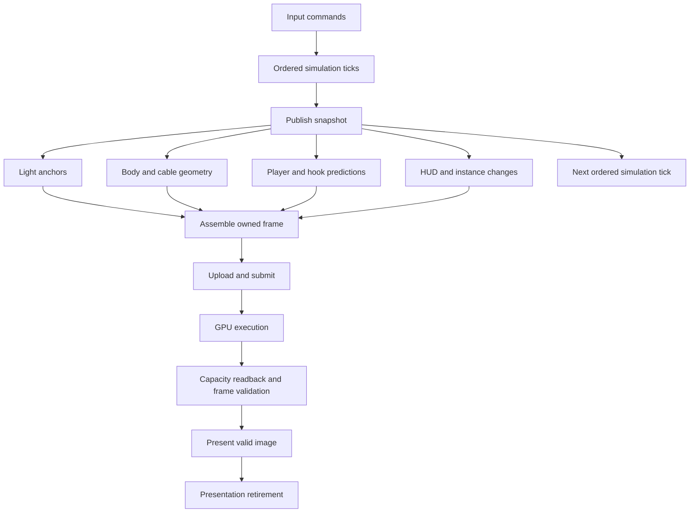

# Task graph architecture

## Status and purpose

This document defines the target architecture. It does not describe an implemented
scheduler. The current game loop and public renderer draw call are synchronous.
The [transfer contract](../render/transfers.md) describes current resource use.
Keep that contract until each replacement passes the delivery gates below.

The runtime must execute independent CPU work in a worker pool. A task that
requires GPU, file, timer, or presentation completion must not occupy a worker
while it waits. Native and browser applications use the same task definitions.
Game code must not use platform threads, locks, GPU fences, or GPU semaphores.

Preserve the fixed simulation step, recorded commands, portal transforms,
lighting rules, rendering results, and error reporting. A scheduling change
must not change the game rules. Concurrency does not by itself prove a speed gain.

## Component boundaries

The following directories are target locations. Add them when their component
is implemented; they are not entries in the current source inventory.

| Component | Target location | Responsibility |
| --- | --- | --- |
| Task API and graph | `src/runtime/task/` | Tasks, typed results, dependencies, scopes, cancellation, graph validation |
| Executor | `src/runtime/executor/` | Ready queues, worker pool, affinity lanes, admission, completion delivery |
| Runtime platform providers | `src/runtime/platform/` | Native threads and waits; browser workers and event integration |
| Runtime tracing | `src/runtime/trace/` | Task spans, dependencies, waits, queue depth, memory counters |
| Renderer API | `src/render/api/` | Owned frame input, asset versions, submission tickets, validated images |
| Common renderer | `src/render/common/` | Capacity planning, packing, render-pass dependencies, transfer ranges |
| Renderer providers | `src/render/host/`, `src/render/web/` | Vulkan and WebGPU resources, commands, synchronization, completion |
| Application services | `src/app/` | Input, window, clock, file and capture interfaces; platform event delivery |
| Game graph | `src/game/tasks/` | Simulation, snapshots, predictions, light anchors, geometry and HUD tasks |
| Other application graphs | `src/demo/`, `src/viewer/` | Compose the same services for their own application policy |
| Build roots | `main.crs`, `demo.crs`, `viewer.crs`, `tests.crs` | Select providers and compose the required components |

Dependencies point from the game to checked service interfaces. The renderer
and application services use the generic task API. The task runtime does not
import renderer, collision, asset, room, player, or game types. Its completion
source is generic; it has no GPU-specific branch.

Platform providers implement narrow interfaces. A native provider can use
pthreads, Windows thread APIs, or Vulkan synchronization internally. These types
must not occur in game fields, task signatures, or public results. The browser
provider applies the same rule to JavaScript promises and worker handles.

Replace direct game access to `RenderState`, mapped addresses, and native window
handles with service operations. Expose typed geometry, light, portal, and overlay
batches. Raw layout access stays inside the renderer and explicit renderer test
adapters. The build must check resolved dependencies against these boundaries.
If Crust cannot enforce an interface boundary, add the required support to Crust.
A naming convention alone is not an access check.

## Task and dependency model

A task is an operation with owned input, a declared execution lane, and typed
output. A dependency states when that input is ready. A task runs once.

Use two node kinds:

- A CPU node runs a bounded function to completion and publishes its result.
- An external node receives completion from a service provider. It does not
  enter a worker ready queue while the operation is pending.

A CPU function can start an external operation and return its completion token.
Work after completion is a dependent CPU node. No worker waits on another task,
a GPU operation, or a blocking file operation. The first implementation uses
explicit continuations. Stackful fibers are not required. Any later suspension
syntax must lower to the same ownership and dependency contracts.

Conceptual interfaces are shown below. These names specify behaviour, not
currently accepted Crust syntax.

| Operation | Result and contract |
| --- | --- |
| Create graph scope | Owns its nodes, captures, result storage, and external subscriptions |
| Add CPU node | Moves its inputs into the scope and returns a typed result handle |
| Add dependency | Connects compatible producer and consumer results before publication |
| Seal and start | Checks the graph once, then makes its ready nodes eligible to run |
| Register external source | Creates one provider-owned completion capability and a consumer token |
| Complete external source | Publishes one success, error, or cancellation result |
| Request cancellation | Stops eligible work; does not reclaim active work |
| Drain scope | Completes when all nodes and external resource owners have retired |

A result handle identifies a graph generation and node. It is not a pointer to
another task's stack. A move-only output has one consumer. Multiple readers use
an immutable published result with an owner that survives all readers.

CPU states are `waiting`, `ready`, `running`, and a terminal state: `succeeded`,
`failed`, or `cancelled`. An external node goes from `pending` to a terminal state.
A success dependency becomes ready only after all required producers succeed.
A failed or cancelled producer prevents its success consumers from running.
Explicit error handlers and finalizers can depend on terminal results.

Validate cycles, result types, lane requirements, and resource access when the
graph is sealed. A static frame graph can be sealed once and instantiated with
new data. Internal scheduling then consumes trusted graph state. It must not
repeat graph validation at every queue operation. Dynamic batches create child
scopes with explicit inputs and a join result; they cannot mutate a running graph.

## Ownership and memory safety

Task safety requires more than moving a pointer into a queue. Crust must check:

- Transfer: an owned capture can move to the selected execution lane.
- Sharing: a published value permits concurrent reads, including reads through
  its internal fields and provider operations.
- Exclusion: writable output storage belongs to one task, or to proven disjoint
  partitions. A shared `mut FrameInput` is not a partition.
- Lifetime: captures and result storage survive every consumer and external use.
- Affinity: a resource is accessed and destroyed on a permitted lane.

These are required language or checked-library contracts, not assumed features
of the present ownership stage. Extend Crust where proof is missing. Do not
bypass checks with raw pointers in game tasks. The trusted runtime may use raw
storage, atomics, and locks behind its checked interface. That boundary owns the
proof of queue publication, reference lifetime, and completion delivery.

Task captures initially contain owned values or handles to owned immutable
snapshots. Do not capture temporary borrows into asynchronous work. Scoped
parallel borrows require a checked join that cannot be skipped by failure or
cancellation; add that API only with compiler rejection tests.

A graph scope remains owned until its drain result completes. Dropping a token
must not free a submitted operation's resources. Task-local cleanup is immediate
only for resources with no external users. Provider cleanup can create retirement
work on the required lane. Shutdown explicitly drains such work.

Use reusable storage for graph instances, result batches, and frame slots.
Allocate task records in batches. Do not allocate one heap object for every
triangle, contact, light anchor, or graph edge. Do not retain every simulation
snapshot. Release a snapshot when its final reader retires.

## Executor and worker pool

The common executor schedules ready nodes. It does not decide which game work
is important. The application supplies task classes and bounded budgets.

| Lane | Contract |
| --- | --- |
| Worker | Independent CPU work; any eligible pool worker can execute it |
| Application | Window events and other operations that require the application thread |
| Serial service | Ordered access to a service such as a GPU queue; no concurrent calls |
| External completion | Provider notifications; dispatch dependants without occupying a worker |

A serial service lane is an ordering rule, not necessarily a dedicated thread.
Each provider declares whether it also requires a fixed thread. Destructors obey
the same affinity rule as ordinary operations.

Use a fixed worker count selected at startup. Start with a bounded common ready
queue. Add per-worker queues and work stealing only if measurements show queue
contention. Keep the scheduling policy independent of the public graph API.
Workers park when no work is ready. Completion publication wakes eligible workers
without a busy loop or a lost wakeup.

A completion can arrive before subscription finishes. Registration and delivery
must form one atomic protocol: the subscriber observes either the pending source
or its terminal result. Terminal publication uses release/acquire ordering for
result visibility. Generation tags prevent a late callback from completing a
reused slot. A completion capability can be consumed only once.

Rendering, input, and simulation have priority over background asset work.
Reserve progress for lower-priority work so it cannot starve. Use bounded batches
for expensive generators and predictions. A long CPU function cannot be preempted
by the graph; it must provide smaller work units at defined boundaries.

Queue exhaustion applies backpressure at scope admission. It must not discard
work, spin a worker, or silently run a thread-affine task on the caller. Reserve
completion and finalization capacity for already admitted operations so a full
work queue cannot prevent retirement. Report allocation failure to the scope owner.

## Simulation and frame graph

Keep the 120 Hz simulation chain ordered. Input commands carry tick identities.
Player motion, hook motion, tether constraints, collision, portal transfer, and
objective changes remain in their required simulation order. Do not split a
coupled solver only to increase task count.

After the required ticks, publish an immutable render snapshot. It contains the
player and hook poses, cable state, room identities, objective and HUD state,
and references to immutable world versions. Collision queries use the matching
world version. Moving collider poses come from the snapshot's tick, not a mutable
clock read during a task.

Light, geometry, prediction, and HUD tasks write separate batches. Each batch
has a stable producer order. Assembly combines them in that order, independent
of worker completion order. Preserve triangle, light, and overlay ordering where
it affects equal-depth coverage, quantization, or overwrite rules.

Predictions use copies of simulation state. They cannot update authoritative
motion or consume input. At first, a rendered frame requires predictions from
its own snapshot. Do not silently substitute an older prediction to meet a
render deadline. Asset generation and file operations use separate scopes;
installation of a new world version is an explicit simulation boundary.

Rendering snapshot N can overlap simulation N+1. This requires separate state;
a lock around the current mutable `GameSession` would serialize the same work.
Recording remains in tick order and consumes simulation results, not render
completion order. Replay hashes must be independent of worker count.

## Frame admission and resource lifetime

Start with two render slots. This is a scheduling and memory budget, not a
geometry limit. The budget is configurable and must pass memory and latency
checks before it increases. Each slot owns its mutable CPU frame data, upload
ranges, GPU scratch ranges, command storage, readback results, and image leases.

Persistent meshes, textures, palettes, and static shadow data use versioned
immutable resources. A replacement publishes a new version for new frames.
Older versions remain alive until all submitted users retire. A slot records
which versions it contains; a global dirty bit cannot prove that every slot has
received an update.

The current packed device allocation prevents direct sharing of all persistent
ranges between slots. The first asynchronous slice can use separate complete
allocations if the measured peak fits the configured budget. Count that duplicate
storage explicitly. The target layout separates immutable assets from per-slot
work ranges so frame overlap does not require duplicate asset libraries.

A slot moves through preparation, submission, GPU completion, validation,
presentation, and retirement. Acquisition of the next slot is a dependency,
not a blocking wait on a worker. A slot cannot be reused while a GPU command,
readback, capture, or presentation operation still refers to it.

Interactive rendering can discard an obsolete snapshot before its graph is
admitted. Keep at most the latest unadmitted render snapshot. Never discard a
simulation tick or a submitted frame's retirement work. Deterministic captures
use explicit requested snapshots and wait for admission instead of dropping them.
Do not add interpolation or change simulation timing as part of this migration.

## Asynchronous renderer contract

The game submits an owned scene description and receives a frame ticket. It does
not receive a native queue, command buffer, fence, semaphore, mapped address, or
browser promise. Renderer service operations attach work to the common graph.

Expose distinct results:

| Result | Meaning |
| --- | --- |
| Submission accepted | The backend accepted the work and owns its referenced resources |
| GPU work complete | Device execution and required transfer operations completed |
| Frame valid | Capacity result and enabled debug checks passed; image can be presented |
| Presentation retired | The output service no longer uses the image or synchronization resources |
| Frame retired | All frame consumers released their resource leases; the slot can be reused |

A valid image is a capability produced by successful frame validation. The
presentation API requires that capability. GPU completion alone cannot construct
it. A capture is another image consumer and holds its own lease until readback
and file output complete.

Preserve the current four-byte capacity readback. It detects runtime traversal
capacity exhaustion, not shader assertions. Schedule its result asynchronously
and reject an incomplete image before presentation. Shader failure readback
remains an explicit debug option. Pixel readback is required only for capture
or enabled checks. This design does not add production image readback.

Keep GPU pass dependencies inside the renderer. Record related compute passes
into suitable command batches; a CPU task per dispatch is not required. Translate
GPU dependencies into backend barriers and queue synchronization. Do not route
every GPU-to-GPU dependency through a host completion callback.

The native renderer provider can use timeline values or fences. A completion
service observes them and publishes generic events. A dedicated service thread
may block in an OS or GPU wait; pool workers must not. Serialize queue access and
use separate command storage for concurrently recorded work. Swapchain acquisition
and presentation synchronization remain renderer-provider details.

The WebGPU provider resolves the same results from queue completion, buffer
mapping, and presentation operations. A queue promise is not proof that a browser
has displayed an image. Define retirement as resource release, not scanout time.
The public contract must be implementable on both backends.

Capacity growth and resize create a new resource generation. Retire the old
generation after its final user completes. A resize may stop frame admission;
it must leave event processing active. An image for an obsolete surface generation
can be discarded with an explicit status. Retire it normally. Do not present it
to the new surface or reuse its storage early.

## Browser and single-worker execution

The graph has a serial executor as well as a parallel executor. Both apply the
same dependencies, errors, ownership, and output ordering. Serial execution is
an explicit supported mode for debugging and environments without shared-memory
workers. It must report its mode, not claim that a worker pool is active.

The browser application thread must return to its event loop. It cannot block
while waiting for a task, slot, GPU result, or shutdown. Completion callbacks
schedule bounded continuation work. Long CPU batches must yield between nodes.

A browser pool uses workers and shared WebAssembly memory behind the runtime
provider. Its build requires the necessary atomic and shared-memory support in
Crust and the toolchain. Its deployment requires cross-origin isolation. Test
worker startup on the actual published origin; do not infer support from a local
server. If parallel mode is explicitly requested but unavailable, report the
missing capability. Keep native and web game sources identical.

## Failure, cancellation, and shutdown

Every admitted node reaches a terminal state. Propagate allocation, IO, device,
and platform failures as typed results. Report the operation, graph, frame or
tick identity, and underlying provider diagnostic. Do not turn an internal
invariant violation into a recoverable empty result.

Cancellation stops nodes that have not started. Running CPU nodes observe it at
specified safe boundaries. A submitted GPU command usually must finish; cancel
its consumers but retain its resources until retirement. Error handlers cannot
publish a successful image for a failed frame.

On exit, stop new admission, cancel unnecessary scopes, finish submitted work,
release image leases, drain affinity-bound cleanup, then stop completion services
and workers. Keep browser callbacks and native completion delivery alive until
this drain finishes. Device loss follows a backend-specific teardown path that
settles pending tokens with an error; it must not wait forever for a signal that
can no longer arrive. Do not reuse lost-device resources.

## Measurement and delivery gates

Before implementation, record a controlled baseline from the production game:
fixed seed, complexity, resolution, input recording, GPU, and execution mode.
Include a lit room, portal overlap, hook launch and reeling, and traversal through
several rooms. Record CPU stage time, GPU time, waits, upload bytes, p50/p95/p99
frame time, input-to-submission latency, and peak host/device memory. Separate
startup allocation from steady execution. Use repeated runs to estimate noise.

Trace every task with its graph, tick/frame, lane, dependencies, start/end time,
and external wait interval. Include queue depth and slot occupancy. Runtime
tracing uses generic labels supplied by clients; it contains no player fields.
Use bounded per-worker trace buffers. Trace overflow must be reported.

Deliver in this order:

1. **Checked runtime contract.** Implement owned tasks, publication, completion,
   scopes, and serial execution in Crust. Test transfer, sharing, affinity, and
   escaped-capture rejection. Establish the native and browser provider boundary.
2. **Production asynchronous slice.** Run one actual game frame through an owned
   snapshot, submission, capacity validation, presentation, and retirement. Run
   prediction while GPU work is pending. Exercise resize and cancellation in
   this path. This is the required ownership and output proof.
3. **Measured decision.** Compare that slice with the baseline. Require unchanged
   simulation hashes and controlled render output, zero worker time in external
   waits, bounded slot memory, and visible CPU/GPU overlap in the trace. Investigate
   any p95 frame-time or input-to-submission regression above 5 percent. Do not
   expand the architecture if overlap is absent or a regression is unexplained.
4. **CPU parallelism.** Add the worker pool and separate light, geometry,
   prediction, and HUD batches. Compare one worker with several workers. Accept
   more task subdivision only when useful execution exceeds scheduling cost and
   the measured critical path improves. Preserve deterministic assembly.
5. **Remaining consumers.** Move asset jobs, file IO, capture, demo, and viewer
   to the same runtime. Complete the split between immutable GPU assets and slot
   storage. Validate parallel browser deployment and serial browser execution.

The architecture is complete only when production tasks use the checked APIs
and application code has no direct platform synchronization access. A synthetic
scheduler benchmark or a successful build does not satisfy a production gate.

## Focused verification

Keep tests small and use production operations. Do not run a whole expedition
for every scheduler change.

- Graph checks: joins, ordering, cycle rejection, move-only fan-out rejection,
  independent writes, and deterministic result assembly with shuffled execution.
- Runtime checks: completion before and after subscription, worker parking,
  full admission queues, cancellation races, generation reuse, and shutdown with
  pending external work. Use controlled event sources, not timed sleeps.
- Ownership checks: captured stack views, concurrent mutable access, unsafe shared
  payloads, wrong-lane access, and premature resource release must be rejected.
- Renderer checks: two live slots, independent outputs, asset replacement,
  capacity failure before presentation, capture leases, resize, device failure,
  and delayed retirement. Exercise the actual backend ownership boundary.
- Game checks: fixed commands produce the same tick hashes and assembled scene
  in serial and parallel execution, including transformed portal overlap.
- Browser checks: serial event-loop progress, worker startup, pending GPU work,
  tab suspension, resize, and teardown on the deployed configuration.

Run native race and memory tools where the provider toolchain supports them.
Use trace assertions to detect worker-side waits. Keep performance captures
separate from correctness runs with heavy diagnostics.

## Platform references

These interfaces are provider implementation references. They are not game APIs.

- [Vulkan synchronization](https://docs.vulkan.org/spec/latest/chapters/synchronization.html)
  defines device dependencies and host synchronization.
- [Vulkan timeline semaphore sample](https://docs.vulkan.org/samples/latest/samples/extensions/timeline_semaphore/README.html)
  shows timeline-based completion and queue dependencies.
- [WebGPU specification](https://www.w3.org/TR/webgpu/)
  defines queue completion, mapping, and device loss.
- [Emscripten thread support](https://emscripten.org/docs/porting/pthreads)
  defines shared-memory build and deployment requirements.
- [Crust ownership design](../../crust/docs/ownership-design.md)
  defines the current ownership foundation. Task transfer and concurrent sharing
  require the additional checked contracts specified here.
